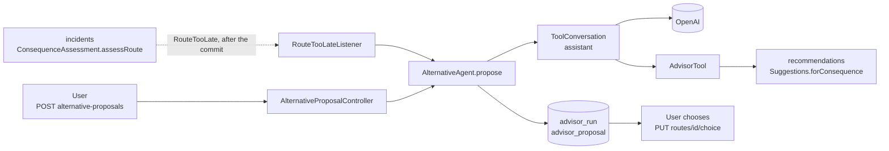

# Proposals by the agent (`advisor`)

- **Status:** decided 2026-11-06 (Lukas). Runs at the user's request and automatic runs (`RouteTooLate`) implemented (`V44`, agent, tools, API), tested with a scripted model, never against the real API. Accommodations via `find_overnight_areas` and `search_accommodations` implemented (`V46`, 2026-11-07), not yet checked against the LiteAPI sandbox, for now only `TARGET_STAY` with a booked accommodation can be booked. Automatic runs are switched on since 2026-11-11 (Philipp), see [Configuration](#configuration). Choosing, dismissing and frontend implemented (`V47`, 2026-11-07), see [Choosing and dismissing](#choosing-and-dismissing) and [Frontend](#frontend), not checked against the LiteAPI and PayPal sandboxes.
- **Goal:** if an incident hits a route, an agent proposes what the user can do. Automatically for `TOO_LATE`, for `DELAYED` only at the user's request.
- **Principle:** the model chooses, compares and justifies. Routes, times and conflicts are calculated by the backend. The model changes nothing on the trip, that is always confirmed by the user.
- **Delimitation:** `recommendations` calculates routes deterministically and without a model ([recommendations.md](recommendations.md)). `advisor` uses this calculation, decides what is proposed and stores the result.
- **Deviation from the previous decision:** proposals for incidents were transient (Philipp, 2026-11-05). But an automatic run has nobody waiting for the result, and there are no notifications yet. Therefore `advisor` stores its runs and proposals (Lukas, 2026-11-06). `recommendations` itself still stores nothing.

## Flow



1. **Trigger:** automatically via `RouteTooLate` or by the user via the [API](#api).
2. **Create run:** `AdvisorRun` with status `PENDING` in its own transaction, then continue on a virtual thread.
3. **Agent:** `ToolConversation` conducts the conversation with the model, calls the tools and ends with `submit_proposals`. No model call and no routing within a transaction.
4. **Store:** proposals with the values from the backend, run `COMPLETED`.
5. **Display and choose:** the frontend reads the run. Choosing happens via the existing endpoints.

## Triggers

### Automatic: only `TOO_LATE`

- `ConsequenceAssessment.assessRoute` is the only place that writes categories. It runs in the transaction of the change and publishes `RouteTooLate(routeId, incidentIds, deadline)` there when a consequence of the route changes to `TOO_LATE` or is newly created with `TOO_LATE` and its passage is not over (`Consequence.isOver`). **Only on this change (Lukas, 2026-11-07):** a reassessment without a change, e.g. with a different deadline or delay while still `TOO_LATE`, or a change away from `TOO_LATE` starts nothing. `incidentIds` contains all `TOO_LATE` incidents of the route, also already passed ones: time merely passing is not a new situation.
- `advisor` listens with `@TransactionalEventListener(AFTER_COMMIT)` and calculates on a virtual thread, like `TrafficEventProcessor.afterPoll`. If the transaction is rolled back, no run starts.
- **Why the change alone is not enough:** a replanning deletes the consequences with the sections, a route that is still late would look new and publish the event again. `NetworkRefreshed` could trigger this for many routes at once. Therefore `auto_key` stays.
- **Limit:** if a replanning has different `TOO_LATE` incidents than before (e.g. only one of two), the key changes and a run starts, even if no single incident changed its category. The previous category is then no longer known.
- **No duplicate runs:** `auto_key` = hash of the `TOO_LATE` incidents (sorted) and the deadline, unique per route. The run is created first, a second one with the same key fails on the unique constraint and is dropped. This keeps the protection across a replanning. The usual case (situation already handled) is queried beforehand so that it does not appear in the log as an SQL error every time.
- **Outdated event:** `AlternativeProposals.startAutomatic` checks the current situation. If the route is no longer `TOO_LATE` or deleted, the run is dropped. It concerns the worst current `TOO_LATE` consequence, goal `ARRIVE_ON_TIME`.
- If a run fails (`FAILED`), `auto_key` is cleared. An aborted run (`run-timeout`) also releases the key: `startAutomatic` ends it in its own transaction before creating the new one. **No automatic retry (Lukas, 2026-11-07):** a new start only happens on the next change to `TOO_LATE` or after a replanning. Until then, after `FAILED` (also `INTERRUPTED` by a restart) only the run by the user remains.
- **Not handled:** a `USER` run on the same route does not stop an automatic one, both then run. That only costs model calls, the last run wins in the display.
- `DELAYED`, `NO_IMPACT` and routes without a deadline never trigger automatically. `MARGINAL` and `timesUnconfirmed` are never `TOO_LATE`, so they do not either.

### By the user

- For a route with a current `TOO_LATE` or `DELAYED` consequence, e.g. for delayed segments.
- If a run is already running for the route, its id is returned, no second one is created. A run that has been in `PENDING` or `RUNNING` for longer than `run-timeout` (15 min, a little above the worst case of around 12 min) counts as aborted (`FAILED`) and does not block a new one (Lukas, 2026-11-07).

## Tools

- **Interface `AdvisorTool`** (`advisor.logic`), a new bean is a new tool:

  ```java
  public interface AdvisorTool {
      String name();
      String description();
      JsonNode parameters();
      boolean appliesTo(RunContext run);
      JsonNode call(RunContext run, JsonNode arguments);
  }
  ```

- **Fixed per run:** user, route and consequence are set by the backend (`RunContext`). They are never parameters of the model.
- **Identifiers:** tools return an `option_id` that is only valid within the run, the `RunContext` keeps the data behind it in memory. `submit_proposals` may only name identifiers from this run, unknown and duplicate ones are discarded by the backend, like `AlternativeRanking` discards foreign hotel ids. If all are unknown, the run counts as without model.
- **Plans:** `compose_plan` and `find_other_targets` build plans from these identifiers (`plan_<n>`, `place_<n>`), see [incident-plans.md](incident-plans.md#building-blocks-and-tools).
- **No tools for changes:** accepting a route, changing stops, reserving, paying and cancelling stay behind the user's confirmation.

### First stage

| Tool | Parameters | Returns | Uses |
|---|---|---|---|
| `find_alternative_routes` | `count` (1–5 or `null`) | per option `option_id`, `via`, departure, arrival, distance, duration, delay, `meets_deadline`, conflicts, share of common route, without geometry | `Suggestions.forConsequence` with `ALTERNATIVES` |
| `find_departure_shifts` | none, always on the planned route | at most one option per direction, fields as above | `Suggestions.forConsequence` with `DEPARTURE_SHIFT` |
| `submit_proposals` | `summary`, `proposals[]` with `option_id` and `reason`, best first | ends the run | `advisor` |

- The user's waypoints stay, all active incidents of the route are blocked or delayed. This is decided by the scenario, not by the model ([recommendations.md](recommendations.md#scenario-recommendationslogic)). Hence no parameters for waypoints or segments.
- `find_departure_shifts` is omitted if the user is already under way.
- **No other departure for route options:** `find_alternative_routes` always calculates with the planned departure. `choice` sets either waypoints or a departure, a proposal with both could not be chosen as displayed.
- **`kind`:** `REROUTE`, `SHIFT_DEPARTURE`, `KEEP_ROUTE`, follows from the `option_id`. `keep_route` is always available to the model. `KEEP_ROUTE` is not a generator in `recommendations`: route and delay from `SuggestionResult.reference`, with a closure waiting time and arrival from the consequence (the reference does not include the waiting).
- **Limit of the first stage:** if with a closure there is neither a detour nor a sensible departure, the run can only report `KEEP_ROUTE` with delay or no usable option. An overnight stay on the way only comes with the accommodation tools.

### Later: accommodations and message to the accommodation

`find_overnight_areas` and `search_accommodations` are implemented, both depend on `stopover-enabled` (default `true`, see [Configuration](#configuration)). `draft_late_arrival_notice` is still missing, for it there is only the interface without implementation and without a tool.

```java
/** Accommodations when the route cannot be driven in time. Places: see Stopovers below. */
public interface StayOptions {
    boolean available();                                       // LiteAPI configured
    List<StayOffer> search(long appUserId, StaySearch search);  // without model, hard check, SearchLimiter
    Optional<BookedStay> bookedStay(long appUserId, long tripId, long stopId);

    record StaySearch(double latitude, double longitude, int radiusMeters, LocalDate checkIn, LocalDate checkOut,
                      int guests, int rooms, @Nullable BigDecimal maxPrice, String currency,
                      @Nullable String excludeHotelId, int maxResults) {}
    record StayOffer(String hotelId, String offerId, String name, double latitude, double longitude,
                     int distanceMeters, @Nullable Double stars, @Nullable Double rating, @Nullable String boardName,
                     BigDecimal price, String currency, boolean refundable,
                     @Nullable LocalDateTime freeCancellationUntil) {}
    record BookedStay(long bookingId, ..., @Nullable LocalDate checkIn, @Nullable LocalDate checkOut,
                      @Nullable Integer guests, int rooms, @Nullable BigDecimal maxPrice, String currency,
                      @Nullable String hotelId) {}
}

/** Draft of a message to the accommodation for a late arrival, the user must send it. */
public interface LateArrivalNotices {
    Optional<LateArrivalNotice> draft(long appUserId, long stopId, OffsetDateTime expectedArrival);

    record LateArrivalNotice(long bookingId, String accommodationName, @Nullable String email,
                             @Nullable String phone, String message) {}
}
```

- The implementations live as adapters in `advisor` (`LiteApiStayOptions`), so that `bookings` does not know the module. Field types as in `bookings`: `freeCancellationUntil` is local at the hotel (`LocalDateTime`), prices are total prices of the stay in the currency of the offer.
- **Tools:**
  - `find_overnight_areas(route_option_id?, latest_arrival?, max_results?)` (implemented): places before the obstacle, on the planned route or a detour, that can be reached in time, see [below](#find_overnight_areas). Needed because `AlternativeSearch.criteriaFor` searches around the booked accommodation, i.e. exactly where the user cannot get to.
  - `search_accommodations(area_id?, radius_km?, check_in?, check_out?, max_price?, max_results?)` (implemented): hotels around a place or the target stop, see [below](#search_accommodations).
  - `draft_late_arrival_notice`: often the cheapest solution if only the check-in is too late. The backend adds contact details, they do not go to the model.
- **New `kind`:** `STOPOVER` and `TARGET_STAY` (implemented, the offer is in `stay`, migration `V46`), `NOTIFY_ACCOMMODATION` comes with `draft_late_arrival_notice`. Likewise the goal `STAY_OVERNIGHT`. Bookings are still not in the context of the model, `search_accommodations` only says `replaces_booked_stay`.
- [accommodation-alternatives.md](accommodation-alternatives.md#roles-assistant-and-liteapi) applies: the model does not trigger a booking.

#### Logic in `recommendations` (`Stopovers`)

- Places are routing without a model, hence in `recommendations.logic` next to `Suggestions`. `recommendations` already knows `trips`, `incidents` and `network`, so `advisor` needs no new dependency.
- `advisor` calls this as a tool, like `forConsequence`. No call within a transaction.

```java
/** Overnight stay on the way when the route cannot be driven in time. */
public class Stopovers {
    OvernightAreas onPlannedRoute(long appUserId, long consequenceId, @Nullable OffsetDateTime latestArrival,
                                  @Nullable Integer maxResults);
    OvernightAreas onOption(long appUserId, long consequenceId, List<RoutedSegment> path, OffsetDateTime departure,
                            @Nullable OffsetDateTime latestArrival, @Nullable Integer maxResults);

    record OvernightAreas(List<OvernightArea> areas, @Nullable StopoverProblem problem) {}
    record OvernightArea(String name, PlaceKind kind, double latitude, double longitude, OffsetDateTime arrivalAt,
                         double remainingMeters, double offRouteMeters) {}
    enum StopoverProblem { NOTHING_REACHABLE, ARRIVES_BEFORE_LIMIT, ROUTE_NOT_USABLE }
}
```

#### `find_overnight_areas`

- **Places:** table `place` in `network`, see [network.md](network.md#places). No external reverse geocoder: mass queries violate Nominatim's terms of use, and the route would go to third parties.
- **One timeline for all paths:** `CandidateEvaluator` returns the passage per step (`Outcome.passages`), the same for the planned route and for detours. This way all delays before count as in the assessment of the options, not only those of `DELAYED` consequences.
- **Detours:** `SuggestedOption.path` holds the driven segments, `ProposalDraft` remembers them for the run. Not in the API, not in the context of the model, not stored.
- **Flow `Stopovers`:**
  1. Timeline: planned route from `ScenarioFactory.forConsequence` (under way from the estimated position and now), detour via `path` from its departure. Problem in the scenario (over, without plan or coordinates) → `ROUTE_NOT_USABLE`.
  2. Obstacle: the earliest of the first blocked passage (also for a closure earlier than the consequence of the run) and, only on the planned route, the first section of the consequence. A detour often has none.
  3. Limit: `latest_arrival` or the first evening limit after the departure in the time zone of the region. Not after the departure → error. Without obstacle and with arrival before the limit → `ARRIVES_BEFORE_LIMIT`, no overnight stay needed.
  4. Places: `Places.near` over the **whole** path, then only places whose nearest segment lies before the obstacle. Otherwise the radius would find the place directly behind a closure.
  5. Arrival and remaining distance from the passage of the nearest segment and the location of the place on it (`OvernightAreaFinder`). Places after the limit are dropped, as are places closer to the target stop than `min-spacing`.
  6. Selection, at most `max_results` (1–5, default 3):
     - `city`/`town` first (accommodations are more likely there), each nearest to the obstacle first (little remaining distance for tomorrow).
     - The place directly before the obstacle is always included, also as `village`, unless a larger one lies closer than `min-spacing` next to it. Otherwise cities far back would push it out.
     - Then `village` while there is room. Minimum distance along the route `min-spacing`, otherwise five suburbs of the same city.
     - None → `NOTHING_REACHABLE`.
  - **Limit:** a closure one could wait out also ends the search. Places behind it are not offered, even if the consequence of the run lies further back.
- **Tool:** `route_option_id` (`null` or `keep_route`: planned route, `route_<n>`: detour), `latest_arrival` (ISO with offset, `null`: evening limit), `max_results`. Unknown id, `departure_<n>` (a shifted departure is meant to get past the incident, an overnight stay on it makes no sense), wrong format or limit before the departure → `ToolInputException`.
  - Returns `problem`, `route_option_id` and per place `area_id`, `name`, `kind`, `arrival_at`, `remaining_km`, `off_route_km`.
  - `arrival_at` is approximate: at the nearest point of the path, without the way there. `off_route_km` is a straight line. The description of the tool says so.
- **`area_id`:** own registration in the `RunContext` (`registerArea`), separate from the options, with the `route_option_id`, so that a later overnight stay stays on this detour. `submit_proposals` cannot name a place, places are only input for `search_accommodations`.
- **`appliesTo`** (`RunContext.overnightRelevant`): a counting consequence is `TOO_LATE` or not passable (`delay == null`). The second also without a deadline: without a deadline there is never `TOO_LATE`, and with a closure without end the overnight stay may be the only solution (Lukas, 2026-11-07). Later also for the goal `STAY_OVERNIGHT`. In addition `stopover-enabled` must be on.
- **Without model** (`withoutModel`): no places, on their own they would not be a proposal.

#### `search_accommodations`

- **Purpose:** turns a place from `find_overnight_areas` or the target stop into proposals the user can book. Uses the same search as [accommodation-alternatives.md](accommodation-alternatives.md): `AlternativeSearch.offers` in `bookings`, a variant of `search` without `bookingId` and without `AlternativeRanking` (a tool of the model does not call the model again). Hard check, cheapest offer per hotel and `SearchLimiter` (searches per user and hour) stay, one call of the tool is one search of the user.
- **Parameters** (all required, `null` for the default):
  - `area_id`: `area_<n>` from `find_overnight_areas` → `STOPOVER`; `null` → target stop of the route → `TARGET_STAY`. Unknown id → `ToolInputException`.
  - `radius_km`: 0.5–50, default 5 (like `default-radius`). Outside → error from `AlternativeSearch.validate` to the model.
  - `check_in`, `check_out` (ISO date): default at the place the date of the approximate arrival and the day after; at the target stop from the booked accommodation (`criteriaFor`), otherwise arrival and departure of the stop, otherwise one night. Without an arrival at the stop the model must specify `check_in`.
  - `max_price`: total price in the currency of the response. Default: at the target stop the (proportional) price of the booked accommodation as in the existing flow, otherwise without limit.
  - `max_results`: 1–5, default 3.
- **From the backend, not from the model:** coordinates (place, booked accommodation or stop), guests and rooms (booked accommodation, otherwise `Trip.travelers`, otherwise 2; one room per two guests), currency (booked accommodation, otherwise EUR), the booked hotel is excluded.
- **Response:** `problem` (`null`, `NO_OFFERS`, `NO_LOCATION`, `RATE_LIMITED`, `SEARCH_UNAVAILABLE`), `place`, period, `nights`, `guests`, `rooms`, `currency`, `max_price` and per offer an option `stay_<n>` like the other options, with `stay`: hotel, distance, stars, rating, board, price, cancellation, `replaces_booked_stay`. A LiteAPI outage or an exhausted quota does not end the run, the model only sees the problem.
- **Proposal:**
  - `STOPOVER`: path like the option of the place (`keep_route` or `route_<n>`: `via`, points, departure, conflicts), `arrival_at` the approximate arrival at the place. The way to the hotel is not routed, `meets_deadline` stays empty.
  - `TARGET_STAY`: planned route with the values of `keep_route`, plus the offer. With a booked accommodation at the stop `replacesBookingId`.
  - The offer is stored in the columns `stay_*` of `advisor_proposal` (`ProposalStay`), so that it can be booked without a new search. The backend checks it again when booking (prebook).
- **`appliesTo`:** like `find_overnight_areas` (`overnightRelevant` and `stopover-enabled`), additionally LiteAPI must be configured (`StayOptions.available`).
- **Without model** (`withoutModel`): no accommodations, a search costs and needs weighing up.
- **Booking:** `TARGET_STAY` with `replacesBookingId` via the existing flow: `POST /accommodation-bookings/{replacesBookingId}/alternative-reservations` with `hotelId`, `offerId`, period, `guests`, `rooms`, `currency` and `price` as `maxPrice`. If the hotel is in another place, the stop moves along ([accommodation-alternatives.md](accommodation-alternatives.md)). `STOPOVER` and `TARGET_STAY` without a booked accommodation: reservation at the stop without `bookingId`, `POST /stops/{stayStopId}/stay-reservations`, see below.

#### Accepting an overnight stay

- **Implemented differently than first designed** (Philipp, 2026-11-07): first create the stop, then book. The draft ("first book, then stop") needed a reservation without a stop, and a failed booking would not have changed the trip. Now the user sees the new planning immediately and books afterwards at the new stop, like any accommodation.
- Flow on acceptance (`ProposalDecisions.accept`, not by the model):
  1. `trips`: new stop at the hotel (name = place of the offer), arrival = approximate arrival of the proposal in the time zone of the destination, departure = day of check-out 09:00. It is placed before the target stop of the route, the route is split (start → hotel, hotel → destination), both replanned, `RouteChanged` → `incidents` reassesses. The old route and with it the run are deleted (`ON DELETE CASCADE`), the decision is therefore not stored.
  2. The arrival at the destination shifts by the nights, not before the departure at the new stop and not after the departure of the destination.
  3. Booked accommodations at the destination that start before the check-out day go on the to-do list (`NOTIFY_LATE_ARRIVAL`), see [domain.md](domain.md#bookings).
  4. Then the frontend opens the booking at the new stop (`/reisen/{trip}/stops/{stayStopId}/unterkunft`), flow as in [accommodation-alternatives.md](accommodation-alternatives.md#flow). If the user does not book, the stop stays without accommodation, they can enter one themselves or delete the stop.
- The way to the place (`via`, points of the option) is not taken over for now, `trips` replans the new route start → hotel.
- When booking the backend checks the offer again, the proposal may be outdated.

## Choosing and dismissing

- The user chooses a proposal or dismisses all ("None fits, I'll replan myself"). Only the choice is stored on the trip, the run keeps the decision as a flag.
- Runs can be restarted at any time, also after dismissing. A dismissed run can still be accepted.
- **Accept** (`ProposalDecisions.accept`): the run must be finished (`COMPLETED`, `COMPLETED_WITHOUT_MODEL`).
  - `REROUTE`: points of the proposal via `RouteChoice` like `PUT /routes/{routeId}/choice`.
  - `SHIFT_DEPARTURE`: new departure via the same `choice`.
  - `KEEP_ROUTE`: changes nothing.
  - `TARGET_STAY`: does not change the trip, the response names `stayStopId` (target stop) and `replacesBookingId`. Booking then happens via the PayPal flow, with `replacesBookingId` as an alternative, otherwise via `stay-reservations`.
  - `STOPOVER`: see [Accepting an overnight stay](#accepting-an-overnight-stay).
  - If the proposal no longer fits the trip (waypoints gone, stop moved, invalid times), `409` `PROPOSAL_NOT_APPLICABLE`, the user searches again.
- **Replacement booked:** if an accommodation is replaced via `replacesBookingId`, the old one goes on the to-do list (`REPLACED`), it is never cancelled automatically.

## Frontend

- `TripAlternativesSheet` (click on a consequence on the map, on a route with an incident on the map or in the list, or in the banner): section "Solutions" with `ProposalsPanel`, below collapsed "Replan myself" with the previous derived ways (route, alternative accommodation).
- `ProposalsPanel`: last run of the route, button "Find solutions"/"Search again", progress (polling every 2.5 s, the dialog may be closed), cards with title, short info, "Recommended" for rank 1, "Chosen" after acceptance. Expanding shows the effect and the button to accept. Note for `stale`.
- If the notice costs no time (any more) (category not `DELAYED`/`TOO_LATE` or resolved), `ProposalsPanel` shows "nothing to replan" instead of the search and without the `stale` note; the last run stays visible with "Chosen", replanning yourself stays possible. If the server still answers `NO_ACTIVE_CONSEQUENCE`, the same applies (no error) and the trip is reloaded.
- **AI invisible:** texts are built by the frontend from the fields (`proposalText.ts`), `summary` and `reason` of the model are not shown (English, see [Context of the model](#context-of-the-model)).
- `ProposalsBanner` on the trip page: an open run (finished, proposals, not decided) of a route with an incident links into the dialog.
- `StayBookingSheet` (`stops/:stopId/unterkunft`): booking of the hotel from the proposal, guest data, PayPal button, return of the redirect via `?reservierung=`.
- To-do list on the trip page (`TodoList`), see [domain.md](domain.md#bookings).

## Context of the model

- Included in the request from the start, which saves reading tools and turns: current time, route (start, destination, waypoints, planned arrival, deadline, slack), consequences by [ranking](consequence-assessment.md#ranking), following stops (name, arrival, departure), estimated position if the user is under way.
- **Tools per situation:** for `DELAYED` and `TOO_LATE` initially the same, the accommodation tools only for `TOO_LATE` or goal `STAY_OVERNIGHT`.
- **Language:** the model writes `summary` and `reason` in English (Lukas, 2026-11-07). The language is thus part of the stored text, other languages later need a setting per user.
- **Third-party texts:** descriptions from traffic messages come from third parties. They are marked as data. This is another reason why no tool may change the trip.

## Data model

- Own tables, migration `V44`, derived and not historised. `@ManyToOne` only within the module, `route_id` as id with foreign key. If the route is deleted, the database deletes the runs along with it (`ON DELETE CASCADE`).
- `AdvisorRun` (`advisor_run`):
  - `route_id`, `consequence_id` (chosen by the user, otherwise the worst of the route, `ON DELETE SET NULL`)
  - `trigger` (`AUTO`, `USER`, column `run_trigger`), `goal` (optional)
  - `status`: `PENDING`, `RUNNING`, `COMPLETED`, `COMPLETED_WITHOUT_MODEL`, `FAILED` with `failure` (`ROUTING_UNAVAILABLE`, `CONSEQUENCE_GONE`, `INTERNAL_ERROR`, `ABANDONED`, `INTERRUPTED`)
  - `auto_key` (only `AUTO`, unique with `route_id`; `NULL` does not collide)
  - `situation`: hash of incidents with category `TOO_LATE` or `DELAYED`, deadline and planned arrival, see [Outdated proposals](#outdated-proposals)
  - `summary`, `failure`, `created_at`, `finished_at`
  - `V47`: `incident_id` (incident the user asked about, `ON DELETE SET NULL`), `decision` (`ACCEPTED`, `DISMISSED`), `chosen_position`, `decided_at`. `@DynamicUpdate`, so that saving the decision does not write back outdated columns.
- `AdvisorProposal` (`advisor_proposal`): `run`, `position`, `kind`, `reason`, `via`, `departure_at`, `arrival_at`, `distance_meters`, `duration`, `delay`, `shared_ratio`, `meets_deadline`.
- `advisor_proposal_point`: `proposal`, `position`, `latitude`, `longitude`, `road_hint`, `waypoint_id` (`ON DELETE SET NULL`). Reproduces the route when chosen.
- `advisor_proposal_conflict`: `proposal`, `incident_id` (`ON DELETE CASCADE`), `impact`, `delay`.
- `V46`: offer of `STOPOVER`/`TARGET_STAY` in `advisor_proposal`, columns `stay_hotel_id`, `stay_offer_id`, `stay_hotel_name`, `stay_latitude`, `stay_longitude`, `stay_place`, `stay_distance_meters`, `stay_check_in`, `stay_check_out`, `stay_guests`, `stay_rooms`, `stay_price` (`NUMERIC(12, 2)` in the currency of the offer, exception like `booking_reservation`, see [money.md](money.md)), `stay_currency`, `stay_refundable`, `stay_free_cancellation_until`, `stay_replaces_booking_id` (`ON DELETE SET NULL`).
- `V51`: `stay_offer_id` (also in `advisor_proposal_step`) and `booking_reservation.offer_id` as `TEXT`, LiteAPI offer ids are sometimes longer than 1000 characters and are needed untruncated for booking.
- Texts as `VARCHAR(n)`, durations via `DurationConverter`, see [architecture.md](architecture.md#persistence).

### Outdated proposals

- When reading, `advisor` compares `situation` with the current situation of the route. If it differs, the run comes back with `stale: true`, nothing is recalculated.
- Accepting sets `situation` to the situation after the choice: what the choice itself changes (arrival, categories) does not make the run `stale`. For chosen runs `stale` therefore means "changed since the choice".
- The user can then start a new run. If they choose anyway, `RoutePlanning` replans and `ConsequenceMatcher` assesses the new path, as with every choice.

## API

- `POST /api/v1/routes/{routeId}/alternative-proposals`: body optional `consequenceId`, `incidentId` (chooses the consequence of the incident on the route), `goal` (`ARRIVE_ON_TIME`, `MINIMIZE_DELAY`, default `ARRIVE_ON_TIME`). Response `202` with `runId`, runs asynchronously because several model calls are needed.
- `GET /api/v1/routes/{routeId}/alternative-proposals`: last run of the route, also the automatic one. Without a run `200` with `run: null`.
- `GET /api/v1/alternative-proposals/{runId}`: `status`, `stale`, `summary`, `proposals`, `consequenceId`, `incidentId`, `decision`, `chosenRank`, `decidedAt`.
- `GET /api/v1/trips/{tripId}/alternative-proposals`: last run per route of the trip (for the banner).
- `POST /api/v1/alternative-proposals/{runId}/proposals/{rank}/acceptance`: accepts, response `kind`, `plannedRouteIds`, `stayStopId`, `replacesBookingId`, `todosAdded`.
- `POST /api/v1/alternative-proposals/{runId}/dismissal`: dismisses all, response the run.
- **Choosing:** via `acceptance`, see [Choosing and dismissing](#choosing-and-dismissing). `PUT /routes/{routeId}/choice` ([recommendations.md](recommendations.md#saving-the-choice)) remains for choosing by hand.
- **Errors** (`AdvisorExceptionHandler`): foreign or unknown route or foreign run `404` `TRIP_NOT_FOUND`, no current `TOO_LATE` or `DELAYED` consequence `409` `NO_ACTIVE_CONSEQUENCE`, `consequenceId` does not belong to the route or rank unknown or run not finished yet `400` `INVALID_PROPOSAL_INPUT`, proposal no longer fits the trip `409` `PROPOSAL_NOT_APPLICABLE`.
- Geometry for the map: see [Open](#open).

## Model, quota, failure

- **`assistant.logic.ToolConversation`** (implemented, knows no domain modules): loop over the OpenAI Responses API with function calling and `store: false`. The caller provides instruction, input and tools, `submit_proposals` is the final tool (`finish`). One tool call per turn. `StructuredExtraction` stays unchanged.
- **Errors in tools:** a tool reports invalid inputs as `ToolInputException`, the model gets the message and can try again. Any other exception (e.g. `RoutingUnavailableException`) ends the conversation and goes to `advisor`.
- **Quota:** every turn is a model call and counts against the limit. `AUTO` uses `system-requests-per-hour`, `USER` the user's `requests-per-hour`. The system quota (default 60) is shared by `AUTO` with the enrichment of traffic messages. With up to 8 calls per run it is enough for about 7 full runs per hour, after that a run ends as `COMPLETED_WITHOUT_MODEL`, keeps its `auto_key` and is not repeated for this situation.
- **Limits:** `max-turns` per run. In the last turn the model must call `submit_proposals` (`tool_choice`), so it finishes with what it has found so far. If it still does not, the run counts as without model (see below).
- **Without model** (no key, limit reached, error, no completion): the best options of `Suggestions.forConsequence` without justification, status `COMPLETED_WITHOUT_MODEL`. As with the search for accommodations, proposals must not fail because of the model.
- **`RoutingUnavailableException`, other errors:** `FAILED`, see [Triggers](#automatic-only-too_late).
- **Restart:** runs in `PENDING` or `RUNNING` become `FAILED` at startup, so that they release `auto_key`.
- **Privacy:** OpenAI receives names and times of stops and waypoints, roads, incident texts and the calculated options, i.e. place and time of the trip. No names or contact details of the travellers, no booking numbers. The `AUTO` behaviour needs a note in the app and the privacy policy.

## Dependencies

- `advisor → recommendations`, `→ incidents`, `→ trips`, `→ assistant`. No other module knows `advisor`, no cycle. Backwards only via the event `RouteTooLate` from `incidents.logic`.
- `advisor → bookings` only in the adapter `LiteApiStayOptions` (`AlternativeSearch.offers`, `criteriaFor`, `BookingLogic.list`). Later also for `LateArrivalNotices`.
- **`trips.logic`:** reading the owner of a route, `RouteSnapshots.ownerOf(routeId)`. The automatic run only knows the `routeId`, `Suggestions` and `RouteSnapshots` require `appUserId`.
- `TripTools` cannot be reused: they read the user from the `SecurityContext`, which a background run does not have. The tools of `advisor` call the same logic.

## Configuration

```properties
nfv.advisor.max-turns=16
nfv.advisor.max-proposals=3
nfv.advisor.plans-enabled=true
nfv.advisor.parallel-tool-calls=true
nfv.advisor.run-timeout=15m
nfv.advisor.auto-enabled=true
nfv.advisor.stopover-enabled=true
# Places for overnight stays, values are defaults
nfv.recommendations.stopover.latest-arrival=22:00
nfv.recommendations.stopover.max-off-route-meters=5000
nfv.recommendations.stopover.min-spacing-meters=15000
nfv.recommendations.stopover.default-areas=3
nfv.recommendations.stopover.max-areas=5
```

- `plans-enabled`: offers `compose_plan` and `find_other_targets` (only together with `stopover-enabled`), see [incident-plans.md](incident-plans.md). `parallel-tool-calls`: the model may call several tools in one turn, `max-turns` 16 for 2–3 plans (2026-11-11).
- `stopover-enabled`: offers the model `find_overnight_areas` and `search_accommodations` (the second only with a LiteAPI key). Default `true` since `search_accommodations` exists (2026-11-07). `false` in the test properties, only the tests of the accommodation tools switch it on.
- `auto-enabled`: switches only the runs triggered by `RouteTooLate`, those of the user always work. Environment variable `NFV_ADVISOR_AUTO_ENABLED`.
  - **Default `true` since 2026-11-11 (Philipp):** when an incident makes a route `TOO_LATE`, solutions are prepared without a request of the user, also for a test incident from "Add road event". Before, the default was `false` (Lukas, 2026-11-07), so no run started and the user only saw the button.
  - Routes and times go to OpenAI without any action by the user. **Still open:** the note in the app and in the privacy policy that Lukas asked for before switching on.
  - Without an OpenAI key the automatic run ends `COMPLETED_WITHOUT_MODEL` like a run of the user.
- In the test properties it is explicitly set to `false`, otherwise every test with `TOO_LATE` would start a run in the background, even after a change of the default. Only `RouteTooLateListenerTest` switches it on.

## Order of implementation

1. Docs.
2. `recommendations`: `forConsequence`, only affected sections, `DEPARTURE_SHIFT`, already under way, testable without a model.
3. `assistant`: `ToolConversation`, tested against a mocked API (`ToolConversationTest`). Before the first operation check once against the real API, especially the repetition of the encrypted reasoning.
4. `advisor`: migration `V44`, agent, tools, API, interfaces `StayOptions` and `LateArrivalNotices`. First runs against the real API.
5. `incidents`: `RouteTooLate` in `assessRoute`, listener and `auto_key` in `advisor`, `RouteSnapshots.ownerOf`, switch `nfv.advisor.auto-enabled` (implemented, default `true` since 2026-11-11).

## Tests

- `ConsequenceAssessment`: `RouteTooLate` only with a current `TOO_LATE`, not with a rolled-back transaction.
- Listener: the same `auto_key` after replanning starts no run, changed incidents or deadline do, `FAILED` releases the key.
- Agent with mocked `ToolConversation` (tests never call OpenAI): unknown identifiers discarded, values come from the backend, `max-turns`, without model `COMPLETED_WITHOUT_MODEL`.
- API: `202`, foreign route `404`, `DELAYED` only starts by the user, `NO_ACTIVE_CONSEQUENCE`, a running run is reused, `stale` after a changed situation.
- Implemented in `AlternativeProposalsTest` (tools, context, values from the backend, without model, aborted runs, restart, API), `ConsequenceMatchingTest` (`RouteTooLate`), `AutomaticProposalsTest` (`auto_key`, `runForSystem`, simultaneous events, outdated event, switched off) and `RouteTooLateListenerTest` (commit, rollback).
- `find_overnight_areas`: `OvernightAreaFinderTest` (location, obstacle, limit, selection), `StopoversTest` (Wellington: place behind the closure, earlier closure, delay, evening limit, under way, detour, inputs), `OvernightAreaToolTest` (identifiers, errors to the model, switch), `OvernightToolOfferedTest` (run: closure without deadline and `TOO_LATE` yes, delay within the deadline no).
- `search_accommodations`: `AccommodationSearchToolTest` (place and target stop, defaults, booked accommodation, detour, problems and errors to the model, switch), `LiteApiStayOptionsTest` (hard check without assistant, booked accommodation, errors translated), `StayProposalsTest` (run with `TARGET_STAY`, stored and in the API).
- Choosing and dismissing: `ProposalDecisionsTest` (Wellington: `STOPOVER` creates a stop and splits the route, to-do for the later arrival; `TARGET_STAY`; `SHIFT_DEPARTURE`; `REROUTE` with waypoints; dismissing and runs of the trip; errors 404/400/409; start with `incidentId`). To-do list in `BookingApiTest` and `AlternativeApiTest`, frontend texts in `proposalText.test.ts` and `todos.test.ts`.

## Open

- **Notification:** channel and thresholds open ([architecture.md](architecture.md#open-points)). Until then the user only sees automatic runs in the app.
- **Geometry of the proposals:** not stored, but the map needs a line. Store it or re-route from the points when opening, to be decided with the frontend.
- **Several replicas:** the protection against duplicate runs holds via the unique constraint, the reset at startup would then have to be changed to runs of the own instance or a time limit.
- **Clean-up:** how long old runs are kept.
- **Overnight stay on the way:** default for `latest_arrival` (fixed time, check-in of the hotel or the user's choice). Check values for `max-off-route-meters` and `min-spacing-meters` on real routes. **Without `evaluate_stopover` (Lukas, 2026-11-07, the tool is dropped):** for now a `STOPOVER` takes over the approximate arrival of the place, `trips` replans the way there (2026-11-07). Still open are the exact arrival at the hotel, the path of the proposal and the time of the onward journey (fixed 09:00).
- **Texts of the model:** `summary` and `reason` are English and are not shown. If they are to become visible, German or a language per user is needed.
- **Simultaneous requests:** two `POST`s at the same moment can start two runs, the second only costs model calls, the last run wins in the display.
- **One run per route:** consequences for later routes of the trip are only context for the model, see [recommendations.md](recommendations.md#open).
- **Plans from several steps** (overnight stay + onward journey + rebooking the destination, one click): implemented 2026-11-11, see [incident-plans.md](incident-plans.md), where the open limits are also listed.
