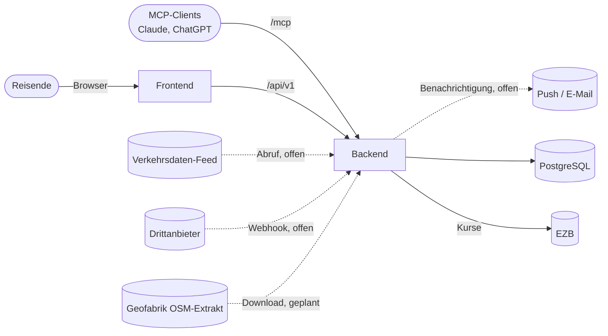
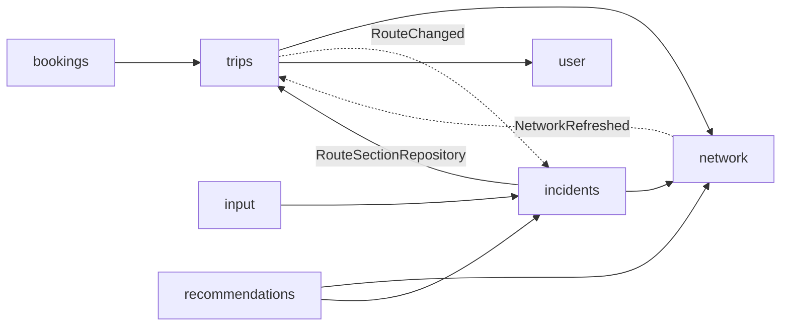

# Architecture

- **Ziel der App:** Nutzer hinterlegen Reiserouten und werden über Ereignisse informiert, die den Reiseverlauf beeinflussen (z. B. Straßensperrung). Fachliches Modell siehe [domain.md](domain.md).
- **Herkunft:** Das Repository war die App VacantAgent (Markt für LLM-Kapazität). Markt, Agents und LLM-Proxy sind entfernt (`V18`, `V19`). Auth, User, Infrastruktur und Deployment werden weiterverwendet. Abrechnung, PayPal und Provider-Onboarding sind Altbestand, siehe [Altbestand](#altbestand).
- **Technik:** Backend Spring Boot (Java 25, Maven) in `backend/`, Frontend React/Vite (TypeScript) in `frontend/`, PostgreSQL, Betrieb als Docker Swarm Stack, siehe [deployment.md](deployment.md). Streckennetz und Routing mit eingebettetem GraphHopper und PostGIS (geplant), siehe [network.md](network.md).

## System Context

- **Reisende:** melden sich über den eigenen Identity Provider an (OIDC, durch Keycloak ersetzbar), siehe [authentication.md](authentication.md).
- **MCP-Clients:** greifen im Namen eines Nutzers über `/mcp` zu (Autorisierung per CIMD). Tools gibt es derzeit keine.
- **Verkehrsdatenquellen:** liefern Ereignisse in das Modul `input`, entweder abgerufen (`TRAFFIC_FEED`) oder gepusht (`WEBHOOK`). Noch keine Quelle angebunden.
- **Routing:** kein externer Dienst, GraphHopper läuft eingebettet im Modul `network` (geplant), Kartendaten von Geofabrik, siehe [network.md](network.md).
- **Benachrichtigung:** Kanal noch offen.

## Building Blocks

Jedes Modul ist ein Paket unter `com.vacantagent`.

| Modul | Aufgabe | Status |
|---|---|---|
| `trips` | Trips, Stops, Routen und ihre Abschnitte | neu |
| `network` | Streckennetz und Routing: OSM-Import, GraphHopper, Segmente, Routing (geplant) | neu |
| `bookings` | Buchungen an Stops | neu |
| `input` | Eingehende Ereignisse und ihre Quellen | neu |
| `incidents` | Incidents, Consequences, Zuordnungslogik | neu |
| `recommendations` | Alternativen zu Consequences (Umfahrung, spätere Abfahrt) | geplant |
| `auth` | Eigener Identity Provider (OAuth2/OIDC, MCP-Clients per CIMD), unabhängig von allen anderen Modulen | Basis |
| `user` | `AppUser`, Absicherung von `/api/**` und `/mcp`, `CurrentUser` | Basis |
| `common` | `AbstractEntity`, Envers-Revision, Konverter, Fehlerbehandlung, OpenAPI | Basis |
| `currency` | Wechselkurse (EZB), Umrechnung an der API | Basis, wird nur von `accounting` gebraucht |
| `accounting`, `paypal`, `onboarding` | Konten, Ein- und Auszahlung über PayPal, Provider-Onboarding | Altbestand |

### Aufbau eines Moduls

- Nach dem Vorbild von `accounting`:
  - `entities`: JPA-Entities und Enums. Felder per Lombok `@Getter`, Änderungen nur über fachliche Methoden, geschützter Default-Konstruktor für JPA.
  - `data`: Spring-Data-Repositories, eigene Abfragen als JPQL.
  - `logic`: fachliche Services (`@Service`, `@Transactional`), Hilfskomponenten paketprivat.
  - `api` und `dto`: REST-Controller und DTOs (`trips`: `TripController`, `incidents`: `TripIncidentController`).
  - `config`: `@Configuration` und `@ConfigurationProperties`.

### Abhängigkeiten zwischen Modulen

- **Referenzen über Modulgrenzen nur per Id** (`appUserId`, `segmentId`, `stopId`, `routeId`, `routeSectionId`, `incidentId`), mit Fremdschlüssel in der Datenbank. JPA-Beziehungen (`@ManyToOne`) nur innerhalb eines Moduls. Pfeile oben zeigen diese Id-Referenzen und die Aufrufe.
- **Rückwärts über Events:** `trips` kennt `incidents` nicht. Nach dem Planen einer Route veröffentlicht `RouteLogic` das Spring-Event `RouteChanged`, `incidents` reagiert darauf (synchron, in derselben Transaktion).
- **`network` nach außen nur über `network.logic`** (`Routing`, `SegmentQueries`, `RegionImport`, `NetworkRefreshed`), keine Entities, Repositories oder GraphHopper-Typen. Später per ArchUnit.
- **`incidents` liest den Index aus `trips`:** `ConsequenceMatcher` nutzt `RouteSectionRepository` (Index Segment → RouteSection). Später ggf. durch eine schmale Schnittstelle in `trips.logic` ersetzen.
- **`auth`** ist per ArchUnit (`AuthModuleIsolationTest`) isoliert. Für die neuen Module gibt es noch keine ArchUnit-Regeln.

## Runtime View

1. **Ereignis kommt an** (offen): Quelle → `input` speichert ein `Event` unverändert (`payload`), doppelte Zustellung über `externalId` erkannt.
2. **Ereignis verarbeiten** (offen): Straße und Ort → Segmente, neuer oder bestehender `Incident` über `IncidentLogic.create`/`change`, `Event.processed(incidentId)`.
3. **Zuordnung:** `ConsequenceMatcher.matchIncident` findet über die Segmente die Routen, deren erwartete Durchfahrt die Gültigkeit überschneidet, und legt `Consequence`s an, aktualisiert oder entfernt sie.
4. **Route planen:** `RoutePlanning.plan` → `network.Routing` → `RouteLogic.replaceSections` → `RouteChanged` → `ConsequenceMatcher.matchRoute`.
5. **Benachrichtigen** (offen): neue oder geänderte Consequences an den Nutzer des Trips.
6. **Netz aktualisieren** (geplant): neuer Extrakt → `NetworkRefreshed` → betroffene Routen neu planen, siehe [network.md](network.md).

## Persistence

- **Schema nur per Flyway** (`backend/src/main/resources/db/migration`, Auth unter `db/migration/auth`), Hibernate validiert nur (`ddl-auto=validate`). Nächste freie Version: `V23`.
- **Datenbank:** PostgreSQL mit PostGIS überall: Stack, lokal, Tests (Testcontainers). H2 ist entfernt. Migrationen weiter möglichst Standard-SQL, z. B. `SMALLINT` statt `TINYINT`, `VARCHAR(n)` statt `TEXT`, PostGIS nur für Geometrie.
- **Ids:** `BIGINT GENERATED BY DEFAULT AS IDENTITY` über `AbstractEntity`.
- **Zeiten:** `OffsetDateTime` / `TIMESTAMP(6) WITH TIME ZONE`, Dauern über `DurationConverter` als `BIGINT` (Nanosekunden).
  - PostgreSQL speichert bei `TIMESTAMP WITH TIME ZONE` nur den Zeitpunkt, nicht den Offset. Wo der Offset zählt (vom Nutzer eingegebene Zeiten: Reisezeitraum, Ankunft/Abfahrt am Stop), steht er per `@TimeZoneStorage(TimeZoneStorageType.COLUMN)` in einer eigenen Spalte `<spalte>_tz` (`INTEGER`, Sekunden).
  - Jackson behält den Offset eingehender Zeitpunkte (`spring.jackson.datatype.datetime.adjust-dates-to-context-time-zone=false`), sonst würde er beim Einlesen auf UTC umgerechnet.
  - Übrige Zeitpunkte (z. B. `createdAt`, Gültigkeit von Incidents) werden auf PostgreSQL als UTC zurückgegeben.
- **Historie:** Hibernate Envers für `@Audited`-Entities, je eine `_aud`-Tabelle in derselben Migration, siehe [envers.md](envers.md).
- **Geometrie:** PostGIS `geometry(…, 4326)` mit GIST-Index (`road_segment`).

## API

- REST unter `/api/v1`, Vertrag in `frontend/openapi.json` (generiert, Client per `npm run generate:api`).
- `GET/POST /trips`, `GET /trips/{id}` (mit Stops und Routen), `POST /trips/{id}/stops`, `GET/PUT /trips/{id}/cover-image` (JPEG, PNG, WebP bis 5 MB, Multipart).
- `GET /trips/{id}/incidents` (aktuelle Hinweise je Route), `GET /incidents/trip-counts` (Zähler für die Reiseliste).
- Fremde oder unbekannte Trips: 404 mit `code` `TRIP_NOT_FOUND`, ungültige Eingaben: 400 mit `INVALID_TRIP_INPUT` (`TripExceptionHandler`, nur für `trips` und `incidents`).

## Frontend

- Seiten nach dem UI-Konzept (Mockups: https://claude.ai/artifact/8Vgxrtx6rJjtV7R8WxXuY4): `/reisen` (aktuelle Reise, Tabs Anstehende/Vergangene), `/reisen/neu`, `/reisen/:id` (Karte mit Liste darunter).
- Dialoge über der Karte sind Unterrouten mit eigener URL (`stops/neu`, `hinweise/:routeId/:incidentId`, `routen/:routeId`), der Zurück-Button schließt sie.
- Karte: MapLibre GL JS mit OpenFreeMap-Kacheln (`VITE_MAP_STYLE_URL` überschreibt den Stil). Routen werden bis zum Routing als gerade Linien zwischen den Stops gezeichnet.
- Ortssuche für Stops: Photon (OpenStreetMap, `VITE_GEOCODING_URL`), direkt aus dem Browser.
- Zeitpunkte gehen mit dem Offset der Zeitzone des Systems ans Backend und werden in dieser Zeitzone angezeigt (`src/trips/time.ts`).
- **Installierbar (PWA):** `vite-plugin-pwa` erzeugt Manifest (`start_url` `/reisen`, `display` `standalone`, Icons in `public/`) und Service Worker (Workbox).
  - Der Service Worker cached die App-Hülle, Kartenkacheln (OpenFreeMap) und Schriften. API-Antworten werden nicht gecached. Pfade von Backend und IdP (`/api`, `/oauth2`, `/login`, …) bekommen nie die gecachte `index.html`.
  - Updates kommen automatisch (`registerType: autoUpdate`). nginx liefert `sw.js` und das Manifest mit `Cache-Control: no-cache`.
  - Installieren per Button (`src/pwa/`): Chromium-Browser (Android, Desktop) feuern `beforeinstallprompt`, der Button „Installieren“ ruft dessen `prompt()` auf. Safari auf iOS hat das nicht, dort zeigt der Button die Anleitung „Teilen → Zum Home-Bildschirm“.
  - Der Button steht im Profilmenü und als Hinweis über der Reiseliste (dauerhaft ausblendbar). Er fehlt, wenn die App schon installiert ist oder als App läuft (`display-mode: standalone`) oder der Browser keine Installation anbietet.
  - Service Worker und Installation brauchen HTTPS (außer `localhost`).
- Die Datenschicht `src/trips/tripsApi.ts` bildet die generierten Typen (alle Felder optional) auf eigene Typen ab (`src/trips/model.ts`).

## Security

- `/api/**`: JWT des eigenen IdP (oder Keycloak), Daten immer nur des angemeldeten `AppUser` (`CurrentUser`).
- `/mcp`: eigene Tokens mit Audience der MCP-URI und Scopes `mcp:read`/`mcp:write`.
- Details in [authentication.md](authentication.md), Secrets in [deployment.md](deployment.md).

## Tests

- Integrationstests mit `@SpringBootTest` gegen PostGIS (Testcontainers, JDBC-URL `jdbc:tc:postgis:…`, ein Container je Testlauf) und alle Migrationen, z. B. `ConsequenceMatchingTest`. Docker nötig. Streckennetz gegen einen Wellington-Testextrakt, siehe [network.md](network.md#tests).
- Architekturregeln mit ArchUnit (`AuthModuleIsolationTest`, `MoneyArchitectureTest`, `PayPalModuleTest`).
- CI (`.github/workflows/backend.yml`): `mvn verify`, danach Abgleich der generierten `frontend/openapi.json`.

## Altbestand

- Aus VacantAgent stammen noch Code und Doku für Abrechnung ([accounting.md](accounting.md), [paypal.md](paypal.md), [money.md](money.md)), das Backend-Modul `onboarding`. Die Frontend-Seiten dazu (Rollen Consumer, Provider, Betreiber, Onboarding, Guthaben, Einnahmen, PayPal-Verknüpfung) sind entfernt; die PayPal-Return-URLs (`vacantagent.frontend-url`) zeigen daher ins Leere.
- Ob davon etwas für die Reise-App gebraucht wird (z. B. bezahlte Benachrichtigungen), ist offen. Bis dahin bleibt der Code unverändert.

## Offene Punkte

- **Streckennetz:** Aktualisierung, Geschwindigkeiten, weitere Regionen, siehe [network.md](network.md#offen).
- **Ereignisquellen:** konkrete Feeds und Webhooks, Abruf-Scheduler, Webhook-Endpunkt mit Signaturprüfung, Verarbeitung Event → Incident inkl. Ortsbestimmung.
- **Benachrichtigung:** Kanal (Web-Push, E-Mail, MCP), Auslöser (neue oder geänderte Consequence), Duplikate vermeiden.
- **Skalierung der Zuordnung:** derzeit synchron in der Transaktion. Bei vielen Routen oder Events asynchron nach dem Commit (`@TransactionalEventListener`, Queue).
- **Räumliche Abfragen:** falls nötig PostGIS, dann aber H2-Ersatz für Tests (z. B. Testcontainers).
- **API und Frontend:** Trips, Stops, Titelfoto und Hinweise sind umgesetzt. Offen sind Bearbeiten und Löschen von Trips und Stops, Stops einfügen/umsortieren, Buchungen, MCP-Tools und die Profil-Einträge (Profil, Benachrichtigungen, Einstellungen, KI-Assistenten, im Menü als „folgt“).
- **Routenvorschläge:** Der Routen-Dialog zeigt Beispieldaten (aus der Luftlinie), „Route übernehmen“ und „Zwischenziel hinzufügen“ sind deaktiviert, bis der Routing-Dienst steht.
- **PWA weiter ausbauen:** Reisedaten offline verfügbar machen (derzeit nur die App-Hülle und zuletzt gesehene Kacheln), Web-Push für Hinweise, App-Name und Icon im Zuge des Brandings.
- **Karte und Ortssuche:** OpenFreeMap und die öffentliche Photon-Instanz sind nur für maßvolle Nutzung gedacht; für den Betrieb eigene Instanz oder Proxy im Backend prüfen. Das Karten-Bundle ist groß (~1 MB, lazy geladen).
- **Titelfoto:** Generierung (Bildmodell, Prompt aus Name und Stops; „Automatisch erzeugen“ zeigt bis dahin ein Platzhalterbild) und ggf. Auslagerung der Bilddaten aus der Datenbank in einen Objektspeicher.
- **ArchUnit-Regeln** für die neuen Module (nur Id-Referenzen, keine Zyklen).
- **Altbestand:** entscheiden, ob Abrechnung, PayPal und Onboarding bleiben oder entfernt werden; App-Name und Branding (README, Icon, Paketname `com.vacantagent`).
