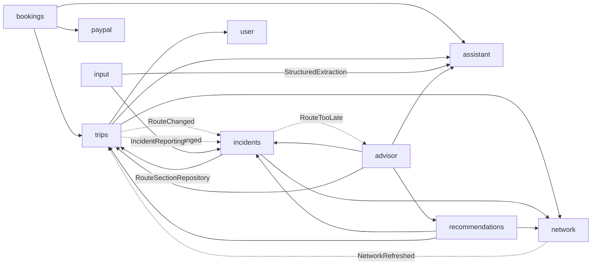

# Architecture

- **Ziel der App:** Nutzer hinterlegen Reiserouten und werden über Ereignisse informiert, die den Reiseverlauf beeinflussen (z. B. Straßensperrung). Fachliches Modell siehe [domain.md](domain.md).
- **Herkunft:** Das Repository war die App Nfv (Markt für LLM-Kapazität). Markt, Agents und LLM-Proxy sind entfernt (`V18`, `V19`). Auth, User, Infrastruktur und Deployment werden weiterverwendet. Abrechnung, PayPal und Provider-Onboarding sind Altbestand, siehe [Altbestand](#altbestand).
- **Technik:** Backend Spring Boot (Java 25, Maven) in `backend/`, Frontend React/Vite (TypeScript) in `frontend/`, PostgreSQL, Betrieb als Docker Swarm Stack, siehe [deployment.md](deployment.md). Streckennetz und Routing mit eingebettetem GraphHopper und PostGIS, siehe [network.md](network.md). Streckenvorschläge siehe [recommendations.md](recommendations.md), Vorschläge durch den Agenten siehe [advisor.md](advisor.md).

## System Context

```mermaid
flowchart LR
    user([Reisende]) -->|Browser| fe[Frontend]
    mcp([MCP-Clients<br>Claude, ChatGPT]) -->|/mcp| be
    fe -->|/api/v1| be[Backend]
    feed[(Verkehrsdaten-Feed)] -.->|Abruf, offen| be
    hook[(Drittanbieter)] -.->|Webhook, offen| be
    osm[(Geofabrik OSM-Extrakt)] -.->|Download, geplant| be
    be -.->|Benachrichtigung, offen| notify[(Push / E-Mail)]
    be --> db[(PostgreSQL)]
    be -->|Kurse| ecb[(EZB)]
    be -->|Bestätigungen auslesen, Titelfotos, Ranking, Agent| openai[(OpenAI)]
    be -->|Alternative Unterkünfte| liteapi[(LiteAPI)]
    be -->|Zahlung| paypal[(PayPal)]
```

- **Reisende:** melden sich über den eigenen Identity Provider an (OIDC, durch Keycloak ersetzbar), siehe [authentication.md](authentication.md).
- **OpenAI:** liest Buchungsbestätigungen aus, recherchiert fehlende Angaben zu Unterkünften im Web, zeichnet Titelfotos, sortiert alternative Unterkünfte und schlägt künftig Lösungen bei Incidents vor (Modul `assistant`), nur wenn ein API-Key gesetzt ist, siehe [Assistant](#assistant).
- **LiteAPI (Nuitee):** Hotelsuche nach Namen und Hoteldaten beim Erfassen einer Buchung, Hotelangebote, Prebook und Buchung alternativer Unterkünfte (Modul `bookings`, `LiteApi`), nur mit Key (`LITEAPI_API_KEY`), siehe [accommodation-alternatives.md](accommodation-alternatives.md).
- **PayPal:** Zahlung alternativer Unterkünfte (Modul `paypal`, Orders API mit Autorisierung), siehe [paypal.md](paypal.md).
- **MCP-Clients:** greifen im Namen eines Nutzers über `/mcp` zu (Autorisierung per CIMD). Tools für Trips, Stops und Waypoints, siehe [API](#api).
- **Verkehrsdatenquellen:** liefern Ereignisse in das Modul `input`, entweder abgerufen (`TRAFFIC_FEED`) oder gepusht (`WEBHOOK`). Gemeinsame Schnittstelle `TrafficSource` je Quelle und Land, erste Quelle NZTA (`nz-nzta`): wird abgerufen, gespeichert und zu Incidents verarbeitet (Stufen 1, 2), noch ohne Anreicherung und Zeitfenster, siehe [traffic-feed.md](traffic-feed.md).
- **Routing:** kein externer Dienst, GraphHopper läuft eingebettet im Modul `network` (geplant), Kartendaten von Geofabrik, siehe [network.md](network.md).
- **Benachrichtigung:** Kanal noch offen.

## Building Blocks

Jedes Modul ist ein Paket unter `com.nfv`.

| Modul | Aufgabe | Status |
|---|---|---|
| `trips` | Trips, Stops, Routen und ihre Abschnitte | neu |
| `network` | Streckennetz und Routing: OSM-Import, GraphHopper, Segmente, Routing (geplant) | neu |
| `bookings` | Buchungen an Stops (zuerst Unterkünfte), Auslesen von Bestätigungen, alternative Unterkünfte suchen und buchen (LiteAPI, PayPal) | neu |
| `assistant` | Zugriff auf das Sprachmodell (OpenAI), kennt keine Fachmodule | neu |
| `input` | Eingehende Ereignisse und ihre Quellen | neu |
| `incidents` | Incidents, Consequences, Zuordnungslogik | neu |
| `recommendations` | Streckenvorschläge aus Szenarien: bei der Planung und als Alternative zu Consequences (Umfahrung, spätere Abfahrt), siehe [recommendations.md](recommendations.md) | neu (Planung), Incidents Entwurf |
| `advisor` | Agent, der bei Incidents Lösungen vorschlägt und speichert, automatisch bei `TOO_LATE`, sonst auf Anfrage, siehe [advisor.md](advisor.md) | Entwurf |
| `auth` | Eigener Identity Provider (OAuth2/OIDC, MCP-Clients per CIMD), unabhängig von allen anderen Modulen | Basis |
| `user` | `AppUser`, Absicherung von `/api/**` und `/mcp`, `CurrentUser` | Basis |
| `common` | `AbstractEntity`, Envers-Revision, Konverter, Fehlerbehandlung, OpenAPI | Basis |
| `currency` | Wechselkurse (EZB), Umrechnung an der API | Basis, wird nur von `accounting` gebraucht |
| `paypal` | Technische Anbindung an PayPal (Checkout mit Capture oder Autorisierung, Refund, Payouts, Connect), kennt keine Fachmodule | Basis, genutzt von `bookings` und `accounting`, siehe [paypal.md](paypal.md) |
| `accounting`, `onboarding` | Konten, Ein- und Auszahlung über PayPal, Provider-Onboarding | Altbestand |

### Aufbau eines Moduls

- Nach dem Vorbild von `accounting`:
  - `entities`: JPA-Entities und Enums. Felder per Lombok `@Getter`, Änderungen nur über fachliche Methoden, geschützter Default-Konstruktor für JPA.
  - `data`: Spring-Data-Repositories, eigene Abfragen als JPQL.
  - `logic`: fachliche Services (`@Service`, `@Transactional`), Hilfskomponenten paketprivat.
  - `api` und `dto`: REST-Controller und DTOs (`trips`: `TripController`, `incidents`: `TripIncidentController`).
  - `config`: `@Configuration` und `@ConfigurationProperties`.

### Abhängigkeiten zwischen Modulen

- **Referenzen über Modulgrenzen nur per Id** (`appUserId`, `segmentId`, `stopId`, `routeId`, `routeSectionId`, `incidentId`), mit Fremdschlüssel in der Datenbank. JPA-Beziehungen (`@ManyToOne`) nur innerhalb eines Moduls. Pfeile oben zeigen diese Id-Referenzen und die Aufrufe.
- **Rückwärts über Events:** `trips` kennt `incidents` nicht. Nach dem Planen einer Route veröffentlicht `RouteLogic` das Spring-Event `RouteChanged`, `incidents` reagiert darauf (synchron, in derselben Transaktion).
- **`network` nach außen nur über `network.logic`** (`Routing`, `SegmentQueries`, `RegionImport`, `NetworkRefreshed`), keine Entities, Repositories oder GraphHopper-Typen. Später per ArchUnit.
- **`incidents` liest den Index aus `trips`:** `ConsequenceMatcher` nutzt `RouteSectionRepository` (Index Segment → RouteSection). Später ggf. durch eine schmale Schnittstelle in `trips.logic` ersetzen.
- **`input` und `incidents`** (beschlossen 2026-11-04, umgesetzt): `input` empfängt, speichert, liest und reichert an (`→ assistant`), kennt `network` nicht. `incidents` verortet über `network.SegmentMatching` (`IncidentReporting`), legt Incidents an und bewertet Consequences. Bewertung bei geänderter Ankunft über das Event `StopArrivalChanged` aus `trips`.
- **`recommendations`** liest Routen über `trips.logic`, berechnet Vorschläge flüchtig (nichts gespeichert) und speichert die gewählte Strecke über `TripEditing.replaceWaypoints` (danach Planung). Liegt nicht in `trips`, weil es `incidents` braucht und `incidents` von `trips` abhängt, siehe [recommendations.md](recommendations.md).
- **`advisor`** (Entwurf 2026-11-06) sitzt ganz oben, kein Modul kennt es: Es ruft `recommendations` als Tools des Agenten auf und speichert seine Läufe und Vorschläge selbst. Dadurch bleibt `recommendations` deterministisch und ohne Modell. Rückwärts nur über das Event `RouteTooLate` aus `incidents`, nach dem Commit, siehe [advisor.md](advisor.md).
- **`auth`** ist per ArchUnit (`AuthModuleIsolationTest`) isoliert. Für die neuen Module gibt es noch keine ArchUnit-Regeln.

## Runtime View

1. **Ereignis kommt an** (Entwurf [traffic-feed.md](traffic-feed.md)): Quelle → `input` speichert ein `Event` unverändert (`payload`), doppelte Zustellung über `externalId` erkannt.
2. **Ereignis verarbeiten** (`TrafficEventProcessor`, nach dem Commit des Abrufs; Anreicherung noch Entwurf): Adapter liest das Event, `input` reichert nur bei geändertem Text per Modell an, `incidents.IncidentReporting` verortet über `network.SegmentMatching` und legt an oder ändert (`IncidentLogic.create`/`change`), `Event.processed(incidentId)`.
   - **Bewerten** (Entwurf [consequence-assessment.md](consequence-assessment.md)): je Route gegen die Ankunft des Ziel-Stops, Kategorien `TOO_LATE`, `DELAYED`, `NO_IMPACT`.
3. **Zuordnung:** `ConsequenceMatcher.matchIncident` findet über die Segmente die Routen, deren erwartete Durchfahrt die Gültigkeit überschneidet, und legt `Consequence`s an, aktualisiert oder entfernt sie.
4. **Route planen:** REST oder MCP → `TripEditing` → Änderung in `TripLogic` (verwirft Sections betroffener Routen, committet) → je betroffene Route `RoutePlanning.plan` → `network.Routing` → `RouteLogic.replaceSections` → `RouteChanged` → `ConsequenceMatcher.matchRoute`.
5. **Vorschläge:** Frontend fragt an → `recommendations` baut ein Szenario (mit Sperren bzw. Verzögerungen aktiver Incidents) und liefert bis zu `n` Vorschläge, ohne sie zu speichern. Nutzer wählt → `PUT /routes/{id}/choice` → `TripEditing.replaceWaypoints` → `RoutePlanning.plan`. Zustand wie „benachrichtigt“ gehört an Consequence bzw. Benachrichtigung.
6. **Vorschläge des Agenten** (Entwurf [advisor.md](advisor.md)): `TOO_LATE` → `RouteTooLate` nach dem Commit, oder Nutzer per `POST /routes/{id}/alternative-proposals` → `advisor` startet einen Lauf auf einem virtuellen Thread → Agent ruft Tools auf `recommendations` auf → Vorschläge gespeichert. Der Nutzer wählt wie unter 5.
7. **Benachrichtigen** (offen): neue oder geänderte Consequences an den Nutzer des Trips.
8. **Netz aktualisieren** (geplant): neuer Extrakt → `NetworkRefreshed` → betroffene Routen neu planen, siehe [network.md](network.md).

## Persistence

- **Schema nur per Flyway** (`backend/src/main/resources/db/migration`, Auth unter `db/migration/auth`), Hibernate validiert nur (`ddl-auto=validate`). Nächste freie Version: `V43`.
- **Datenbank:** PostgreSQL mit PostGIS überall: Stack, lokal, Tests (Testcontainers). H2 ist entfernt. Migrationen weiter möglichst Standard-SQL, z. B. `SMALLINT` statt `TINYINT`, `VARCHAR(n)` statt `TEXT`, PostGIS nur für Geometrie.
- **Ids:** `BIGINT GENERATED BY DEFAULT AS IDENTITY` über `AbstractEntity`.
- **Zeiten:** `OffsetDateTime` / `TIMESTAMP(6) WITH TIME ZONE`, Dauern über `DurationConverter` als `BIGINT` (Nanosekunden).
  - PostgreSQL speichert bei `TIMESTAMP WITH TIME ZONE` nur den Zeitpunkt, nicht den Offset. Wo der Offset zählt (vom Nutzer eingegebene Zeiten: Reisezeitraum, Ankunft/Abfahrt am Stop), steht er per `@TimeZoneStorage(TimeZoneStorageType.COLUMN)` in einer eigenen Spalte `<spalte>_tz` (`INTEGER`, Sekunden).
  - Jackson behält den Offset eingehender Zeitpunkte (`spring.jackson.datatype.datetime.adjust-dates-to-context-time-zone=false`), sonst würde er beim Einlesen auf UTC umgerechnet.
  - Übrige Zeitpunkte (z. B. `createdAt`, Gültigkeit von Incidents) werden auf PostgreSQL als UTC zurückgegeben.
- **Historie:** Hibernate Envers für `@Audited`-Entities, je eine `_aud`-Tabelle in derselben Migration, siehe [envers.md](envers.md).
- **Geometrie:** PostGIS `geometry(…, 4326)` mit GIST-Index (`road_segment`), in JPA über hibernate-spatial (JTS), nur im Modul `network`. Linien anderer Module (Vorschläge, `route-lines`) sind Listen von `GeoPoint`.
  - Einzelne Punkte (Stop, Waypoint, Unterkunft) sind in JPA und API `latitude`/`longitude` (`DOUBLE PRECISION`), kein JTS außerhalb von `network`. Zuordnung von Incidents zu Routen läuft über Segment-Ids, nicht über Geometrie.
  - Wo räumlich gesucht wird, leitet die Datenbank einen Punkt ab: generierte Spalte `geometry(Point, 4326)` aus `latitude`/`longitude` mit GIST-Index, nicht gemappt, nicht in `_aud`. Bisher `booking_accommodation.location` (`V28`, für Incidents in der Nähe einer Unterkunft).
  - Nur die Extension `postgis`. Die vom Image `postgis/postgis` angelegten Extensions `postgis_tiger_geocoder`, `postgis_topology`, `fuzzystrmatch` und Schemata `tiger`, `topology` entfernt `V27`.

## API

- REST unter `/api/v1`, Vertrag in `frontend/openapi.json` (generiert, Client per `npm run generate:api`).
- `GET/POST /trips`, `GET/PUT/DELETE /trips/{id}` (mit Stops und Routen), `GET/PUT /trips/{id}/cover-image` (JPEG, PNG, WebP bis 5 MB, Multipart), `POST /trips/{id}/cover-image/generation` (Titelfoto vom Bildmodell, synchron, dauert einige Sekunden; 503 `ASSISTANT_UNAVAILABLE`, 429 `ASSISTANT_RATE_LIMITED`).
- Stops (`TripController`), Antwort jeweils der ganze Trip, da sich Routen mit ändern: `POST /trips/{id}/stops` (optional `position`, sonst ans Ende), `PUT /trips/{id}/stops/{stopId}`, `PUT /trips/{id}/stops/{stopId}/position`, `DELETE /trips/{id}/stops/{stopId}`.
- Routen (`RouteController`), Antwort Route mit Waypoints: `GET /trips/{id}/routes/{routeId}`, `PUT /trips/{id}/routes/{routeId}/waypoints` (ganze geordnete Liste), `POST /trips/{id}/routes/{routeId}/plan` (erneut planen). `GET /trips/{id}/route-lines`: geplante Linie, Distanz, Dauer und „über …“ je geplanter Route für die Karte. Waypoints mit `origin` (`USER`, `SUGGESTION`).
- Streckenvorschläge (`SuggestionController`): `POST /routes/{routeId}/suggestions` (berechnet, nicht gespeichert, Option mit `waypoints`), `PUT /routes/{routeId}/choice` (gewählte Strecke als Waypoints speichern oder neue Abfahrt setzen, dann planen), Fehler über `RecommendationExceptionHandler` (`TRIP_NOT_FOUND`, `INVALID_SUGGESTION_INPUT`, `ROUTING_UNAVAILABLE`), siehe [recommendations.md](recommendations.md#api).
- Vorschläge des Agenten (geplant, `AlternativeProposalController`): `POST /routes/{routeId}/alternative-proposals` (`202`, asynchron), `GET /routes/{routeId}/alternative-proposals` (letzter Lauf), `GET /alternative-proposals/{runId}`, siehe [advisor.md](advisor.md#api).
- Ändernde Aufrufe planen betroffene Routen sofort (`TripEditing`, siehe [domain.md](domain.md#trips)). Ergebnis an jeder Route als `planOutcome`/`planReason`.
- `GET /trips/{id}/incidents` (aktuelle Hinweise je Route mit Bewertung, sortiert nach Rangfolge), `GET /trips/{id}/incidents/routes` (Lage je Route: schlechteste Kategorie, erwartete Ankunft, Puffer), `GET /incidents/trip-counts` (Zähler für die Reiseliste, nur `TOO_LATE` und `DELAYED`), siehe [consequence-assessment.md](consequence-assessment.md#api-und-frontend).
- Fremde oder unbekannte Trips: 404 mit `code` `TRIP_NOT_FOUND`, Stops, Routen, Waypoints, die nicht zum Trip gehören: 404 mit `STOP_NOT_FOUND`, `ROUTE_NOT_FOUND`, `WAYPOINT_NOT_FOUND`, ungültige Eingaben: 400 mit `INVALID_TRIP_INPUT` (`TripExceptionHandler`, nur für `trips` und `incidents`).
- Buchungen (`BookingController`): `GET /trips/{id}/bookings`, `POST /stops/{stopId}/accommodation-bookings`, `PUT /accommodation-bookings/{id}`, `DELETE /bookings/{id}`, `GET /bookings/assistant` (Auslesen verfügbar?), `POST /bookings/accommodation-drafts` (Multipart `text` und/oder `file`, liefert einen nicht gespeicherten Entwurf), `GET /bookings/accommodation-suggestions?query=…&latitude=…&longitude=…` (LiteAPI-Hotels zum Namen, leer ohne LiteAPI), `POST /bookings/accommodation-facts` (Kontakt und Hausregeln: LiteAPI, Rest per Websuche des Assistenten, mit Herkunft je Feld).
- Alternative Unterkünfte (`AlternativeController`, siehe [accommodation-alternatives.md](accommodation-alternatives.md#api)): `GET /bookings/alternatives/status`, `GET /accommodation-bookings/{id}/alternative-criteria`, `POST /accommodation-bookings/{id}/alternative-searches`, `POST /accommodation-bookings/{id}/alternative-reservations`, `GET /booking-reservations/{id}`, `POST /booking-reservations/{id}/booking`, `POST /booking-reservations/{id}/abort`, `POST /bookings/{id}/cancellation` (nur in der App als storniert markieren).
- Fehler der Buchungen (`BookingExceptionHandler`): 404 `STOP_NOT_FOUND`/`BOOKING_NOT_FOUND`/`TRIP_NOT_FOUND`, 400 `INVALID_BOOKING_INPUT`, 503 `ASSISTANT_UNAVAILABLE` (kein Key, Modell fehlgeschlagen), 429 `ASSISTANT_RATE_LIMITED`; Alternativen: 404 `RESERVATION_NOT_FOUND`, 409 `OFFER_UNAVAILABLE`/`PRICE_EXCEEDED`, 422 `PAYMENT_NOT_APPROVED`/`PAYMENT_DECLINED`, 429 `ALTERNATIVES_RATE_LIMITED`, 503 `ALTERNATIVES_UNAVAILABLE`/`PAYPAL_NOT_CONFIGURED`, 502 `PAYPAL_ERROR`.
- **MCP-Tools** (`trips.api.TripTools`, gleiche Logik und DTOs wie REST): `list_trips`, `get_trip`, `get_route` (Scope `mcp:read`, `nfv.mcp.read-tools`), `create_trip`, `update_trip`, `add_stop`, `update_stop`, `move_stop`, `remove_stop`, `set_waypoints`, `plan_route` (zusätzlich `mcp:write`). Trips löschen bewusst nicht per MCP. Für Buchungen gibt es noch keine MCP-Tools.
  - Der Nutzer kommt aus dem `SecurityContext`: Spring AI führt Tools bei Servlet-Servern im Request-Thread aus (`immediateExecution`).

## Frontend

- Seiten nach dem UI-Konzept (Mockups: https://claude.ai/artifact/8Vgxrtx6rJjtV7R8WxXuY4): `/reisen` (aktuelle Reise, Tabs Anstehende/Vergangene), `/reisen/neu`, `/reisen/:id` (Karte mit Liste darunter).
- Dialoge über der Karte sind Unterrouten mit eigener URL (`stops/neu`, `stops/:stopId/buchung`, `buchungen/:bookingId`, `hinweise/:routeId/:incidentId`, `routen/:routeId`), der Zurück-Button schließt sie.
- Karte: MapLibre GL JS mit OpenFreeMap-Kacheln (`VITE_MAP_STYLE_URL` überschreibt den Stil). Routen werden bis zum Routing als gerade Linien zwischen den Stops gezeichnet.
- Ortssuche für Stops: Photon (OpenStreetMap, `VITE_GEOCODING_URL`), direkt aus dem Browser.
- Zeitpunkte gehen mit dem Offset der Zeitzone des Systems ans Backend und werden in dieser Zeitzone angezeigt (`src/trips/time.ts`).
- **Installierbar (PWA):** `vite-plugin-pwa` erzeugt Manifest (`start_url` `/reisen`, `display` `standalone`, Icons in `public/`) und Service Worker (Workbox).
  - Der Service Worker cached die App-Hülle, Kartenkacheln (OpenFreeMap) und Schriften. API-Antworten werden nicht gecached. Pfade von Backend und IdP (`/api`, `/oauth2`, `/login`, …) bekommen nie die gecachte `index.html`.
  - Updates kommen automatisch (`registerType: autoUpdate`). nginx liefert `sw.js` und das Manifest mit `Cache-Control: no-cache`.
  - Installieren per Button (`src/pwa/`): Chromium-Browser (Android, Desktop) feuern `beforeinstallprompt`, der Button „Installieren“ ruft dessen `prompt()` auf. Safari auf iOS hat das nicht, dort zeigt der Button die Anleitung „Teilen → Zum Home-Bildschirm“.
  - Der Button steht im Profilmenü und als Hinweis über der Reiseliste (dauerhaft ausblendbar). Er fehlt, wenn die App schon installiert ist oder als App läuft (`display-mode: standalone`) oder der Browser keine Installation anbietet.
  - Service Worker und Installation brauchen HTTPS (außer `localhost`).
- **Buchungen** (`src/bookings/`): Sheet „Buchung hinzufügen“ (Typ-Chips, Wege „Bestätigung einfügen“, „Manuell“, „Per Sprache suchen“ als „folgt“; keinen eigenen Weg je Anbieter wie Booking.com, deren Bestätigungen laufen über „Bestätigung einfügen“ oder Teilen), danach immer dasselbe Prüf-Formular (aus der Bestätigung gelesene Felder mit ✦, unsichere gelb markiert, Ort per Photon automatisch gesucht). Im Namensfeld Vorschläge beim Tippen (LiteAPI-Hotels nahe dem Stop zuerst, danach Unterkünfte aus Photon mit `osm_tag=tourism` und Ortsbezug); die Auswahl setzt Adresse, Land und Kartenposition und lädt Kontakt und Check-in-Zeiten nach (nur leere Felder, ein Hinweis nennt, was aus den Hoteldaten kommt und was im Web gefunden wurde, letzteres mit ✦ und „Bitte prüfen“). Aufenthalt nur als An-/Abreisedatum, vorbelegt mit Ankunft und Abfahrt des Stops; Gäste vorbelegt mit den Reisenden der Reise. Erreichbar aus „Stop hinzufügen“ und per „+ Buchung“ in der Stop-Liste; Buchungen erscheinen unter ihrem Stop, Tippen öffnet die Details (Nummer kopieren, beim Anbieter öffnen, Route, bearbeiten, löschen). Zeiten werden in der Ortszeit der Unterkunft angezeigt (`src/bookings/localTime.ts`).
- **Teilen an die App (Share Target, nur Android/Chromium, iOS unterstützt es nicht):** Manifest `share_target` (POST `/teilen`, Text, URL, Bild, PDF). Der Service Worker (`public/share-target-sw.js`, per `workbox.importScripts`) legt das Geteilte im Cache `share-target` ab, weil der POST kein Token trägt, und öffnet `/teilen`. Die Seite `/teilen` führt in denselben Ablauf wie „Bestätigung einfügen“ (gemeinsame Komponente `src/bookings/ConfirmationInput.tsx`): Geteiltes wird angezeigt und lässt sich um eingefügten Text oder eine Datei ergänzen (z. B. geteilter Link plus Text der Bestätigungsmail), „Auslesen“ schickt alles zusammen an den Assistant (`combineInput`: Texte aneinandergehängt, eine Datei, die selbst gewählte vor der geteilten), danach Prüf-Formular mit Vorschlag für Reise und Stop (oder einen neuen Stop für die Unterkunft). Alternativ manuell eingeben. Das Geteilte wird nach dem Speichern oder Verwerfen gelöscht.
- **Alternative suchen** (`src/bookings/AlternativesSheet.tsx`, Unterroute `buchungen/:bookingId/alternativen`, Button in den Buchungsdetails, nur wenn LiteAPI konfiguriert ist): Kriterien aus der Buchung prüfen, Ergebnisse mit Empfehlung und Begründung (✦), Gastdaten, Preis sichern, „Mit PayPal bezahlen“ (Weiterleitung). PayPal kehrt auf dieselbe Unterroute mit `?reservierung=<id>` zurück (abgebrochen: `&abgebrochen=1`), die Seite bucht dann und bietet an, die alte Buchung als storniert zu markieren.
- Noch nicht gespeichertes Geteiltes erscheint auch im Sheet „Buchung hinzufügen“ unter „Bestätigung einfügen“ und wird dort genauso mitgelesen; `source` ist `SHARE`, sobald Geteiltes mitgelesen wurde, sonst `DOCUMENT`. Unterbricht die Anmeldung, weist die Reiseliste auf die wartende Buchung hin.
- Die Datenschicht `src/trips/tripsApi.ts` bildet die generierten Typen (alle Felder optional) auf eigene Typen ab (`src/trips/model.ts`).

## Assistant

- **Modul `assistant`:** Zugriff auf das Sprachmodell, kennt keine Fachmodule. `StructuredExtraction.extract(…)` schickt Anweisung, JSON-Schema und Eingaben (Text, Bild, PDF) an die OpenAI Responses API (Structured Outputs, `strict`) und liefert das JSON zurück; mit `webSearch` darf das Modell vorher das Web durchsuchen (OpenAI-Tool `web_search`, nur für öffentliche Daten wie Name und Adresse einer Unterkunft). Schema und Anweisung bringt der Aufrufer mit (z. B. `bookings.logic.AccommodationExtractor`, `bookings.logic.AlternativeRanking`).
- **Agenten:** `ToolConversation.run(…)` bzw. `runForSystem(…)` führt ein Gespräch mit Function Calling über die Responses API, bis das Modell ein vom Aufrufer bestimmtes letztes Tool aufruft, und liefert dessen Argumente. Anweisung, Eingabe und Tools (`ConversationTool`, strikte Schemata) bringt der Aufrufer mit, das Modul bleibt ohne Fachwissen. Ein Tool-Aufruf je Runde, jede Runde zählt gegen das Limit, in der letzten Runde muss das Modell abschließen. Wegen `store: false` wiederholt jede Anfrage alle bisherigen Ausgaben samt verschlüsseltem Reasoning. Aufrufer: `advisor` (geplant), siehe [advisor.md](advisor.md#modell-kontingent-ausfall).
- **Bilder:** `ImageGeneration.generate(…)` schickt einen Prompt an die OpenAI Images API (`/images/generations`, 1536×1024, JPEG) und liefert die Bilddaten. Aufrufer: `trips.logic.CoverImageGeneration` (Prompt aus Name und Stops des Trips, ohne Transaktion um den Modellaufruf; ein inzwischen hochgeladenes Foto bleibt). Zählt gegen dasselbe Limit je Nutzer wie das Auslesen.
- **HTTP direkt per `RestClient`**, ohne Spring-AI-Modell-Starter: volle Kontrolle über `store: false`, PDF-Eingabe und Schema, kein Pflicht-Key beim Start.
- **Konfiguration** (`nfv.assistant.*`): `api-key` (`OPENAI_API_KEY`, im Stack Docker Secret, siehe [deployment.md](deployment.md)), `base-url`, `model` (Standard `gpt-5-mini`, `OPENAI_MODEL`), `image-model` (Standard `gpt-image-1-mini`, `OPENAI_IMAGE_MODEL`), `image-quality` (Standard `low`), `timeout`, `requests-per-hour` (je Nutzer, im Speicher, Standard 30), geplant `system-requests-per-hour` (Hintergrundaufrufe ohne Nutzer, z. B. Anreicherung von Verkehrsmeldungen, eigener Zähler, Standard 60, beschlossen 2026-11-04, siehe [traffic-feed.md](traffic-feed.md#anreicherung-messageenrichment)).
- **Ohne Key** startet die App normal, `GET /bookings/assistant` meldet `extractionAvailable: false`, das Frontend bietet dann nur die manuelle Eingabe an.
- **Datenschutz:** Eingaben werden nicht gespeichert und mit `store: false` gesendet; das Frontend weist vor dem Auslesen auf die Übertragung an OpenAI hin. Tests rufen OpenAI nie auf (`nfv.assistant.api-key=` in den Test-Properties, `StructuredExtraction` und `ImageGeneration` gemockt). Der Trip-Name (und Stop-Namen) gehen beim Erzeugen eines Titelfotos an OpenAI.

## Security

- `/api/**`: JWT des eigenen IdP (oder Keycloak), Daten immer nur des angemeldeten `AppUser` (`CurrentUser`).
- `/mcp`: eigene Tokens mit Audience der MCP-URI und Scopes `mcp:read`/`mcp:write`.
- Details in [authentication.md](authentication.md), Secrets in [deployment.md](deployment.md).

## Tests

- Integrationstests mit `@SpringBootTest` gegen PostGIS (Testcontainers, JDBC-URL `jdbc:tc:postgis:…`, ein Container je Testlauf) und alle Migrationen, z. B. `ConsequenceMatchingTest`. Docker nötig. Streckennetz gegen einen Wellington-Testextrakt, siehe [network.md](network.md#tests).
- Architekturregeln mit ArchUnit (`AuthModuleIsolationTest`, `MoneyArchitectureTest`, `PayPalModuleTest`).
- CI (`.github/workflows/backend.yml`): `mvn verify`, danach Abgleich der generierten `frontend/openapi.json`.

## Altbestand

- Aus Nfv stammen noch Code und Doku für Abrechnung ([accounting.md](accounting.md), [paypal.md](paypal.md), [money.md](money.md)), das Backend-Modul `onboarding`. Die Frontend-Seiten dazu (Rollen Consumer, Provider, Betreiber, Onboarding, Guthaben, Einnahmen, PayPal-Verknüpfung) sind entfernt; die PayPal-Return-URLs (`nfv.frontend-url`) zeigen daher ins Leere.
- Ob davon etwas für die Reise-App gebraucht wird (z. B. bezahlte Benachrichtigungen), ist offen. Bis dahin bleibt der Code unverändert.
- **Entschieden (2026-11-02):** `paypal` ist kein Altbestand mehr, es bezahlt alternative Unterkünfte (umgesetzt 2026-11-03), siehe [accommodation-alternatives.md](accommodation-alternatives.md#zahlung). `accounting` und `onboarding` bleiben Altbestand.

## Offene Punkte

- **Streckennetz:** Aktualisierung, Geschwindigkeiten, weitere Regionen, siehe [network.md](network.md#offen).
- **Ereignisquellen:** [traffic-feed.md](traffic-feed.md): Schnittstelle, Abruf, Abgleich, Lesen und Verortung umgesetzt (NZTA), Anreicherung und Zeitfenster entworfen; Bewertung in [consequence-assessment.md](consequence-assessment.md) entworfen.
- **Benachrichtigung:** Kanal (Web-Push, E-Mail, MCP), Auslöser (neue oder geänderte Consequence), Duplikate vermeiden.
- **Skalierung der Zuordnung:** derzeit synchron in der Transaktion. Bei vielen Routen oder Events asynchron nach dem Commit (`@TransactionalEventListener`, Queue).
- **API und Frontend:** Trips, Stops, Waypoints, Titelfoto, Hinweise und MCP-Tools sind im Backend umgesetzt. Buchungen von Unterkünften sind umgesetzt (Eingabe, Auslesen von Bestätigungen, Teilen an die App, alternative Unterkunft suchen und mit PayPal buchen). Im Frontend fehlen Bearbeiten und Löschen von Trips und Stops, Stops einfügen/umsortieren, Waypoints und die Anzeige des Planungsstatus. Offen sind außerdem weitere Buchungstypen, MCP-Tools für Buchungen und die Profil-Einträge (Profil, Benachrichtigungen, Einstellungen, KI-Assistenten, im Menü als „folgt“).
- **Routenvorschläge:** Backend für die Planung steht (siehe [recommendations.md](recommendations.md)). Der Routen-Dialog im Frontend zeigt noch Beispieldaten (aus der Luftlinie), „Route übernehmen“ und „Zwischenziel hinzufügen“ sind deaktiviert, bis er die API nutzt.
- **PWA weiter ausbauen:** Reisedaten offline verfügbar machen (derzeit nur die App-Hülle und zuletzt gesehene Kacheln), Web-Push für Hinweise, App-Name und Icon im Zuge des Brandings.
- **Karte und Ortssuche:** OpenFreeMap und die öffentliche Photon-Instanz sind nur für maßvolle Nutzung gedacht; für den Betrieb eigene Instanz oder Proxy im Backend prüfen. Das Karten-Bundle ist groß (~1 MB, lazy geladen).
- **Titelfoto:** „Automatisch erzeugen“ ruft nach dem Anlegen die Generierung auf (ohne zu warten). Da beim Anlegen noch keine Stops existieren, kommt der Prompt nur aus dem Namen; neu erzeugen (z. B. nach den ersten Stops) und Anzeige des Fortschritts fehlen im Frontend. Ohne Assistant oder bei Fehlern bleibt das Platzhalterbild. Ggf. Auslagerung der Bilddaten aus der Datenbank in einen Objektspeicher.
- **Assistant:** Kosten beobachten (Modellwahl, Bildgröße), Hinweis in der Datenschutzerklärung, Rate-Limit bei mehreren Replicas in die Datenbank, Sprachsuche (Transkription, Such-Agent mit OSM/Websuche) und E-Mail-Weiterleitung als nächste Stufen.
- **Zeitzonen-Daten:** timeshape `2024a` (neuere Versionen brauchen protobuf 4, GraphHopper/osmosis bringt protobuf 3; `protobuf-java` ist auf 3.25.5 angehoben, ab 3.25.6 scheitert das Lesen von `.osm.pbf` am alten osmosis-Code). Die Grenzen belegen nach dem ersten Gebrauch ca. 200 MB Heap (per `SoftReference`, bei Speichermangel freigegeben).
- **ArchUnit-Regeln** für die neuen Module (nur Id-Referenzen, keine Zyklen).
- **Altbestand:** entscheiden, ob Abrechnung, PayPal und Onboarding bleiben oder entfernt werden; App-Name und Branding (README, Icon, Paketname `com.nfv`).
