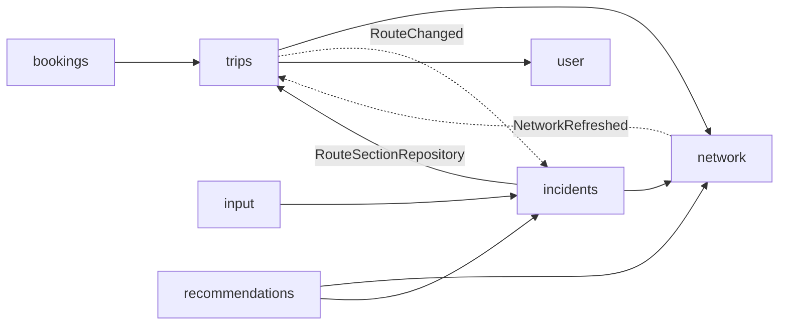

# Architecture

- **Ziel der App:** Nutzer hinterlegen Reiserouten und werden über Ereignisse informiert, die den Reiseverlauf beeinflussen (z. B. Straßensperrung). Fachliches Modell siehe [domain.md](domain.md).
- **Herkunft:** Das Repository war die App VacantAgent (Markt für LLM-Kapazität). Markt, Agents und LLM-Proxy sind entfernt (`V18`, `V19`). Auth, User, Infrastruktur und Deployment werden weiterverwendet. Abrechnung, PayPal und Provider-Onboarding sind Altbestand, siehe [Altbestand](#altbestand).
- **Technik:** Backend Spring Boot (Java 25, Maven) in `backend/`, Frontend React/Vite (TypeScript) in `frontend/`, PostgreSQL, Betrieb als Docker Swarm Stack, siehe [deployment.md](deployment.md). Streckennetz und Routing mit eingebettetem GraphHopper und PostGIS (geplant), siehe [network.md](network.md).

## System Context

- **Reisende:** melden sich über den eigenen Identity Provider an (OIDC, durch Keycloak ersetzbar), siehe [authentication.md](authentication.md).
- **MCP-Clients:** greifen im Namen eines Nutzers über `/mcp` zu (Autorisierung per CIMD). Tools gibt es derzeit keine.
- **Verkehrsdatenquellen:** liefern Ereignisse in das Modul `input`, entweder abgerufen (`TRAFFIC_FEED`) oder gepusht (`WEBHOOK`). Noch keine Quelle angebunden.
- **Routing:** kein externer Dienst, GraphHopper läuft eingebettet im Modul `network` (geplant), Kartendaten von Geofabrik, siehe [network.md](network.md).
- **Benachrichtigung:** Kanal noch offen.

## Building Blocks

Jedes Modul ist ein Paket unter `com.vacantagent`.

| Modul | Aufgabe | Status |
|---|---|---|
| `trips` | Trips, Stops, Routen und ihre Abschnitte | neu |
| `network` | Streckennetz und Routing: OSM-Import, GraphHopper, Segmente, Routing (geplant) | neu |
| `bookings` | Buchungen an Stops | neu |
| `input` | Eingehende Ereignisse und ihre Quellen | neu |
| `incidents` | Incidents, Consequences, Zuordnungslogik | neu |
| `recommendations` | Alternativen zu Consequences (Umfahrung, spätere Abfahrt) | geplant |
| `auth` | Eigener Identity Provider (OAuth2/OIDC, MCP-Clients per CIMD), unabhängig von allen anderen Modulen | Basis |
| `user` | `AppUser`, Absicherung von `/api/**` und `/mcp`, `CurrentUser` | Basis |
| `common` | `AbstractEntity`, Envers-Revision, Konverter, Fehlerbehandlung, OpenAPI | Basis |
| `currency` | Wechselkurse (EZB), Umrechnung an der API | Basis, wird nur von `accounting` gebraucht |
| `accounting`, `paypal`, `onboarding` | Konten, Ein- und Auszahlung über PayPal, Provider-Onboarding | Altbestand |

### Aufbau eines Moduls

- Nach dem Vorbild von `accounting`:
  - `entities`: JPA-Entities und Enums. Felder per Lombok `@Getter`, Änderungen nur über fachliche Methoden, geschützter Default-Konstruktor für JPA.
  - `data`: Spring-Data-Repositories, eigene Abfragen als JPQL.
  - `logic`: fachliche Services (`@Service`, `@Transactional`), Hilfskomponenten paketprivat.
  - `api` und `dto`: REST-Controller und DTOs (für die neuen Module noch nicht vorhanden).
  - `config`: `@Configuration` und `@ConfigurationProperties`.

### Abhängigkeiten zwischen Modulen

- **Referenzen über Modulgrenzen nur per Id** (`appUserId`, `segmentId`, `stopId`, `routeId`, `routeSectionId`, `incidentId`), mit Fremdschlüssel in der Datenbank. JPA-Beziehungen (`@ManyToOne`) nur innerhalb eines Moduls. Pfeile oben zeigen diese Id-Referenzen und die Aufrufe.
- **Rückwärts über Events:** `trips` kennt `incidents` nicht. Nach dem Planen einer Route veröffentlicht `RouteLogic` das Spring-Event `RouteChanged`, `incidents` reagiert darauf (synchron, in derselben Transaktion).
- **`network` nach außen nur über `network.logic`** (`Routing`, `SegmentQueries`, `RegionImport`, `NetworkRefreshed`), keine Entities, Repositories oder GraphHopper-Typen. Später per ArchUnit.
- **`incidents` liest den Index aus `trips`:** `ConsequenceMatcher` nutzt `RouteSectionRepository` (Index Segment → RouteSection). Später ggf. durch eine schmale Schnittstelle in `trips.logic` ersetzen.
- **`auth`** ist per ArchUnit (`AuthModuleIsolationTest`) isoliert. Für die neuen Module gibt es noch keine ArchUnit-Regeln.

## Runtime View

1. **Ereignis kommt an** (offen): Quelle → `input` speichert ein `Event` unverändert (`payload`), doppelte Zustellung über `externalId` erkannt.
2. **Ereignis verarbeiten** (offen): Straße und Ort → Segmente, neuer oder bestehender `Incident` über `IncidentLogic.create`/`change`, `Event.processed(incidentId)`.
3. **Zuordnung:** `ConsequenceMatcher.matchIncident` findet über die Segmente die Routen, deren erwartete Durchfahrt die Gültigkeit überschneidet, und legt `Consequence`s an, aktualisiert oder entfernt sie.
4. **Route planen** (geplant): `RoutePlanning.plan` → `network.Routing` → `RouteLogic.replaceSections` → `RouteChanged` → `ConsequenceMatcher.matchRoute`.
5. **Benachrichtigen** (offen): neue oder geänderte Consequences an den Nutzer des Trips.
6. **Netz aktualisieren** (geplant): neuer Extrakt → `NetworkRefreshed` → betroffene Routen neu planen, siehe [network.md](network.md).

## Persistence

- **Schema nur per Flyway** (`backend/src/main/resources/db/migration`, Auth unter `db/migration/auth`), Hibernate validiert nur (`ddl-auto=validate`). Nächste freie Version: `V21`.
- **Datenbank:** PostgreSQL mit PostGIS überall: Stack, lokal, Tests (Testcontainers). H2 ist entfernt. Migrationen weiter möglichst Standard-SQL, z. B. `SMALLINT` statt `TINYINT`, `VARCHAR(n)` statt `TEXT`, PostGIS nur für Geometrie.
- **Ids:** `BIGINT GENERATED BY DEFAULT AS IDENTITY` über `AbstractEntity`.
- **Zeiten:** `OffsetDateTime` / `TIMESTAMP(6) WITH TIME ZONE`, Dauern über `DurationConverter` als `BIGINT` (Nanosekunden).
- **Historie:** Hibernate Envers für `@Audited`-Entities, je eine `_aud`-Tabelle in derselben Migration, siehe [envers.md](envers.md).
- **Geometrie:** PostGIS `geometry(…, 4326)` mit GIST-Index (geplant, zuerst `road_segment`), bisher GeoJSON-Text.

## Security

- `/api/**`: JWT des eigenen IdP (oder Keycloak), Daten immer nur des angemeldeten `AppUser` (`CurrentUser`).
- `/mcp`: eigene Tokens mit Audience der MCP-URI und Scopes `mcp:read`/`mcp:write`.
- Details in [authentication.md](authentication.md), Secrets in [deployment.md](deployment.md).

## Tests

- Integrationstests mit `@SpringBootTest` gegen PostGIS (Testcontainers, JDBC-URL `jdbc:tc:postgis:…`, ein Container je Testlauf) und alle Migrationen, z. B. `ConsequenceMatchingTest`. Docker nötig. Streckennetz gegen einen Wellington-Testextrakt, siehe [network.md](network.md#tests).
- Architekturregeln mit ArchUnit (`AuthModuleIsolationTest`, `MoneyArchitectureTest`, `PayPalModuleTest`).
- CI (`.github/workflows/backend.yml`): `mvn verify`, danach Abgleich der generierten `frontend/openapi.json`.

## Altbestand

- Aus VacantAgent stammen noch Code und Doku für Abrechnung ([accounting.md](accounting.md), [paypal.md](paypal.md), [money.md](money.md)), das Backend-Modul `onboarding` sowie im Frontend die Rollen Consumer, Provider und Betreiber mit ihren Seiten (Aufträge, Angebote, Marktplatz, Guthaben, Einnahmen).
- Ob davon etwas für die Reise-App gebraucht wird (z. B. bezahlte Benachrichtigungen), ist offen. Bis dahin bleibt der Code unverändert.

## Offene Punkte

- **Streckennetz:** Aktualisierung, Geschwindigkeiten, weitere Regionen, siehe [network.md](network.md#offen).
- **Ereignisquellen:** konkrete Feeds und Webhooks, Abruf-Scheduler, Webhook-Endpunkt mit Signaturprüfung, Verarbeitung Event → Incident inkl. Ortsbestimmung.
- **Benachrichtigung:** Kanal (Web-Push, E-Mail, MCP), Auslöser (neue oder geänderte Consequence), Duplikate vermeiden.
- **Skalierung der Zuordnung:** derzeit synchron in der Transaktion. Bei vielen Routen oder Events asynchron nach dem Commit (`@TransactionalEventListener`, Queue).
- **API und Frontend** für Trips, Stops, Buchungen, Incidents und Consequences, MCP-Tools.
- **ArchUnit-Regeln** für die neuen Module (nur Id-Referenzen, keine Zyklen).
- **Altbestand:** entscheiden, ob Abrechnung, PayPal, Onboarding und die alten Frontend-Seiten bleiben oder entfernt werden; App-Name und Branding (README, Icon, Paketname `com.vacantagent`).
