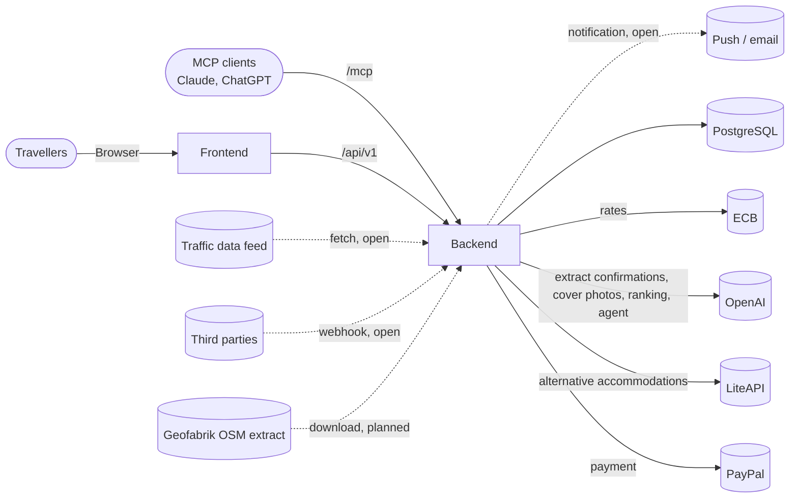
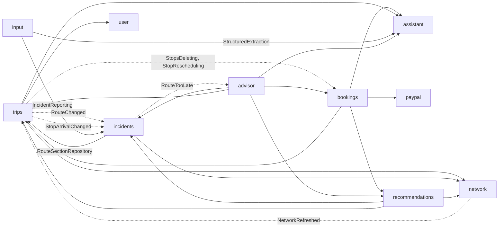

# Architecture

- **Goal of the app:** users store travel routes and are informed about events that affect the course of their trip (e.g. road closure). Domain model see [domain.md](domain.md).
- **Origin:** the repository was the app Nfv (market for LLM capacity). Market, agents and LLM proxy have been removed (`V18`, `V19`). Auth, user, infrastructure and deployment are reused. Accounting, PayPal and provider onboarding are legacy code, see [Legacy code](#legacy-code).
- **Technology:** backend Spring Boot (Java 25, Maven) in `backend/`, frontend React/Vite (TypeScript) in `frontend/`, PostgreSQL, operated as a Docker Swarm stack, see [deployment.md](deployment.md). Road network and routing with embedded GraphHopper and PostGIS, see [network.md](network.md). Route suggestions see [recommendations.md](recommendations.md), proposals by the agent see [advisor.md](advisor.md).

## System Context

- **Travellers:** log in via the own identity provider (OIDC, replaceable by Keycloak), see [authentication.md](authentication.md).
- **OpenAI:** extracts booking confirmations, researches missing details about accommodations on the web, draws cover photos, sorts alternative accommodations and proposes solutions for incidents (module `assistant`), only if an API key is set, see [Assistant](#assistant).
- **LiteAPI (Nuitee):** hotel search by name and hotel data when entering a booking, hotel offers, prebook and booking of alternative accommodations (module `bookings`, `LiteApi`), only with a key (`LITEAPI_API_KEY`), see [accommodation-alternatives.md](accommodation-alternatives.md).
- **PayPal:** payment of alternative accommodations (module `paypal`, Orders API with authorisation), see [paypal.md](paypal.md).
- **MCP clients:** access on behalf of a user via `/mcp` (authorisation via CIMD). Tools for trips, stops and waypoints, see [API](#api).
- **Traffic data sources:** deliver events into the module `input`, either fetched (`TRAFFIC_FEED`) or pushed (`WEBHOOK`). Common interface `TrafficSource` per source and country, first source NZTA (`nz-nzta`): fetched, stored and processed into incidents (stages 1, 2), still without enrichment and time windows, see [traffic-feed.md](traffic-feed.md).
- **Routing:** no external service, GraphHopper runs embedded in the module `network` (planned), map data from Geofabrik, see [network.md](network.md).
- **Notification:** channel still open.

## Building Blocks

Every module is a package under `com.nfv`.

| Module | Responsibility | Status |
|---|---|---|
| `trips` | Trips, stops, routes and their sections | new |
| `network` | Road network and routing: OSM import, GraphHopper, segments, routing (planned) | new |
| `bookings` | Bookings at stops (accommodations first), extracting confirmations, searching and booking alternative accommodations (LiteAPI, PayPal) | new |
| `assistant` | Access to the language model (OpenAI), knows no domain modules | new |
| `input` | Incoming events and their sources | new |
| `incidents` | Incidents, consequences, matching logic | new |
| `recommendations` | Route suggestions from scenarios: during planning and as an alternative to consequences (detour, later departure), see [recommendations.md](recommendations.md) | new (planning), incidents draft |
| `advisor` | Agent that proposes and stores solutions for incidents, automatically for `TOO_LATE`, otherwise on request, see [advisor.md](advisor.md) | new, automatic mode switched off for now |
| `auth` | Own identity provider (OAuth2/OIDC, MCP clients via CIMD), independent of all other modules | base |
| `user` | `AppUser`, securing `/api/**` and `/mcp`, `CurrentUser` | base |
| `common` | `AbstractEntity`, Envers revision, converters, error handling, OpenAPI | base |
| `currency` | Exchange rates (ECB), conversion at the API | base, only needed by `accounting` |
| `paypal` | Technical integration with PayPal (checkout with capture or authorisation, refund, payouts, connect), knows no domain modules | base, used by `bookings` and `accounting`, see [paypal.md](paypal.md) |
| `accounting`, `onboarding` | Accounts, top-up and payout via PayPal, provider onboarding | legacy code |

### Structure of a module

- Modelled on `accounting`:
  - `entities`: JPA entities and enums. Fields via Lombok `@Getter`, changes only via domain methods, protected default constructor for JPA.
  - `data`: Spring Data repositories, own queries as JPQL.
  - `logic`: domain services (`@Service`, `@Transactional`), helper components package-private.
  - `api` and `dto`: REST controllers and DTOs (`trips`: `TripController`, `incidents`: `TripIncidentController`).
  - `config`: `@Configuration` and `@ConfigurationProperties`.

### Dependencies between modules

- **References across module boundaries only by id** (`appUserId`, `segmentId`, `stopId`, `routeId`, `routeSectionId`, `incidentId`), with a foreign key in the database. JPA relationships (`@ManyToOne`) only within a module. The arrows above show these id references and the calls.
- **Backwards via events:** `trips` does not know `incidents`. After planning a route `RouteLogic` publishes the Spring event `RouteChanged`, `incidents` reacts to it (synchronously, in the same transaction). Likewise `trips` does not know `bookings`: before deleting stops `StopsDeleting`, after a new arrival/departure of a stop `StopRescheduling` (bookings must fit into the days of the stop, see [domain.md](domain.md#bookings)); the listeners reject via an exception that rolls back the transaction.
- **`network` to the outside only via `network.logic`** (`Routing`, `SegmentQueries`, `Places`, `RegionImport`, `NetworkRefreshed`), no entities, repositories or GraphHopper types. Later via ArchUnit.
- **`incidents` reads the index from `trips`:** `ConsequenceMatcher` uses `RouteSectionRepository` (index segment → RouteSection). Later possibly replace with a narrow interface in `trips.logic`.
- **`input` and `incidents`** (decided 2026-11-04, implemented): `input` receives, stores, reads and enriches (`→ assistant`), does not know `network`. `incidents` locates via `network.SegmentMatching` (`IncidentReporting`), creates incidents and assesses consequences. Assessment on a changed arrival via the event `StopArrivalChanged` from `trips`.
- **`recommendations`** reads routes via `trips.logic`, calculates suggestions transiently (nothing stored) and stores the chosen route via `TripEditing.replaceWaypoints` (then planning). It is not in `trips` because it needs `incidents` and `incidents` depends on `trips`, see [recommendations.md](recommendations.md).
- **`advisor`** sits at the very top, no module knows it: it calls `recommendations` as tools of the agent and stores its runs and proposals itself. This keeps `recommendations` deterministic and without a model. Backwards only via the event `RouteTooLate` from `incidents`, after the commit, see [advisor.md](advisor.md).
- **`auth`** is isolated via ArchUnit (`AuthModuleIsolationTest`). There are no ArchUnit rules for the new modules yet.

## Runtime View

1. **An event arrives** (draft [traffic-feed.md](traffic-feed.md)): source → `input` stores an `Event` unchanged (`payload`), duplicate delivery detected via `externalId`.
2. **Processing the event** (`TrafficEventProcessor`, after the commit of the fetch; enrichment still a draft): the adapter reads the event, `input` enriches via the model only if the text changed, `incidents.IncidentReporting` locates via `network.SegmentMatching` and creates or changes (`IncidentLogic.create`/`change`), `Event.processed(incidentId)`.
   - **Assessment** (draft [consequence-assessment.md](consequence-assessment.md)): per route against the arrival of the target stop, categories `TOO_LATE`, `DELAYED`, `NO_IMPACT`.
3. **Matching:** `ConsequenceMatcher.matchIncident` finds via the segments the routes whose expected passage overlaps the validity, and creates, updates or removes `Consequence`s.
4. **Planning a route:** REST or MCP → `TripEditing` → change in `TripLogic` (discards sections of affected routes, commits) → per affected route `RoutePlanning.plan` → `network.Routing` → `RouteLogic.replaceSections` → `RouteChanged` → `ConsequenceMatcher.matchRoute`.
5. **Suggestions:** the frontend requests → `recommendations` builds a scenario (with blocks or delays of active incidents) and returns up to `n` suggestions without storing them. The user chooses → `PUT /routes/{id}/choice` → `TripEditing.replaceWaypoints` → `RoutePlanning.plan`. State such as "notified" belongs to the consequence or notification.
6. **Proposals of the agent** ([advisor.md](advisor.md), `TOO_LATE` implemented, switched on since 2026-11-11: `nfv.advisor.auto-enabled`): `TOO_LATE` → `RouteTooLate` after the commit, or the user via `POST /routes/{id}/alternative-proposals` → `advisor` starts a run on a virtual thread → the agent calls tools on `recommendations` → proposals stored. The user chooses as under 5.
7. **Notifying** (open): new or changed consequences to the user of the trip.
8. **Updating the network** (planned): new extract → `NetworkRefreshed` → replan affected routes, see [network.md](network.md).

## Persistence

- **Schema only via Flyway** (`backend/src/main/resources/db/migration`, auth under `db/migration/auth`), Hibernate only validates (`ddl-auto=validate`). Next free version: `V46`.
- **Database:** PostgreSQL with PostGIS everywhere: stack, local, tests (Testcontainers). H2 has been removed. Migrations still as standard SQL as far as possible, e.g. `SMALLINT` instead of `TINYINT`, `VARCHAR(n)` instead of `TEXT`, PostGIS only for geometry.
- **Ids:** `BIGINT GENERATED BY DEFAULT AS IDENTITY` via `AbstractEntity`.
- **Times:** `OffsetDateTime` / `TIMESTAMP(6) WITH TIME ZONE`, durations via `DurationConverter` as `BIGINT` (nanoseconds).
  - With `TIMESTAMP WITH TIME ZONE` PostgreSQL only stores the point in time, not the offset. Where the offset matters (times entered by the user: travel period, arrival/departure at the stop), it is stored via `@TimeZoneStorage(TimeZoneStorageType.COLUMN)` in a separate column `<column>_tz` (`INTEGER`, seconds).
  - Jackson keeps the offset of incoming points in time (`spring.jackson.datatype.datetime.adjust-dates-to-context-time-zone=false`), otherwise it would be converted to UTC when reading.
  - Other points in time (e.g. `createdAt`, validity of incidents) are returned as UTC on PostgreSQL.
- **History:** Hibernate Envers for `@Audited` entities, one `_aud` table each in the same migration, see [envers.md](envers.md).
- **Geometry:** PostGIS `geometry(…, 4326)` with GIST index (`road_segment`), in JPA via hibernate-spatial (JTS), only in the module `network`. Lines of other modules (suggestions, `route-lines`) are lists of `GeoPoint`.
  - Single points (stop, waypoint, accommodation) are `latitude`/`longitude` (`DOUBLE PRECISION`) in JPA and API, no JTS outside `network`. Matching of incidents to routes runs via segment ids, not via geometry.
  - Where spatial searches happen, the database derives a point: generated column `geometry(Point, 4326)` from `latitude`/`longitude` with GIST index, not mapped, not in `_aud`. So far `booking_accommodation.location` (`V28`, for incidents near an accommodation).
  - Only the extension `postgis`. The extensions `postgis_tiger_geocoder`, `postgis_topology`, `fuzzystrmatch` and schemas `tiger`, `topology` created by the image `postgis/postgis` are removed by `V27`.

## API

- REST under `/api/v1`, contract in `frontend/openapi.json` (generated, client via `npm run generate:api`).
- `GET/POST /trips`, `GET/PUT/DELETE /trips/{id}` (with stops and routes), `GET/PUT /trips/{id}/cover-image` (JPEG, PNG, WebP up to 5 MB, multipart), `GET /trips/{id}/cover-image/thumbnail` (reduced copy for the trip list, otherwise the original; both with ETag, 304 on `If-None-Match`), `POST /trips/{id}/cover-image/generation` (cover photo from the image model, synchronous, takes a few seconds; 503 `ASSISTANT_UNAVAILABLE`, 429 `ASSISTANT_RATE_LIMITED`).
- Stops (`TripController`), the response is always the whole trip, since routes change with it: `POST /trips/{id}/stops` (optional `position`, otherwise at the end), `PUT /trips/{id}/stops/{stopId}`, `PUT /trips/{id}/stops/{stopId}/position`, `DELETE /trips/{id}/stops/{stopId}`.
- Routes (`RouteController`), response route with waypoints: `GET /trips/{id}/routes/{routeId}`, `PUT /trips/{id}/routes/{routeId}/waypoints` (whole ordered list), `POST /trips/{id}/routes/{routeId}/plan` (plan again). `GET /trips/{id}/route-lines`: planned line, distance, duration and "via …" per planned route for the map. Waypoints with `origin` (`USER`, `SUGGESTION`).
- Route suggestions (`SuggestionController`): `POST /routes/{routeId}/suggestions` (calculated, not stored, option with `waypoints`), `PUT /routes/{routeId}/choice` (store the chosen route as waypoints or set a new departure, then plan), errors via `RecommendationExceptionHandler` (`TRIP_NOT_FOUND`, `INVALID_SUGGESTION_INPUT`, `ROUTING_UNAVAILABLE`), see [recommendations.md](recommendations.md#api).
- Proposals of the agent (`AlternativeProposalController`): `POST /routes/{routeId}/alternative-proposals` (`202`, asynchronous), `GET /routes/{routeId}/alternative-proposals` (last run), `GET /alternative-proposals/{runId}`, `GET /trips/{tripId}/alternative-proposals` (last run per route), `POST /alternative-proposals/{runId}/proposals/{rank}/acceptance` (accept, changes the trip), `POST /alternative-proposals/{runId}/dismissal` (dismiss), errors via `AdvisorExceptionHandler` (`TRIP_NOT_FOUND`, `NO_ACTIVE_CONSEQUENCE`, `INVALID_PROPOSAL_INPUT`, `PROPOSAL_NOT_APPLICABLE`), see [advisor.md](advisor.md#api).
- Modifying calls plan affected routes immediately (`TripEditing`, see [domain.md](domain.md#trips)). The result is on every route as `planOutcome`/`planReason`.
- `GET /trips/{id}/incidents` (current notices per route with assessment, sorted by ranking), `GET /trips/{id}/incidents/routes` (situation per route: worst category, expected arrival, slack), `GET /incidents/trip-counts` (counters for the trip list, only `TOO_LATE` and `DELAYED`), see [consequence-assessment.md](consequence-assessment.md#api-and-frontend).
- Foreign or unknown trips: 404 with `code` `TRIP_NOT_FOUND`, stops, routes, waypoints that do not belong to the trip: 404 with `STOP_NOT_FOUND`, `ROUTE_NOT_FOUND`, `WAYPOINT_NOT_FOUND`, invalid inputs: 400 with `INVALID_TRIP_INPUT` (`TripExceptionHandler`, only for `trips` and `incidents`).
- Bookings (`BookingController`): `GET /trips/{id}/bookings`, `POST /stops/{stopId}/accommodation-bookings`, `PUT /accommodation-bookings/{id}`, `DELETE /bookings/{id}`, `GET /bookings/assistant` (extraction available?), `POST /bookings/accommodation-drafts` (multipart `text` and/or `file`, returns an unsaved draft), `GET /bookings/accommodation-suggestions?query=…&latitude=…&longitude=…` (LiteAPI hotels for the name, empty without LiteAPI), `POST /bookings/accommodation-facts` (contact and house rules: LiteAPI, the rest via web search of the assistant, with origin per field), to-do list `GET /trips/{id}/booking-todos`, `POST`/`DELETE /booking-todos/{id}/completion`, `POST /booking-todos/{id}/refund-cancellation` (bookings made in the app, also after the booking or stop was deleted) ([domain.md](domain.md#bookings)).
- Alternative accommodations (`AlternativeController`, see [accommodation-alternatives.md](accommodation-alternatives.md#api-proposal)): `GET /bookings/alternatives/status`, `GET /accommodation-bookings/{id}/alternative-criteria`, `POST /accommodation-bookings/{id}/alternative-searches`, `POST /accommodation-bookings/{id}/alternative-reservations`, `POST /stops/{stopId}/stay-reservations` (hotel of a proposal at the stop without a replaced booking), `GET /booking-reservations/{id}`, `POST /booking-reservations/{id}/booking`, `POST /booking-reservations/{id}/abort`, `POST /bookings/{id}/cancellation` (only mark as cancelled in the app).
- Errors of the bookings (`BookingExceptionHandler`): 404 `STOP_NOT_FOUND`/`BOOKING_NOT_FOUND`/`TRIP_NOT_FOUND`, 400 `INVALID_BOOKING_INPUT`, 503 `ASSISTANT_UNAVAILABLE` (no key, model failed), 429 `ASSISTANT_RATE_LIMITED`; alternatives: 404 `RESERVATION_NOT_FOUND`, 409 `OFFER_UNAVAILABLE`/`PRICE_EXCEEDED`, 422 `PAYMENT_NOT_APPROVED`/`PAYMENT_DECLINED`, 429 `ALTERNATIVES_RATE_LIMITED`, 503 `ALTERNATIVES_UNAVAILABLE`/`PAYPAL_NOT_CONFIGURED`, 502 `PAYPAL_ERROR`.
- **MCP tools** (`trips.api.TripTools`, same logic and DTOs as REST): `list_trips`, `get_trip`, `get_route` (scope `mcp:read`, `nfv.mcp.read-tools`), `create_trip`, `update_trip`, `add_stop`, `update_stop`, `move_stop`, `remove_stop`, `set_waypoints`, `plan_route` (additionally `mcp:write`). Deleting trips deliberately not via MCP. There are no MCP tools for bookings yet.
  - The user comes from the `SecurityContext`: with servlet servers Spring AI executes tools in the request thread (`immediateExecution`).

## Frontend

- Pages according to the UI concept (mockups: https://claude.ai/artifact/8Vgxrtx6rJjtV7R8WxXuY4): `/reisen` (current trip, tabs upcoming/past), `/reisen/neu`, `/reisen/:id` (map with list below).
- Dialogs above the map are sub-routes with their own URL (`stops/neu`, `stops/:stopId/buchung`, `buchungen/:bookingId`, `hinweise/:routeId/:incidentId`, `routen/:routeId`), the back button closes them.
- Map: MapLibre GL JS with OpenFreeMap tiles (`VITE_MAP_STYLE_URL` overrides the style). Routes are drawn as straight lines between the stops until routing. The attribution (OpenFreeMap, OpenMapTiles, OpenStreetMap) comes from the tile metadata and is always expanded at the top left, because the trip sheet covers the lower corners.
- Current position: browser geolocation (`watchPosition`, `src/map/position.ts`) as long as the trip is open; marked as a green pawn (`src/map/pawn.ts`), faded at the last position when the signal is lost. Not sent to the backend. Without permission or without the API no pawn, the position button briefly explains why.
- To the left of the plus button two small map buttons (without shadow): "Show whole route" (all stops above the sheet) and "To my position" (zoom 14, about 2 km width on the phone: road, nearest junctions and places stay recognisable; waits for the first position if necessary).
- Place search for stops: Photon (OpenStreetMap, `VITE_GEOCODING_URL`), directly from the browser. Only places in New Zealand (`bbox` and `countrycode`, also for the accommodation search), a stop needs a selected suggestion, see [domain.md](domain.md#trips).
- **Languages:** German and English via i18next (`src/i18n/`), all UI texts as keys in `de.ts` and `en.ts`, switch in the profile menu, see [i18n.md](i18n.md).
- **Loading indicator:** if something takes a little longer, the app shows the waiting kiwi (`kiwi-waiting.svg` in the repository, copy in `frontend/src/assets/kiwi.svg`, the animation is inside the SVG, rests with `prefers-reduced-motion`) via `src/components/KiwiLoader.tsx`, without shadow.
  - Is the indicator of every antd `Spin` via `ConfigProvider` (`main.tsx`), so also full-page (`Spin fullscreen`).
  - Otherwise use directly: size `small` next to a text (e.g. in buttons during "Saving …", then `decorative`), `medium` in boxes, `large` for empty areas (trip list, map while loading).
  - No own spinners (`LoadingOutlined`, skeletons) for waiting times any more.
- **Optimistic:** what almost always works and is easy to undo is shown by the frontend immediately and reverted on an error, e.g. "Remove notice from the map" (see [domain.md](domain.md)).
- Points in time go to the backend with the offset of the system time zone and are displayed in this time zone (`src/trips/time.ts`).
- **Installable (PWA):** `vite-plugin-pwa` generates the manifest (`start_url` `/reisen`, `display` `standalone`, icons in `public/`) and service worker (Workbox).
  - The service worker caches the app shell, map tiles (OpenFreeMap) and fonts. API responses are not cached. Paths of backend and IdP (`/api`, `/oauth2`, `/login`, …) never get the cached `index.html`.
  - Updates come automatically (`registerType: autoUpdate`). nginx serves `sw.js` and the manifest with `Cache-Control: no-cache`.
  - Installing via button (`src/pwa/`): Chromium browsers (Android, desktop) fire `beforeinstallprompt`, the button "Install" calls its `prompt()`. Safari on iOS does not have this, there the button shows the instruction "Share → Add to Home Screen".
  - The button is in the profile menu and as a note above the trip list (can be hidden permanently). It is missing if the app is already installed or runs as an app (`display-mode: standalone`) or the browser offers no installation.
  - Service worker and installation need HTTPS (except `localhost`).
- **Bookings** (`src/bookings/`): sheet "Add booking" (type chips, ways "Paste confirmation", "Manual", "Search by voice" as "coming soon"; no separate way per provider such as Booking.com, their confirmations go via "Paste confirmation" or sharing), afterwards always the same review form (fields read from the confirmation with ✦, uncertain ones marked yellow, place searched automatically via Photon). In the name field suggestions while typing (LiteAPI hotels near the stop first, then accommodations from Photon with `osm_tag=tourism` and place reference); the selection sets address, country and map position and loads contact and check-in times (only empty fields, a note says what comes from the hotel data and what was found on the web, the latter with ✦ and "Please check"). Stay only as arrival/departure date, prefilled with arrival and departure of the stop; guests prefilled with the travellers of the trip. Reachable from "Add stop" and via "+ Booking" in the stop list; bookings appear under their stop, tapping opens the details (copy number, open at the provider, route, edit, delete). Times are displayed in the local time of the accommodation (`src/bookings/localTime.ts`).
- **Sharing to the app (share target, only Android/Chromium, iOS does not support it):** manifest `share_target` (POST `/teilen`, text, URL, image, PDF). The service worker (`public/share-target-sw.js`, via `workbox.importScripts`) stores what was shared in the cache `share-target`, because the POST carries no token, and opens `/teilen`. The page `/teilen` leads into the same flow as "Paste confirmation" (shared component `src/bookings/ConfirmationInput.tsx`): what was shared is displayed and can be supplemented with pasted text or a file (e.g. a shared link plus the text of the confirmation email), "Extract" sends everything together to the assistant (`combineInput`: texts concatenated, one file, the self-chosen one before the shared one), then the review form with a proposal for trip and stop (or a new stop for the accommodation). Alternatively enter manually. What was shared is deleted after saving or discarding.
- **Search alternative** (`src/bookings/AlternativesSheet.tsx`, sub-route `buchungen/:bookingId/alternativen`, button in the booking details, only if LiteAPI is configured): check criteria from the booking, results with recommendation and justification (✦), guest data, secure price, "Pay with PayPal" (redirect). PayPal returns to the same sub-route with `?reservierung=<id>` (cancelled: `&abgebrochen=1`), the page then books and offers to mark the old booking as cancelled.
- Shared content not yet saved also appears in the sheet "Add booking" under "Paste confirmation" and is read along in the same way there; `source` is `SHARE` as soon as shared content was read, otherwise `DOCUMENT`. If the login interrupts, the trip list points to the waiting booking.
- **Proposals for incidents** (`src/proposals/`, see [advisor.md](advisor.md#frontend)): in the dialog `alternativen/:routeId/:incidentId` first "Solutions" (proposals of the agent, accept or "I'll replan myself"), below collapsed "Replan myself". Banner on the trip page for open proposals. Booking the hotel of a proposal: `stops/:stopId/unterkunft` (`StayBookingSheet`).
- **To-do list** (`src/bookings/TodoList.tsx`) on the trip page: bookings to cancel or inform yourself, with link, phone, email, "Done", for those booked in the app "Cancel" (with refund, also after the booking or its stop was deleted). Deleting a booking made in the app, or its stop, opens `src/bookings/RemoveAppBookingDialog.tsx`: cancel as well or only remove (then it goes on the list).
- The data layer `src/trips/tripsApi.ts` maps the generated types (all fields optional) to own types (`src/trips/model.ts`).

## Assistant

- **Module `assistant`:** access to the language model, knows no domain modules. `StructuredExtraction.extract(…)` sends instruction, JSON schema and inputs (text, image, PDF) to the OpenAI Responses API (Structured Outputs, `strict`) and returns the JSON; with `webSearch` the model may search the web beforehand (OpenAI tool `web_search`, only for public data such as name and address of an accommodation); with `ReasoningEffort` (`LOW`, `MEDIUM`, `HIGH`) a reasoning model thinks shorter or longer, e.g. `LOW` where the user waits for the answer (`AlternativeRanking`), without a value the model's default applies. Schema and instruction are provided by the caller (e.g. `bookings.logic.AccommodationExtractor`, `bookings.logic.AlternativeRanking`).
- **Agents:** `ToolConversation.run(…)` or `runForSystem(…)` conducts a conversation with function calling via the Responses API until the model calls a final tool determined by the caller, and returns its arguments. Instruction, input and tools (`ConversationTool`, strict schemas) are provided by the caller, the module stays without domain knowledge. One tool call per turn, every turn counts against the limit, in the last turn the model must finish. Because of `store: false` every request repeats all previous outputs including encrypted reasoning. Caller: `advisor`, see [advisor.md](advisor.md#model-quota-failure).
- **Images:** `ImageGeneration.generate(…)` sends a prompt to the OpenAI Images API (`/images/generations`, 1536×1024, JPEG) and returns the image data. Caller: `trips.logic.CoverImageGeneration` (prompt from name and stops of the trip, without a transaction around the model call; a photo uploaded in the meantime stays). Counts against the same limit per user as extraction.
- **HTTP directly via `RestClient`**, without Spring AI model starters: full control over `store: false`, PDF input and schema, no mandatory key at startup.
- **Configuration** (`nfv.assistant.*`): `api-key` (`OPENAI_API_KEY`, Docker secret in the stack, see [deployment.md](deployment.md)), `base-url`, `model` (default `gpt-5-mini`, `OPENAI_MODEL`), `image-model` (default `gpt-image-1-mini`, `OPENAI_IMAGE_MODEL`), `image-quality` (default `low`), `timeout`, `requests-per-hour` (per user, in memory, default 30), planned `system-requests-per-hour` (background calls without a user, e.g. enrichment of traffic messages, own counter, default 60, decided 2026-11-04, see [traffic-feed.md](traffic-feed.md#enrichment-messageenrichment)).
- **Without a key** the app starts normally, `GET /bookings/assistant` reports `extractionAvailable: false`, the frontend then only offers manual input.
- **Privacy:** inputs are not stored and are sent with `store: false`; before extraction the frontend points out the transfer to OpenAI. Tests never call OpenAI: the test properties set `nfv.assistant.api-key=` and a `base-url` pointing nowhere (applies even with `OPENAI_API_KEY` on the machine, `NoRealModelCallsTest` checks it). Not all tests mock the model: `ManualSourceApiTest` and `TrafficProcessingTest` are partly only stopped by the missing key. `NFV_ASSISTANT_API_KEY` and `-Dnfv.assistant.api-key` override the test properties, therefore never set them together with a real `base-url`. `ToolConversationTest` uses a mock server. The trip name (and stop names) go to OpenAI when generating a cover photo.

## Security

- `/api/**`: JWT of the own IdP (or Keycloak), data always only of the logged-in `AppUser` (`CurrentUser`).
- `/mcp`: own tokens with the audience of the MCP URI and scopes `mcp:read`/`mcp:write`.
- Details in [authentication.md](authentication.md), secrets in [deployment.md](deployment.md).

## Tests

- Integration tests with `@SpringBootTest` against PostGIS (Testcontainers, JDBC URL `jdbc:tc:postgis:…`, one container per test JVM) and all migrations, e.g. `ConsequenceMatchingTest`. Docker needed. Road network against a Wellington test extract, see [network.md](network.md#tests).
- **Parallel:** Surefire distributes the test classes to one JVM per two cores (`surefire.forkCount=0.5C` in `pom.xml`, `-Dsurefire.forkCount=1` for a run in one JVM). Locally with 4 cores 2 JVMs (2:25 → 1:30 min), on the CI runner with 2 cores 1 JVM, because 2 JVMs were slower there. Every JVM has its own container, own database and own contexts. Tests must therefore not rely on data of other test classes; which classes run together in one JVM is not fixed.
- **Contexts:** every different context configuration (`@MockitoBean`, `properties`, `@DynamicPropertySource`, own `@TestConfiguration`, with or without `@AutoConfigureMockMvc`) starts its own Spring context (about 1.5–2.5 s each). Write new tests with an existing combination where possible instead of introducing another one.
- Every Spring context cached in the test run holds its own connection pool on the same database (limit 100 connections). Therefore the pool is limited to 5 in the test properties: with 10 the context start fails from about 11 contexts with `too many clients`.
- Architecture rules with ArchUnit (`AuthModuleIsolationTest`, `MoneyArchitectureTest`, `PayPalModuleTest`).
- **OpenAPI:** `OpenApiSpecTest` writes `frontend/openapi.json` from the test context (`GET /v3/api-docs`, server URL with port 18180 as before), without starting the app a second time. So on every `mvn test`/`mvn verify`.
- CI (`.github/workflows/backend.yml`): `mvn test` (without Ryuk, the runner is discarded), then comparison of the generated `frontend/openapi.json`.

## Legacy code

- Code and docs for accounting ([accounting.md](accounting.md), [paypal.md](paypal.md), [money.md](money.md)) and the backend module `onboarding` still come from Nfv. The frontend pages for them (roles consumer, provider, operator, onboarding, credit, earnings, PayPal linking) have been removed; the PayPal return URLs (`nfv.frontend-url`) therefore point nowhere.
- Whether any of it is needed for the travel app (e.g. paid notifications) is open. Until then the code stays unchanged.
- **Decided (2026-11-02):** `paypal` is no longer legacy code, it pays for alternative accommodations (implemented 2026-11-03), see [accommodation-alternatives.md](accommodation-alternatives.md#payment). `accounting` and `onboarding` stay legacy code.

## Open points

- **Road network:** update, speeds, further regions, see [network.md](network.md#open).
- **Event sources:** [traffic-feed.md](traffic-feed.md): interface, fetching, reconciliation, reading and locating implemented (NZTA), enrichment and time windows designed; assessment designed in [consequence-assessment.md](consequence-assessment.md).
- **Notification:** channel (web push, email, MCP), trigger (new or changed consequence), avoiding duplicates.
- **Scaling the matching:** currently synchronous in the transaction. With many routes or events asynchronous after the commit (`@TransactionalEventListener`, queue).
- **API and frontend:** trips, stops, waypoints, cover photo, notices and MCP tools are implemented in the backend. Accommodation bookings are implemented (input, extraction of confirmations, sharing to the app, searching an alternative accommodation and booking it with PayPal). The frontend lacks editing and deleting trips and stops, inserting/reordering stops, waypoints and the display of the planning status. Also open are further booking types, MCP tools for bookings and the profile entries (profile, notifications, settings, AI assistants, in the menu as "coming soon").
- **Route suggestions:** the backend for planning is in place (see [recommendations.md](recommendations.md)). The route dialog in the frontend still shows sample data (from the straight line), "Apply route" and "Add intermediate destination" are disabled until it uses the API.
- **Expanding the PWA:** make trip data available offline (currently only the app shell and recently seen tiles), web push for notices, app name and icon as part of the branding.
- **Map and place search:** OpenFreeMap and the public Photon instance are only intended for moderate use; for operation check an own instance or a proxy in the backend. The map bundle is large (~1 MB, lazy loaded).
- **Cover photo:** "Generate automatically" calls the generation after creation (without waiting). Since no stops exist yet at creation, the prompt only comes from the name; regenerating (e.g. after the first stops) and display of the progress are missing in the frontend. Without the assistant or on errors the placeholder image stays. "My trips" only loads the thumbnail (`CoverImage size="thumbnail"`).
- **Thumbnails of the cover photos:** `trips.logic.CoverThumbnails` creates a copy as JPEG when saving every cover photo (generated and uploaded) (at most 768×512, quality 0.8, EXIF orientation taken into account, transparency to white), enough for the wide card of the current trip at 2× pixel density. Decodes only with the JDK (JPEG, PNG); WebP and broken data get none, then the endpoint returns the original. `CoverThumbnailBackfill` adds missing thumbnails at startup (photos from before V48), one transaction per photo. Possibly moving the image data out of the database into an object store.
- **Assistant:** monitor costs (model choice, image size), note in the privacy policy, rate limit in the database with several replicas, voice search (transcription, search agent with OSM/web search) and email forwarding as next stages.
- **Time zone data:** timeshape `2024a` (newer versions need protobuf 4, GraphHopper/osmosis brings protobuf 3; `protobuf-java` is raised to 3.25.5, from 3.25.6 reading `.osm.pbf` fails because of the old osmosis code). After first use the boundaries occupy approx. 200 MB of heap (via `SoftReference`, released on memory shortage).
- **ArchUnit rules** for the new modules (only id references, no cycles).
- **Legacy code:** decide whether accounting, PayPal and onboarding stay or are removed; app name and branding (README, icon, package name `com.nfv`).
