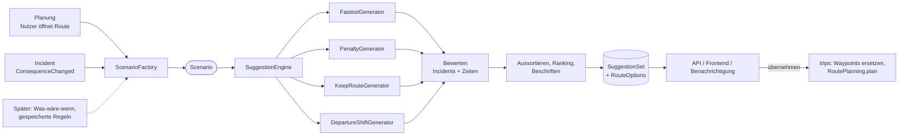

# Streckenvorschläge (`recommendations`)

- **Status:** Entwurf, noch nicht umgesetzt. Schema geplant als `V25__recommendations.sql`.
- **Ziel:** Für eine Route bekommt der Nutzer bis zu `n` Vorschläge, wie er fahren kann. Dieselbe Logik liefert Vorschläge, wenn ein Incident die geplante Route trifft (Umfahrung, spätere Abfahrt, Verzögerung hinnehmen).
- **Grundidee:** Ein Vorschlag entsteht immer aus einem **Szenario** (Ausgangslage: Punkte, Abfahrt, Einschränkungen im Netz, Referenzroute). Planung und Incident unterscheiden sich nur darin, wie das Szenario gebaut wird. Erzeugen, Bewerten, Aussortieren, Speichern, API und Frontend sind gemeinsam.
- Ersetzt die Beispieldaten in `frontend/src/trips/routeExamples.ts` und schließt den offenen Punkt „Umfahrung bei `BLOCKED`“ aus [domain.md](domain.md#offen).

## Ablauf

1. **Szenario bauen** (`ScenarioFactory`, einziger auslöserabhängiger Teil).
2. **Kandidaten erzeugen:** jeder aktive Generator liefert 0..* Kandidaten.
3. **Bewerten:** Durchfahrtszeiten je Segment, aktive Incidents auf dem Kandidaten (gleiche Überschneidungsregel wie `ConsequenceMatcher`), Ankunft inklusive Wartezeit und Verzögerungen.
4. **Aussortieren und Ranking:** zu ähnliche, zu langsame und unfahrbare Kandidaten fallen weg, die besten `n` bleiben.
5. **Beschriften:** Merkmale (`FASTEST`, `AVOIDS_INCIDENT`, …) und Hauptstraße des abweichenden Teils (z. B. „über SH 2“).
6. **Speichern** als `SuggestionSet` mit `RouteOption`s, damit API, Benachrichtigung und „übernehmen“ dieselben Vorschläge meinen.
7. **Übernehmen:** Via-Punkte des Vorschlags werden Waypoints der Route, ggf. neue Abfahrt, dann `RoutePlanning.plan`.

## Szenario (`recommendations.logic`)

- `Scenario` (Record, nicht persistiert):
  - `routeId`, `trigger` (`PLANNING`, `INCIDENT`, später `WHAT_IF`), optional `consequenceId`.
  - `start`: Stop oder geschätzte Position (siehe unten), `end`: Ziel-Stop, `vias`: Waypoints des Nutzers (`RoutePoint` mit `VIA`).
  - `departure`: Abfahrt am Start.
  - `constraints`: `blockedSegmentIds`, `delayedSegments` (Segment-Id → Verzögerung), `avoidedSegmentIds` (Strafe statt Sperre, z. B. Vorlieben).
  - `reference`: aktuell geplante Sections der Route (leer, wenn noch nicht geplant). Grundlage für `KeepRouteGenerator`, Anteil gemeinsamer Strecke und „schneller/langsamer als bisher“.
  - `generators`: welche Generatoren laufen, `count`: gewünschte Anzahl `n` (Standard 3, höchstens 5).
- **Planung** (`ScenarioFactory.forPlanning(routeId, departure?)`):
  - Punkte und Abfahrt wie in `RoutePlanning` (Stops, Waypoints, Abfahrt am Start-Stop). Fehlende Koordinaten oder Abfahrt → gleiche Ergebnisse wie `PlanResult` (`MISSING_COORDINATES`, `MISSING_DEPARTURE`), kein Set.
  - Keine Einschränkungen im Netz. Bekannte Incidents werden nur bewertet, nicht umfahren: der Nutzer sieht „führt durch Baustelle SH 1“ am Vorschlag.
  - Generatoren: `FASTEST`, `PENALTY`.
- **Incident** (`ScenarioFactory.forConsequence(consequenceId)`):
  - Wie Planung, dazu: `CLOSURE` → Segmente des Incidents in `blockedSegmentIds`, sonst mit `expectedDelay` in `delayedSegments`. Weitere aktive Incidents auf der Referenzroute ebenso.
  - Referenz = aktuell geplante Route. Generatoren: `KEEP_ROUTE`, `FASTEST`, `PENALTY`, `DEPARTURE_SHIFT`.
  - **Bereits unterwegs** (Abfahrt vorbei, Ankunft nicht): Start ist die geschätzte Position jetzt = Section, deren erwartete Durchfahrt `now` enthält, Punkt bei passendem Anteil. Vorschläge nur ab dort, `DEPARTURE_SHIFT` entfällt. Echte Position (GPS aus der App) später als eigener `start`.
  - Section mit dem Incident schon passiert → kein Set.
- **Später** (`WHAT_IF`): andere Abfahrt ausprobieren, vom Nutzer gesperrte Straße, gespeicherte Regeln aus [network.md](network.md#offen) („Szenarien als gespeicherte Regeln“). Nur neue Factory-Methode, Rest bleibt.

## Generatoren

- Interface `CandidateGenerator { List<Candidate> generate(Scenario, GeneratorContext) }`, je Generator eine Spring-Bean mit `kind()`. `GeneratorContext` gibt Zugriff auf `Routing` und die bisherigen Kandidaten (für Vielfalt).
- `Candidate`: Herkunft (`kind`), `RouteResult`, ggf. geänderte Abfahrt, Via-Punkte, die zum Übernehmen gespeichert werden.
- **`FASTEST`:** eine Route mit den Einschränkungen des Szenarios. Bei Planung identisch mit dem, was `RoutePlanning` plant.
- **`PENALTY` (Vielfalt):** Penalty-Methode, bis zu `2·n` Durchläufe: alle Segmente bisheriger Kandidaten bekommen Faktor 1,5 (kumulativ, höchstens 4), neu routen. Liefert unterschiedliche Strecken auch mit Via-Punkten und Bordsteinseite.
  - Kein GraphHopper `alternative_route`: unterstützt in 11.1 nur zwei Punkte, kein `pass_through` und keine `curbsides` (`Router`), passt also nicht zu Waypoints und Stops. Einsetzbar höchstens als zusätzliche Quelle für Routen ohne Waypoints, nicht im ersten Schritt.
  - Die Zeiten im Ergebnis bleiben echt: Strafen ändern nur die Gewichtung, nicht `TIME`.
- **`KEEP_ROUTE`:** Referenzroute unverändert, bewertet mit Verzögerungen bzw. als unfahrbar bei Sperrung. Nur wenn es eine Referenz gibt. Ergebnis „Verzögerung hinnehmen“ oder (gesperrt) nicht im Ranking, aber als Vergleich in der Antwort (`reference`).
- **`DEPARTURE_SHIFT`:** nur bei Incident mit Ende (`validTo`) oder Beginn in der Zukunft:
  - Später fahren: Abfahrt so, dass die betroffene Section frühestens `validTo + Puffer` erreicht wird (Puffer konfigurierbar, Standard 15 min), Strecke = Referenz.
  - Früher fahren: Section vor `validFrom - Puffer` passieren, nur wenn die neue Abfahrt nicht in der Vergangenheit und nicht vor der Ankunft am Start-Stop liegt.
  - Kein Routing nötig, nur neue Durchfahrtszeiten.
- Neue Generatoren (z. B. Vorlieben „keine unbefestigten Straßen“, Fähre meiden) nur als neue Bean und `kind`, Engine und Schema bleiben.

## Bewertung, Aussortieren, Ranking

- **Bewertung** je Kandidat (`CandidateEvaluator`):
  - Durchfahrt je Segment wie in `RoutePlanning.sections` (Abfahrt plus Dauern davor), dazu Verzögerungen aus `delayedSegments` und aus Incidents auf dem Weg, fortgeschrieben auf alle folgenden Segmente (löst für Vorschläge den offenen Punkt „Verzögerung fortschreiben“).
  - Aktive Incidents auf den Segmenten mit Überschneidung → `conflicts` (Incident, Impact, Verzögerung). Gleiche Regel wie `ConsequenceMatcher`, dafür eine reine Funktion `IncidentOverlap` in `incidents.logic`, die beide nutzen.
  - Ergebnis: Ankunft, Distanz, Fahrzeit, Wartezeit, Verzögerung, Anteil gemeinsamer Strecke mit der Referenz, `BLOCKED` ja/nein.
- **Aussortieren:**
  - Kandidat führt über eine Sperrung zur Zeit der Durchfahrt → raus.
  - Ähnlich: Anteil gemeinsamer Strecke (nach Distanz) mit einem besser platzierten Vorschlag > 0,6 → raus. Gleiche Werte wie GraphHopper `max_share`.
  - Zu langsam: Fahrzeit > 1,4 × schnellster Kandidat → raus. Gilt nicht für `DEPARTURE_SHIFT` und `KEEP_ROUTE` (anderer Vorteil: gleiche Strecke).
  - Alle Schwellen in `RecommendationProperties`.
- **Ranking:** nach Ankunft am Ziel (inkl. Warten und Verzögerung), dann Distanz. Höchstens `n` Vorschläge, höchstens ein `DEPARTURE_SHIFT` je Richtung.
- **Beschriften** (`labels`, mehrere möglich): `FASTEST`, `SHORTEST`, `CURRENT` (gleich der Referenz), `AVOIDS_INCIDENT`, `HAS_INCIDENT`, `LATER_DEPARTURE`, `EARLIER_DEPARTURE`, `FERRY`. Dazu `via`: häufigste `ref` bzw. Straßenname im abweichenden Teil (über `SegmentQueries`), z. B. „über SH 2“. Texte baut das Frontend.

## Datenmodell (`V25__recommendations.sql`)

- Nicht historisiert (abgeleitet, wird ersetzt), wie `Route`/`RouteSection`.
- `SuggestionSet`: `routeId` (FK `route`, `ON DELETE CASCADE`), `trigger`, optional `consequenceId` (FK `consequence`, `ON DELETE SET NULL`) und `incidentId` (FK `incident`), `requestedCount`, `departureAt` des Szenarios, `basisHash`, `status`, `createdAt`, `expiresAt`.
  - `basisHash`: Hash über Punkte, Abfahrt, Einschränkungen, Referenz-Sections und `extractVersionId`. Gleicher Hash → bestehendes Set wiederverwenden statt neu rechnen.
  - `status`: `CURRENT`, `STALE` (Route oder Incident seitdem geändert), `APPLIED`, `EXPIRED`.
  - `expiresAt`: Planung 1 h, Incident bis Durchfahrt der betroffenen Section bzw. `validTo`.
- `SuggestionSet` 1–* `RouteOption` (`@ManyToOne` innerhalb des Moduls): `rank` (eindeutig je Set), `kind`, `labels`, `via`, `departureAt`, `arrivalAt`, `distanceMeters`, `duration`, `waiting`, `delay`, `sharedRatio`, `geometry` (`geometry(LineString, 4326)`, für die Karte), `appliedAt`.
- `RouteOption` 1–* `RouteOptionPoint`: `position`, Koordinate, `roadHint`. Die Via-Punkte, die beim Übernehmen Waypoints werden.
- `RouteOption` 1–* `RouteOptionConflict`: `incidentId` (FK), `impact`, `delay`. Was auf diesem Vorschlag noch passiert.
- Keine Segmentliste je Vorschlag: nach dem Übernehmen plant `RoutePlanning` neu, die Sections entstehen dort.
- `waypoint` bekommt `origin` (`USER`, `SUGGESTION`, `VARCHAR(16)`, Standard `USER`, auch in `waypoint_aud`): Frontend zeigt erzeugte Waypoints anders, „zurück zur schnellsten“ entfernt nur `SUGGESTION`-Waypoints.
- Aufräumen: Job löscht Sets mit `expiresAt` älter als 7 Tage.

## Übernehmen eines Vorschlags

- Gespeichert wird die **Absicht**, nicht die Segmentliste (wie bei Waypoints): Via-Punkte, die den Vorschlag reproduzieren.
- Via-Punkte beim Erzeugen bestimmen (`ViaPointExtractor`): Waypoints des Nutzers bleiben; für jeden zusammenhängenden Abschnitt, der von `FASTEST` abweicht, ein Punkt in der Mitte des längsten Segments dort, mit dessen `ref` als `roadHint`. Prüfen: Routing über diese Punkte ergibt ≥ 90 % gemeinsame Strecke mit dem Kandidaten, sonst weiteren Punkt im längsten noch abweichenden Abschnitt (höchstens 3 je Abschnitt).
- So bleibt die Wahl nach `NetworkRefreshed` und Änderungen der Abfahrt erhalten, und die Sperre selbst muss nicht dauerhaft gespeichert werden.
- `SuggestionApplication.apply(optionId, userId)`:
  1. Set muss `CURRENT` sein und dem Nutzer gehören, sonst `409` mit `SUGGESTION_STALE`.
  2. `trips.logic.RouteLogic.replaceWaypoints(routeId, points, SUGGESTION)` (neu, ersetzt alle Waypoints, Nutzer-Waypoints sind in den Punkten enthalten).
  3. Bei `DEPARTURE_SHIFT`: Abfahrt am Start-Stop ändern (`TripLogic`, neu).
  4. `RoutePlanning.plan(routeId)` → `RouteChanged` → `ConsequenceMatcher` entfernt die nicht mehr zutreffende Consequence.
  5. Set `APPLIED`, `RouteOption.appliedAt`.

## Auslöser und Lebenszyklus

- **Planung:** auf Anfrage (API), synchron. Routing außerhalb der Transaktion wie in `RoutePlanning`. Zeitbudget: `FASTEST` + `PENALTY` mit `n = 3` ≈ 4–7 Routen, mit LM je wenige ms bis ~100 ms für lange Strecken.
- **Incident:** `incidents` veröffentlicht `ConsequenceChanged` (`consequenceId`, `routeId`, `incidentId`, `CREATED`/`UPDATED`/`REMOVED`).
  - `recommendations` hört mit `@TransactionalEventListener(AFTER_COMMIT)` und rechnet auf einem virtuellen Thread: Routing darf die Transaktion von `ConsequenceMatcher` nicht verlängern.
  - Nur bei `BLOCKED` oder `delay` ≥ `min-delay` (Standard 15 min), passt zu den Schwellen der Benachrichtigung.
  - `REMOVED` → Sets der Consequence `STALE`.
- **`RouteChanged`** → alle `CURRENT`-Sets der Route `STALE` (nicht neu rechnen; Planung rechnet beim nächsten Öffnen, Incident über das folgende `ConsequenceChanged`).
- **`RoutingUnavailableException`:** Planung → `503`, Incident → später erneut (gleicher Mechanismus wie die offene Neuplanung).
- **Benachrichtigung** (offen): enthält den besten Vorschlag und verlinkt das Set.

## Schnittstellen

- `recommendations.logic` nach außen: `Suggestions.forPlanning(routeId, count, departure?)`, `Suggestions.forConsequence(consequenceId, count)`, `Suggestions.get(setId)`, `SuggestionApplication.apply(optionId)`. Ergebnis `SuggestionResult` (Set, Vorschläge, `reference`, ggf. Problem wie `MISSING_DEPARTURE`).
- **`network`** (Erweiterung von `RouteOptions`, ersetzt den Satz „derzeit nur `blockedSegmentIds`“ in [network.md](network.md#schnittstellen-networklogic)):
  - `RouteOptions(blockedSegmentIds, penalizedSegments: Map<Long, Double>, delayedSegments: Map<Long, Duration>)`.
  - `BlockedEdgesWeighting` wird `ScenarioWeighting`: gesperrt → unendlich, Strafe → Gewicht × Faktor, Verzögerung → Gewicht + Sekunden. Alle Werte nur ≥ 1 bzw. ≥ 0: Gewichte steigen nur, die LM-Schätzung bleibt gültig.
  - Neu `Routing.evaluate(segmentIds)` nicht nötig: Dauern der Referenz stehen schon in den Sections.
- **`incidents`:** `ConsequenceChanged` (Event), `IncidentOverlap` (reine Funktion, auch von `ConsequenceMatcher` genutzt), `ActiveIncidents.onSegments(segmentIds, from, to)` (Lesen).
- **`trips`:** `RouteLogic.replaceWaypoints(…)`, Abfahrt am Stop ändern, `RoutePlanning.plan`, Lesen von Stops, Waypoints und Sections über eine schmale Klasse `RouteSnapshot` in `trips.logic` statt Repositories.

### Abhängigkeiten

- `recommendations → network`, `→ incidents`, `→ trips`. Keines dieser Module kennt `recommendations`, kein Zyklus. Rückwärts nur über Events (`ConsequenceChanged`, `RouteChanged`).
- Neu gegenüber [architecture.md](architecture.md#abhängigkeiten-zwischen-modulen): `recommendations → trips` (Lesen der Route, Übernehmen).

## API

- `POST /api/v1/routes/{routeId}/suggestions` (`count`, optional `departureAt` für Was-wäre-wenn ohne Speichern am Stop): Planung, liefert bestehendes `CURRENT`-Set bei gleichem `basisHash`.
- `GET /api/v1/suggestion-sets/{id}`: Set mit Vorschlägen (Geometrie als Koordinatenliste), `reference`, `status`.
- `POST /api/v1/suggestion-sets/{setId}/options/{optionId}/apply`: übernehmen, liefert die neu geplante Route.
- `GET /trips/{id}/incidents` bekommt je Hinweis `suggestionSetId` (falls vorhanden).
- Fremde Route oder Set: `404` `TRIP_NOT_FOUND`, veraltetes Set: `409` `SUGGESTION_STALE`, kein Graph: `503`.
- Später MCP-Tool `suggest_routes` auf derselben Logik.

## Frontend

- Gemeinsame Komponente `RouteOptionList` (Radio-Liste wie heute in `RouteSheet`): Dauer, km, Ankunft, Labels als Chips, Konflikte als Warnzeile, Linien aller Vorschläge auf der Karte (gewählter hervorgehoben).
- `RouteSheet` (Planung): ersetzt `exampleSuggestions`, Button „Route übernehmen“ ruft `apply` auf.
- `IncidentSheet` (Incident): unter „Auswirkung auf deine Reise“ Abschnitt „Was du tun kannst“ mit derselben Liste, `reference` als „Wie geplant (+45 min)“ bzw. „Wie geplant (gesperrt)“.
- Erzeugte Waypoints (`origin` `SUGGESTION`) in der Liste als „aus Vorschlag“, entfernbar.

## Tests

- `SuggestionEngineTest` auf dem Wellington-Extrakt: Terrace Tunnel gesperrt → Vorschlag ohne Tunnel, `KEEP_ROUTE` unfahrbar; ohne Sperre → `n` Vorschläge mit `sharedRatio` ≤ 0,6.
- `PenaltyGenerator` mit Via-Punkt und Bordsteinseite (dort, wo `alternative_route` scheitert).
- `DepartureShiftGenerator` ohne Routing (Zeiten), inkl. „bereits unterwegs“.
- `ViaPointExtractor`: übernommener Vorschlag reproduziert ≥ 90 % der Strecke.
- Lebenszyklus: `RouteChanged` → `STALE`, `apply` auf `STALE` → 409, `apply` entfernt die Consequence.

## Offen

- Mehrere Routen eines Trips: Verzögerung auf Route 1 verschiebt Route 2. Erst Vorschläge je Route, Kette später.
- Vorlieben am Trip (unbefestigt meiden, Fähre meiden) als Einschränkungen im Szenario.
- Vorschläge, die Stops ändern (Übernachtung verschieben, Booking betroffen), gehören zu Incidents an Unterkünften.
- Echte Position während der Fahrt statt geschätzter.
- Verkehrsabhängige Zeiten (Stoßzeiten) fehlen, Zeiten kommen nur aus GraphHopper.
