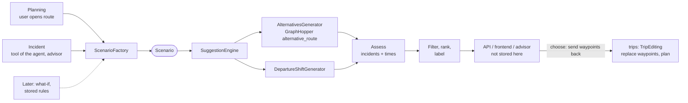

# Route suggestions (`recommendations`)

- **Status:** planning implemented (scenario, `ALTERNATIVES`, assessment, ranking, via points, saving the choice) and connected in the frontend (`RouteSheet`, map). Since `V38__drop_suggestion_sets.sql` suggestions are no longer stored, only the chosen option as waypoints. Incidents implemented in the backend (`forConsequence`, `DEPARTURE_SHIFT`, only affected sections, already under way, choice of a new departure), called by the agent in the module `advisor`, see [advisor.md](advisor.md).
- **Goal:** for a route the user gets up to `n` suggestions for how to drive. The same logic provides suggestions when an incident hits the planned route (detour, later departure, accept the delay).
- **Basic idea:** a suggestion always comes from a **scenario** (starting situation: points, departure, restrictions in the network, reference route). Planning and incident differ only in how the scenario is built. Generating, assessing, filtering, API and frontend are shared.
- **Suggestions are transient:** they are recalculated on every request and not stored (decision Philipp 2026-11-05). Only what the user chooses is stored, as waypoints of the route. The module stores nothing for incidents either. **Changed 2026-11-06 (Lukas):** what the agent proposes for incidents is stored by the module `advisor` in its own tables, because nobody waits for the result in an automatic run, see [advisor.md](advisor.md). State such as "notified at" belongs to the consequence or the notification.
- Replaced the sample data in `frontend/src/trips/routeExamples.ts` and closes the open point "detour for `BLOCKED`" from [domain.md](domain.md#open).

## Flow

1. **Build the scenario** (`ScenarioFactory`, the only trigger-dependent part).
2. **Generate candidates:** every active generator provides 0..* candidates.
3. **Assess:** passage times per segment, active incidents on the candidate (same overlap rule as `ConsequenceMatcher`), arrival including waiting time and delays.
4. **Filter and rank:** too similar, too slow and undrivable candidates are dropped, the best `n` remain.
5. **Label:** features (`FASTEST`, `AVOIDS_INCIDENT`, …) and the main road of the deviating part (e.g. "via SH 2").
6. **Respond** without storing: per option the via points (`waypoints`) that reproduce it when chosen.
7. **Choose:** the client sends back the waypoints of the chosen option, they become waypoints of the route via `TripEditing` (committed, then `RoutePlanning.plan`).

## Scenario (`recommendations.logic`)

- `Scenario` (record, not persisted):
  - `routeId`, `trigger` (`PLANNING`, `INCIDENT`, later `WHAT_IF`), optional `consequenceId`.
  - `start`: stop or estimated position (see below), `end`: target stop, `vias`: waypoints of the user (`RoutePoint` with `VIA`), empty with `waypoints` = `IGNORE`.
  - `waypoints`: `IGNORE` (only start and destination) or `FOLLOW` (via all waypoints, route split into sections).
  - Sections for which alternatives are searched: not in the scenario, `AlternativesGenerator` decides from `constraints` (see incident below). Planning searches in all sections.
  - `departure`: departure at the start.
  - `constraints`: `blockedSegmentIds`, `delayedSegments` (segment id → delay), `avoidedSegmentIds` (penalty instead of block, e.g. preferences). Only for routing: for incidents the assessment reads the same incidents directly, otherwise a delay would count twice and a nightly closure would apply all day (`Scenario.evaluationConstraints`).
  - `reference`: planned sections of the route that still lie ahead of the user (empty if not planned yet). Basis for the assessment "as planned", share of common route and "faster/slower than before".
  - `avoid`, `earliestDeparture`: periods and earliest possible departure for `DEPARTURE_SHIFT`, empty for planning.
  - `generators`: which generators run, `count`: desired number `n` (default 3, at most 5).
- **Planning** (`ScenarioFactory.forPlanning(routeId, includeWaypoints, departure?)`):
  - Flag `includeWaypoints` (default `false`): suggestions only between start and target stop, waypoints of the user are ignored (`waypoints` = `IGNORE`). One GraphHopper request, free suggestions also away from the previous waypoints. With `true` → `FOLLOW`, sections as under [Generators](#generators).
  - The reference is still the planned route with waypoints, so that the user can compare ("as planned via Arthur's Pass").
  - Departure as in `RoutePlanning` (departure at the start stop) or `departureAt` from the request (not stored at the stop). Missing coordinates or departure → same results as `PlanResult` (`MISSING_COORDINATES`, `MISSING_DEPARTURE`), no suggestions.
  - **Substitute departure in the frontend:** if the start stop has no departure (common when entering), the frontend sends the arrival at the start stop as `departureAt`, otherwise 09:00 on the first day of the trip (`substituteDeparture`). It then shows driving time and distance, but no arrival times. Route without sections (planning failed or discarded) → no reference.
  - No restrictions in the network. Known incidents are only assessed, not avoided: the user sees "leads through roadworks SH 1" on the suggestion.
  - Generators: `ALTERNATIVES` (also provides the fastest).
- **Incident** (`ScenarioFactory.forConsequence`):
  - Always `waypoints` = `FOLLOW`: the user's waypoints stay, no flag.
  - Like planning, plus from the consequences of the route that count (`DELAYED` or `TOO_LATE`, not `MARGINAL`, not over, the requested one always): closure → segments in `blockedSegmentIds`, otherwise the assessed delay (also the assumption of the source) proportionally in `delayedSegments`. This way the same applies as in the assessment ([consequence-assessment.md](consequence-assessment.md)), e.g. `HEAVY_ONLY` has no effect.
  - **Only affected sections new:** `AlternativesGenerator` first routes every section (between start, waypoints and destination) without restrictions. If the path does not touch a restricted segment, it stays. Only otherwise does GraphHopper search for alternatives. A smaller, understandable change ("detour between Arthur's Pass and Greymouth"). **Deviation from the draft:** the sections do not know which section they belong to, therefore re-routed instead of taken from the reference, the path matches that of the next planning. A curve at the curbside may differ.
  - If GraphHopper finds no detour: no `options`, the reference stays as a comparison, problem `WAYPOINT_UNREACHABLE` (with waypoints, the user must move or remove one) or `NO_ROUTE` (without).
  - Reference = currently planned route. Generators as requested by the caller: `ALTERNATIVES`, `DEPARTURE_SHIFT`, `count` suggestions per call.
  - **Already under way** (departure passed, arrival not): the start is the estimated position now = middle of the section whose expected passage is the first to end after `now`. Waypoints behind it are dropped (comparison via the next section, because sections do not know their section of the route). Suggestions and reference only from there, `DEPARTURE_SHIFT` is omitted. Real position (GPS from the app) later as its own `start`.
  - Consequence over (`isOver`) or route finished → problem `CONSEQUENCE_PASSED`.
- **Later** (`WHAT_IF`): try a different departure, road blocked by the user, stored rules from [network.md](network.md#open) ("scenarios as stored rules"). Only a new factory method, the rest stays.

## Generators

- Interface `CandidateGenerator { List<Candidate> generate(Scenario) }`, one Spring bean per generator with `kind()`. No `GeneratorContext`: the bean gets `Routing` and `SegmentQueries` injected.
- `Candidate`: origin (`kind`), `RouteResult`, possibly changed departure, via points that are stored as waypoints when chosen.
- **`ALTERNATIVES`:** GraphHopper generates the suggestions with `algorithm=alternative_route` (`Routing.alternatives`, see [Interfaces](#interfaces)). Blocks and delays of the scenario take effect via the same weighting as in normal routing, so GraphHopper avoids the incident itself.
  - Parameters: `alternative_route.max_paths` = `n + 1` (reserve in case a suggestion drops out after the assessment), `max_weight_factor` 1.4, `max_share_factor` 0.6. With these GraphHopper already filters out too similar and too long routes. Values in `RecommendationProperties`.
  - Works with LM (`LMRoutingAlgorithmFactory` knows `alternative_route`), no CH needed.
  - The first path is the fastest route, label `FASTEST`.
  - **Limits in GraphHopper 11.1** (`Router.routeAlt`) and how we work around them:
    - Only two points: route without waypoints → one request stop → stop. `IGNORE` (default for planning) → likewise one request stop → stop. `FOLLOW` with waypoints → one request with alternatives per section (stop → via, via → via, via → stop), for incidents only for affected sections, then combine: combinations by total duration, the best `n + 1` go on to the assessment.
      - Combination happens section by section, after each only the best `n + 1` remain (instead of a full cross product, which grows strongly with many waypoints).
    - No `pass_through`: combinations that turn at a via point (last segment of a section = opposite direction of the first of the next, `SegmentInfo.reverseId`) are dropped.
      - Exception: if all combinations turn there, they stay. A via point on a dead end can only be left this way, `Routing.route` also turns there (Wellington test: Kelburn lands on a 39 m spur road).
    - No `curbsides`: `Routing.route` has not set them either since 2026-11-07, see [network.md](network.md#routing-details). What comes as a suggestion can thus also be planned.
  - If GraphHopper returns fewer than `n` routes (short routes, little network), the user gets fewer suggestions. No own alternatives alongside.
- **Keeping the route (no generator, changed 2026-11-06):** "as planned" is already in `reference`, a separate `KEEP_ROUTE` would only add a second copy. With a closure the reference carries `blocked`, its arrival does not include the waiting; the waiting time is on the consequence (`assessedDelay`, `expectedArrival`).
- **`DEPARTURE_SHIFT`** (`DepartureShiftGenerator`): at most one per direction across all incidents that count, route = reference, no routing, only new passage times:
  - Leave later: departure such that every affected section is reached at the earliest at the end of the time window or validity plus buffer (`departure-shift-buffer`, default 15 min). Omitted if an incident has no end or the departure would be more than `departure-shift-max` (default 24 h) later.
  - Leave earlier: leave every section before the start of the time window or validity minus buffer, only if the new departure is not in the past and not before the arrival at the start stop.
  - If the new time runs into another closure, the assessment filters out the suggestion.
  - **Buffer and tolerance (Lukas, 2026-11-06):** the buffer stays 15 min and thus matches the smallest tolerance of the assessment ([consequence-assessment.md](consequence-assessment.md#passage-tolerance-decided-2026-11-04)). After the choice the route may therefore still be marked as "tight" (`MARGINAL`), but never as `TOO_LATE`.
- New generators (e.g. preferences "no unpaved roads", avoid ferries) only as a new bean and `kind`, engine and schema stay.

## Assessment, filtering, ranking

- **Assessment** per candidate (`CandidateEvaluator`):
  - Passage per segment as in `RoutePlanning.sections` (departure plus durations before), plus delays from `delayedSegments` and from incidents on the path, propagated to all following segments (resolves the open point "propagate delay" for suggestions).
  - Active incidents on the segments with overlap → `conflicts` (incident, impact, delay). Same rule as `ConsequenceMatcher`, for this a pure function `IncidentOverlap` in `incidents.logic`, used by both. If the incident has time windows, the passage must additionally lie in a window (`ActiveIncident.windows`). As in the assessment, the assumption of the source also counts as delay, `HEAVY_ONLY` has no effect (also applies to planning, changed 2026-11-06).
  - Result: arrival, distance, driving time, waiting time, delay, share of common route with the reference, `BLOCKED` yes/no.
- **Filtering:**
  - Candidate leads over a closure at the time of passage → out.
  - Similarity and length are checked by GraphHopper (`max_share_factor`, `max_weight_factor`). Only checked ourselves what GraphHopper cannot see: combined sections (share of common route > 0.6 with a better placed suggestion → out).
  - All thresholds in `RecommendationProperties`.
- **Ranking:** by arrival at the destination (incl. waiting and delay), then distance. At most `n` suggestions, at most one `DEPARTURE_SHIFT` per direction.
- **Labelling** (`labels`, several possible): `FASTEST`, `SHORTEST`, `CURRENT` (equal to the reference), `AVOIDS_INCIDENT`, `HAS_INCIDENT`, `LATER_DEPARTURE`, `EARLIER_DEPARTURE`, `FERRY` (not set yet, `SegmentInfo` does not know the ferry). `CURRENT`: share of common route with the reference ≥ `current-shared-ratio` (0.95). Plus `via`: most frequent `ref` or road name in the deviating part (via `SegmentQueries`), e.g. "via SH 2". The texts are built by the frontend.

## Data model

- **No own tables:** `V29__recommendations.sql` had created `suggestion_set`, `route_option` and sub-tables, `V38__drop_suggestion_sets.sql` deletes them again. Suggestions are records in `recommendations.logic` (`SuggestionResult`, `SuggestedOption` with `Point` and `Conflict`), the geometry as `List<GeoPoint>` (no JTS in `recommendations`).
- `SuggestedOption`: `rank` (1 = best), `kind`, `labels`, `via`, `departureAt`, `arrivalAt`, `distanceMeters`, `duration`, `waiting`, `delay`, `sharedRatio`, `geometry`, `points`, `conflicts`, `path`.
  - `path`: driven segments in order, for `Stopovers`. Not in the API.
  - `points`: via points (coordinate, `roadHint`, optional `waypointId`) that become waypoints when chosen. With `FOLLOW` the existing waypoints of the user carry their id, they are kept when chosen.
- Remains from V29: `waypoint.origin` (`USER`, `SUGGESTION`, `VARCHAR(16)`, default `USER`, also in `waypoint_aud`). The frontend shows generated waypoints differently, "back to the fastest" only removes `SUGGESTION` waypoints.
- What is dropped as a result: reusing identical suggestions (`basisHash`), status `STALE`/`APPLIED`/`EXPIRED`, clean-up job, evaluation of which options were offered and chosen. The choice itself is in the Envers history of the waypoints.

## Saving the choice

- What is stored is the **intention**, not the segment list (as with waypoints): via points that reproduce the suggestion.
- Determining via points when generating (`ViaPointExtractor`): with `FOLLOW` the user's waypoints stay, with `IGNORE` they do not; for every contiguous section that deviates from the fastest route, one point on the segment nearest to the middle of that section (by distance; very short segments last), with its `ref` as `roadHint`. Then more points in the middle of the longest stretch of the suggestion the route over the points still misses, until that route fits: it drives ≥ 90 % of the suggestion (`via-reproduce-ratio`), ≥ 90 % of it lies on the suggestion, and it neither misses nor adds a stretch longer than 2 km (`via-max-gap-meters`). At most 12 points (`max-via-points`), at most 3 segments tried per point (`max-via-points-per-section`).
- Every point is checked when set (routing like `RoutePlanning`): it is kept only if the route can be planned via all points **and** fits the suggestion better than without it (missed plus added distance gets smaller), otherwise the next segment of the stretch is tried. If the option does not fit in the end, there is a warning in the log.
- Why both directions (changed 2026-11-11): with only "≥ 90 % of the suggestion driven", a point on a slow detour far from where it leaves the fastest route was accepted although the planned route drove the old way to it and back (Kingston → Nelson via Nevis Road: the old way along Lake Wakatipu through the closure, then a spur down Nevis Road). On a long route the 10 % allowed that easily.
- **For incidents:** reference and check are the path **without** restrictions, because that is how `RoutePlanning` plans after the choice. Otherwise the best detour would get no point, and the new planning would lead through the incident again.
- This way the choice survives `NetworkRefreshed` and changes of the departure, and the block itself does not have to be stored permanently.
- `RouteChoice.choose(appUserId, routeId, points)`:
  1. The route must belong to the user, otherwise `TripItemNotFoundException` (`404`).
  2. At most `max-chosen-points` (25) points, valid coordinates; a point with `waypointId` must be a waypoint of the route, otherwise `400`.
  3. `TripEditing.replaceWaypoints(appUserId, tripId, routeId, points)`: points with `waypointId` keep the user's id, coordinate, name and `origin`, all others become waypoints with `origin` `SUGGESTION`. Missing waypoints are deleted (with `IGNORE` therefore those of the user, the frontend points this out beforehand). Empty list = fastest route without waypoints. `TripEditing` commits, discards the old sections and plans the route.
  4. `RoutePlanning.plan` → `RouteChanged` → `ConsequenceMatcher` creates consequences for the new path, the old one is already gone with the discarded sections.
  5. Response: `PlanResult` of the route. If the planning fails (`MISSING_DEPARTURE`, `ROUTING_UNAVAILABLE`, `NO_ROUTE`), the waypoints stay anyway (rule of `TripEditing`), the route shows the status.
- **Concurrent changes:** no check for now, the last choice wins (decision Philipp 2026-11-05). Later in general via versioning of the entities (`@Version`, number incremented on every change); for routes the two stops also count.
- The client may send any points, these are the same rights as `PUT /trips/{tripId}/routes/{routeId}/waypoints` (own route). Allowing only calculated options (e.g. via a signed token) is deliberately not implemented.
- `DEPARTURE_SHIFT` (new departure at the start stop): `choice` with `departureAt` only sets the departure via `RouteChoice.chooseDeparture` and `TripEditing.updateStop`, the waypoints stay (`waypoints` in the body is then ignored). Departure in the past: `400`.

## Triggers and life cycle

- **Planning:** on request (API), synchronous, new on every request. Routing outside the transaction as in `RoutePlanning`. Time budget: one `alternative_route` request per section, with LM a few ms up to ~100 ms for long routes. If that is not enough, an in-memory cache, no database.
- **Incident (changed 2026-11-06, replaces `ConsequenceChanged`):** `recommendations` no longer listens to any event. The agent in the module `advisor` calls `Suggestions.forConsequence` as a tool, automatically for `TOO_LATE` (`RouteTooLate`), for `DELAYED` only at the user's request, see [advisor.md](advisor.md#triggers). Routing still runs outside transactions.
  - So that nobody is notified twice, the consequence or a notification log remembers "notified at".
  - An option becomes undrivable between display and choice: after saving `RoutePlanning` replans, `ConsequenceMatcher` finds the block, a new notice is created.
- **`RoutingUnavailableException`:** planning → `503`, incident → again later (same mechanism as the open replanning for `ROUTING_UNAVAILABLE`).
- **Notification** (open): contains the best suggestion as text and links the notice.

## Interfaces

- `recommendations.logic` to the outside: `Suggestions.forPlanning(appUserId, routeId, count, includeWaypoints, departure?)` → `SuggestionResult` (`waypointMode`, `departureAt`, `options`, `reference`, possibly a problem such as `MISSING_DEPARTURE`), `RouteChoice.choose(appUserId, routeId, points)` → `Chosen(tripId, routeId, PlanResult)`, `Suggestions.forConsequence(appUserId, consequenceId, kinds, count, departure?)` → `SuggestionResult`, used by the module `advisor`, `RouteChoice.chooseDeparture(appUserId, routeId, departureAt)`, `Stopovers.onPlannedRoute` and `onOption` (places for overnight stays on the way, used by `advisor`, see [advisor.md](advisor.md#find_overnight_areas)).
- **`network`** (extension of `RouteOptions`, replaces the sentence "currently only `blockedSegmentIds`" in [network.md](network.md#interfaces-networklogic)):
  - `RouteOptions(blockedSegmentIds, delayedSegments: Map<Long, Duration>)`.
  - `BlockedEdgesWeighting` becomes `ScenarioWeighting`: blocked → infinite, delay → weight + seconds (≥ 0). Weights only increase, the LM estimate stays valid. Applies to normal routing and `alternative_route` alike.
  - New `Routing.alternatives(RoutePoint from, RoutePoint to, RouteOptions, AlternativeOptions)`: exactly two points, `algorithm=alternative_route`, without `pass_through`. Result `List<RouteResult>`, first entry = fastest. `AlternativeOptions`: `maxPaths`, `maxWeightFactor`, `maxShareFactor`.
  - New `Routing.evaluate(segmentIds)` not needed: durations of the reference are already in the sections.
- **`incidents`:** `IncidentOverlap` (pure function, also used by `ConsequenceMatcher`), `ActiveIncidents.onSegments(segmentIds, from)`, `consequence(id)`, `consequencesOnRoute(routeId)` → `RouteConsequence` (reading, records, no entities).
- **`trips`:** `TripEditing.replaceWaypoints(…)` and `updateStop(…)` (existing, `NewWaypoint` gets `origin`), reading stops, waypoints and sections via `RouteSnapshots.of(appUserId, routeId)` → record `RouteSnapshot` in `trips.logic` instead of repositories (foreign or unknown route: `TripItemNotFoundException`).

### Dependencies

- `recommendations → network`, `→ incidents`, `→ trips`. None of these modules knows `recommendations`, no cycle. `advisor → recommendations` calls the calculation. `recommendations` listens to no events.
- New compared to [architecture.md](architecture.md#dependencies-between-modules): `recommendations → trips` (reading the route, saving the choice). The calculation stays in `recommendations`: in `trips` the assessment with active incidents would result in a cycle `trips ↔ incidents`.

## API

- `SuggestionController`:
- `POST /api/v1/routes/{routeId}/suggestions` (body optional: `count` 1–5, default 3, `includeWaypoints` default `false`, `departureAt` instead of the departure at the stop, not stored): recalculates, stores nothing. Missing departure or coordinates, `NO_ROUTE`: `200` with empty `options` and `problem`.
  - Response: `routeId`, `waypointMode`, `departureAt`, `options`, `reference` (planned route for comparison, incidents as of now), `problem`.
  - Per option: rank, `kind`, `labels`, `via`, departure, arrival, distance, duration/waiting/delay in seconds, `sharedRatio`, `geometry` as a list of coordinates, `waypoints` (coordinate, `roadHint`, `waypointId`), `conflicts`. No id.
- `PUT /api/v1/routes/{routeId}/choice` (body `waypoints` = the `waypoints` of the chosen option, or `departureAt` for a new departure): stores the choice, plans the route. Response `tripId`, `routeId`, `planOutcome`, `planReason`; the frontend reads the route via `GET /trips/{tripId}/routes/{routeId}` or `GET /trips/{tripId}/route-lines`.
- `GET /api/v1/trips/{tripId}/route-lines` (in `trips`, `RouteLines`): per planned route `geometry`, `distanceMeters`, `durationSeconds`, `via` (road hints of the `SUGGESTION` waypoints) for the map. Unplanned routes are missing.
- Errors (`RecommendationExceptionHandler`): foreign or unknown route `404` `TRIP_NOT_FOUND`, `count` outside 1–5 or invalid points `400` `INVALID_SUGGESTION_INPUT`, no graph `503` `ROUTING_UNAVAILABLE`.
- Later MCP tool `suggest_routes` on the same logic: returns options with `waypoints`, the agent then calls `choice`.

## Frontend

- **`RouteSheet`** (`/reisen/{tripId}/routen/{routeId}`): loads up to three suggestions on every opening (`routesApi.fetchSuggestions`), radio list with a title from labels and `via` ("Fastest · via SH 1", "Alternative via SH 7"), driving time, km, arrival (not with substitute departure), difference to the fastest ("+18 min"), chips "Currently planned"/"Avoids notice", warning line per conflict. Texts in `trips/routeOptionText.ts`.
  - "Take this route" calls `choice` with the `waypoints` of the option, reloads the trip. If `planOutcome` is not `PLANNED` (e.g. `MISSING_DEPARTURE`: start stop without departure, suggestions came from the substitute departure), the sheet stays open with "Route saved, but not planned yet" and the reason. The waypoints are stored, planning happens as soon as the departure is entered. Only one option: without radio, "Confirm route".
  - States: skeleton while loading, `MISSING_COORDINATES`, `NO_ROUTE`, `503` with "Try again".
  - Switch "Consider intermediate destinations" only if the route has waypoints of the user (`USER`), off = default; then the note "Your intermediate destinations will be removed".
  - Sheet without mask (60 % height), the map above shows all options (`RoutePreview` in the `TripContext`), the chosen one black, the others grey; tapping a line selects it.
- **After "Add stop"** `StopSheet` opens the `RouteSheet` of the new route with `?neu=1` (button "Later") if both stops have coordinates. Whoever chooses "Later" keeps the automatically planned fastest route.
- **Map** (`TripMap`): planned routes from `route-lines` instead of straight lines, unplanned routes dashed as a straight line. `RouteRow` shows "via SH 1 · 3 h 40 min".
- Open: `IncidentSheet` (incident) with the same list under "What you can do", `reference` as "As planned (+45 min)"; generated waypoints as "from suggestion" in a waypoint list.

## Tests

- `SuggestionsTest` on the Wellington extract: planning without flag ignores waypoints, with flag it follows them; suggestions are recalculated on every request; a closure is assessed, not avoided; missing departure, `count` out of range, foreign route.
- `AlternativesAndViaPointsTest`: sections combined, combination with turning at the via point discarded, via points reproduce the suggestion.
- `SuggestionApiTest`: response without ids, substitute departure, `choice` replaces waypoints (`SUGGESTION`) or keeps those of the user, invalid points `400`, choice around a closure removes the consequence, `route-lines`.
- Frontend: `routeOptionText.test.ts` (title, duration, distance, substitute departure).
- `SuggestionsForConsequenceTest`: avoid a closure, and after the choice the new planning also leads around it; delay counts once; waypoints stay, only the affected section changes; `WAYPOINT_UNREACHABLE`; new departure before and after a time window, no later one without end; already under way; over; `HEAVY_ONLY`; inputs; foreign consequence.
- `DepartureShiftGeneratorTest` (times, limits), `CandidateEvaluatorTest` (assumption of the source, `HEAVY_ONLY`, passages).

## Open

- Several routes of a trip: a delay on route 1 shifts route 2. First suggestions per route, the chain later.
- Preferences on the trip (avoid unpaved, avoid ferries) as restrictions in the scenario.
- Suggestions that change stops (moving an overnight stay, booking affected) come with the accommodation tools in `advisor`, see [advisor.md](advisor.md#later-accommodations-and-message-to-the-accommodation).
- Real position while driving instead of estimated.
- Traffic-dependent times (rush hours) are missing, times only come from GraphHopper.
