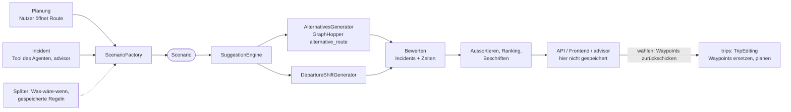

# Streckenvorschläge (`recommendations`)

- **Status:** Planung umgesetzt (Szenario, `ALTERNATIVES`, Bewertung, Ranking, Via-Punkte, Auswahl speichern) und im Frontend angebunden (`RouteSheet`, Karte). Seit `V38__drop_suggestion_sets.sql` werden Vorschläge nicht mehr gespeichert, nur die gewählte Option als Waypoints. Incidents im Backend umgesetzt (`forConsequence`, `DEPARTURE_SHIFT`, nur betroffene Abschnitte, bereits unterwegs, Wahl einer neuen Abfahrt), aufgerufen vom Agenten im Modul `advisor`, siehe [advisor.md](advisor.md).
- **Ziel:** Für eine Route bekommt der Nutzer bis zu `n` Vorschläge, wie er fahren kann. Dieselbe Logik liefert Vorschläge, wenn ein Incident die geplante Route trifft (Umfahrung, spätere Abfahrt, Verzögerung hinnehmen).
- **Grundidee:** Ein Vorschlag entsteht immer aus einem **Szenario** (Ausgangslage: Punkte, Abfahrt, Einschränkungen im Netz, Referenzroute). Planung und Incident unterscheiden sich nur darin, wie das Szenario gebaut wird. Erzeugen, Bewerten, Aussortieren, API und Frontend sind gemeinsam.
- **Vorschläge sind flüchtig:** Sie werden bei jeder Anfrage neu berechnet und nicht gespeichert (Entscheidung Philipp 2026-11-05). Gespeichert wird nur, was der Nutzer wählt, als Waypoints der Route. Das Modul speichert auch bei Incidents nichts. **Geändert 2026-11-06 (Lukas):** Was der Agent bei Incidents vorschlägt, speichert das Modul `advisor` in eigenen Tabellen, weil bei einem automatischen Lauf niemand auf das Ergebnis wartet, siehe [advisor.md](advisor.md). Zustand wie „benachrichtigt am“ gehört an die Consequence bzw. die Benachrichtigung.
- Hat die Beispieldaten in `frontend/src/trips/routeExamples.ts` ersetzt und schließt den offenen Punkt „Umfahrung bei `BLOCKED`“ aus [domain.md](domain.md#offen).

## Ablauf

1. **Szenario bauen** (`ScenarioFactory`, einziger auslöserabhängiger Teil).
2. **Kandidaten erzeugen:** jeder aktive Generator liefert 0..* Kandidaten.
3. **Bewerten:** Durchfahrtszeiten je Segment, aktive Incidents auf dem Kandidaten (gleiche Überschneidungsregel wie `ConsequenceMatcher`), Ankunft inklusive Wartezeit und Verzögerungen.
4. **Aussortieren und Ranking:** zu ähnliche, zu langsame und unfahrbare Kandidaten fallen weg, die besten `n` bleiben.
5. **Beschriften:** Merkmale (`FASTEST`, `AVOIDS_INCIDENT`, …) und Hauptstraße des abweichenden Teils (z. B. „über SH 2“).
6. **Antworten** ohne zu speichern: je Option die Via-Punkte (`waypoints`), die sie beim Wählen reproduzieren.
7. **Wählen:** Der Client schickt die Waypoints der gewählten Option zurück, sie werden Waypoints der Route über `TripEditing` (committet, dann `RoutePlanning.plan`).

## Szenario (`recommendations.logic`)

- `Scenario` (Record, nicht persistiert):
  - `routeId`, `trigger` (`PLANNING`, `INCIDENT`, später `WHAT_IF`), optional `consequenceId`.
  - `start`: Stop oder geschätzte Position (siehe unten), `end`: Ziel-Stop, `vias`: Waypoints des Nutzers (`RoutePoint` mit `VIA`), leer bei `waypoints` = `IGNORE`.
  - `waypoints`: `IGNORE` (nur Start und Ziel) oder `FOLLOW` (über alle Waypoints, Route in Abschnitte geteilt).
  - Abschnitte, für die Alternativen gesucht werden: nicht im Szenario, `AlternativesGenerator` entscheidet aus `constraints` (siehe Incident unten). Planung sucht in allen Abschnitten.
  - `departure`: Abfahrt am Start.
  - `constraints`: `blockedSegmentIds`, `delayedSegments` (Segment-Id → Verzögerung), `avoidedSegmentIds` (Strafe statt Sperre, z. B. Vorlieben). Nur für das Routing: Die Bewertung liest bei Incidents dieselben Incidents direkt, sonst zählte eine Verzögerung doppelt und eine nächtliche Sperrung gälte den ganzen Tag (`Scenario.evaluationConstraints`).
  - `reference`: geplante Sections der Route, die noch vor dem Nutzer liegen (leer, wenn noch nicht geplant). Grundlage für die Bewertung „wie geplant“, Anteil gemeinsamer Strecke und „schneller/langsamer als bisher“.
  - `avoid`, `earliestDeparture`: Zeiträume und frühestmögliche Abfahrt für `DEPARTURE_SHIFT`, leer bei der Planung.
  - `generators`: welche Generatoren laufen, `count`: gewünschte Anzahl `n` (Standard 3, höchstens 5).
- **Planung** (`ScenarioFactory.forPlanning(routeId, includeWaypoints, departure?)`):
  - Flag `includeWaypoints` (Standard `false`): Vorschläge nur zwischen Start- und Ziel-Stop, Waypoints des Nutzers werden ignoriert (`waypoints` = `IGNORE`). Eine GraphHopper-Anfrage, freie Vorschläge auch abseits der bisherigen Waypoints. Mit `true` → `FOLLOW`, Abschnitte wie unter [Generatoren](#generatoren).
  - Die Referenz ist trotzdem die geplante Route mit Waypoints, damit der Nutzer vergleichen kann („wie geplant über Arthur's Pass“).
  - Abfahrt wie in `RoutePlanning` (Abfahrt am Start-Stop) oder `departureAt` aus der Anfrage (nicht am Stop gespeichert). Fehlende Koordinaten oder Abfahrt → gleiche Ergebnisse wie `PlanResult` (`MISSING_COORDINATES`, `MISSING_DEPARTURE`), keine Vorschläge.
  - **Ersatz-Abfahrt im Frontend:** Hat der Start-Stop keine Abfahrt (beim Erfassen häufig), schickt das Frontend als `departureAt` die Ankunft am Start-Stop, sonst 09:00 am ersten Reisetag (`substituteDeparture`). Es zeigt dann Fahrzeit und Strecke, aber keine Ankunftszeiten. Route ohne Sections (Planung gescheitert oder verworfen) → keine Referenz.
  - Keine Einschränkungen im Netz. Bekannte Incidents werden nur bewertet, nicht umfahren: der Nutzer sieht „führt durch Baustelle SH 1“ am Vorschlag.
  - Generatoren: `ALTERNATIVES` (liefert auch die schnellste).
- **Incident** (`ScenarioFactory.forConsequence`):
  - Immer `waypoints` = `FOLLOW`: die Waypoints des Nutzers bleiben, kein Flag.
  - Wie Planung, dazu aus den Consequences der Route, die zählen (`DELAYED` oder `TOO_LATE`, nicht `MARGINAL`, nicht vorbei, die angefragte immer): Sperrung → Segmente in `blockedSegmentIds`, sonst bewertete Verzögerung (auch die Annahme der Quelle) anteilig in `delayedSegments`. So gilt dasselbe wie in der Bewertung ([consequence-assessment.md](consequence-assessment.md)), z. B. wirkt `HEAVY_ONLY` nicht.
  - **Nur betroffene Abschnitte neu:** `AlternativesGenerator` routet jeden Abschnitt (zwischen Start, Waypoints und Ziel) zuerst ohne Einschränkungen. Berührt der Weg kein eingeschränktes Segment, bleibt er. Nur sonst sucht GraphHopper Alternativen. Kleinere, verständliche Änderung („Umfahrung zwischen Arthur's Pass und Greymouth“). **Abweichung vom Entwurf:** Die Sections wissen nicht, zu welchem Abschnitt sie gehören, deshalb neu geroutet statt aus der Referenz, der Weg entspricht dem der nächsten Planung. Eine Kurve an der Bordsteinseite kann abweichen.
  - Findet GraphHopper keine Umfahrung: keine `options`, die Referenz bleibt als Vergleich, Problem `WAYPOINT_UNREACHABLE` (mit Waypoints, der Nutzer muss einen verschieben oder entfernen) oder `NO_ROUTE` (ohne).
  - Referenz = aktuell geplante Route. Generatoren nach Wunsch des Aufrufers: `ALTERNATIVES`, `DEPARTURE_SHIFT`, je Aufruf `count` Vorschläge.
  - **Bereits unterwegs** (Abfahrt vorbei, Ankunft nicht): Start ist die geschätzte Position jetzt = Mitte der Section, deren erwartete Durchfahrt als erste nach `now` endet. Waypoints dahinter fallen weg (Vergleich über die nächste Section, weil Sections ihren Abschnitt nicht kennen). Vorschläge und Referenz nur ab dort, `DEPARTURE_SHIFT` entfällt. Echte Position (GPS aus der App) später als eigener `start`.
  - Consequence vorbei (`isOver`) oder Route zu Ende → Problem `CONSEQUENCE_PASSED`.
- **Später** (`WHAT_IF`): andere Abfahrt ausprobieren, vom Nutzer gesperrte Straße, gespeicherte Regeln aus [network.md](network.md#offen) („Szenarien als gespeicherte Regeln“). Nur neue Factory-Methode, Rest bleibt.

## Generatoren

- Interface `CandidateGenerator { List<Candidate> generate(Scenario) }`, je Generator eine Spring-Bean mit `kind()`. Kein `GeneratorContext`: die Bean bekommt `Routing` und `SegmentQueries` injiziert.
- `Candidate`: Herkunft (`kind`), `RouteResult`, ggf. geänderte Abfahrt, Via-Punkte, die beim Wählen als Waypoints gespeichert werden.
- **`ALTERNATIVES`:** GraphHopper erzeugt die Vorschläge mit `algorithm=alternative_route` (`Routing.alternatives`, siehe [Schnittstellen](#schnittstellen)). Sperren und Verzögerungen des Szenarios wirken über dieselbe Gewichtung wie beim normalen Routing, GraphHopper umfährt den Incident also selbst.
  - Parameter: `alternative_route.max_paths` = `n + 1` (Reserve, falls ein Vorschlag nach der Bewertung wegfällt), `max_weight_factor` 1,4, `max_share_factor` 0,6. GraphHopper sortiert damit schon zu ähnliche und zu lange Strecken aus. Werte in `RecommendationProperties`.
  - Funktioniert mit LM (`LMRoutingAlgorithmFactory` kennt `alternative_route`), kein CH nötig.
  - Der erste Pfad ist die schnellste Strecke, Label `FASTEST`.
  - **Grenzen in GraphHopper 11.1** (`Router.routeAlt`) und wie wir sie umgehen:
    - Nur zwei Punkte: Route ohne Waypoints → eine Anfrage Stop → Stop. `IGNORE` (Standard bei Planung) → ebenfalls eine Anfrage Stop → Stop. `FOLLOW` mit Waypoints → je Abschnitt (Stop → Via, Via → Via, Via → Stop) eine Anfrage mit Alternativen, bei Incidents nur für betroffene Abschnitte, dann kombinieren: Kombinationen nach Gesamtdauer, die besten `n + 1` weiter in die Bewertung.
      - Kombiniert wird Abschnitt für Abschnitt, nach jedem bleiben nur die besten `n + 1` (statt vollem Kreuzprodukt, das mit vielen Waypoints stark wächst).
    - Kein `pass_through`: Kombinationen, die an einem Via-Punkt wenden (letztes Segment eines Abschnitts = Gegenrichtung des ersten des nächsten, `SegmentInfo.reverseId`), fallen weg.
      - Ausnahme: Wenden alle Kombinationen dort, bleiben sie. Ein Via-Punkt auf einer Sackgasse lässt sich nur so verlassen, auch `Routing.route` wendet dort (Wellington-Test: Kelburn landet auf einer 39-m-Stichstraße).
    - Keine `curbsides`: Vorschläge ignorieren die Bordsteinseite an den Stops. Weil sie auch beim Planen nur weich gilt (`force_curbside=false`), ändert sich höchstens das letzte Stück. Nach dem Wählen plant `RoutePlanning` mit Bordsteinseite neu.
  - Liefert GraphHopper weniger als `n` Strecken (kurze Routen, wenig Netz), bekommt der Nutzer weniger Vorschläge. Keine eigenen Alternativen daneben.
- **Route behalten (kein Generator, geändert 2026-11-06):** „Wie geplant“ steckt schon in `reference`, ein eigener `KEEP_ROUTE` brächte nur eine zweite Kopie. Die Referenz führt bei einer Sperrung `blocked`, ihre Ankunft enthält das Warten nicht; die Wartezeit steht an der Consequence (`assessedDelay`, `expectedArrival`).
- **`DEPARTURE_SHIFT`** (`DepartureShiftGenerator`): höchstens je eine Richtung über alle zählenden Incidents, Strecke = Referenz, kein Routing, nur neue Durchfahrtszeiten:
  - Später fahren: Abfahrt so, dass jede betroffene Section frühestens am Ende von Zeitfenster bzw. Gültigkeit plus Puffer erreicht wird (`departure-shift-buffer`, Standard 15 min). Entfällt, wenn ein Incident kein Ende hat oder die Abfahrt mehr als `departure-shift-max` (Standard 24 h) später läge.
  - Früher fahren: jede Section vor Beginn von Zeitfenster bzw. Gültigkeit minus Puffer verlassen, nur wenn die neue Abfahrt nicht in der Vergangenheit und nicht vor der Ankunft am Start-Stop liegt.
  - Läuft die neue Zeit in eine andere Sperrung, sortiert die Bewertung den Vorschlag aus.
  - **Puffer und Toleranz (Lukas, 2026-11-06):** Der Puffer bleibt 15 min und entspricht damit der kleinsten Toleranz der Bewertung ([consequence-assessment.md](consequence-assessment.md#toleranz-der-durchfahrt-beschlossen-2026-11-04)). Nach der Wahl kann die Route deshalb weiter als „knapp“ (`MARGINAL`) markiert sein, nie aber als `TOO_LATE`.
- Neue Generatoren (z. B. Vorlieben „keine unbefestigten Straßen“, Fähre meiden) nur als neue Bean und `kind`, Engine und Schema bleiben.

## Bewertung, Aussortieren, Ranking

- **Bewertung** je Kandidat (`CandidateEvaluator`):
  - Durchfahrt je Segment wie in `RoutePlanning.sections` (Abfahrt plus Dauern davor), dazu Verzögerungen aus `delayedSegments` und aus Incidents auf dem Weg, fortgeschrieben auf alle folgenden Segmente (löst für Vorschläge den offenen Punkt „Verzögerung fortschreiben“).
  - Aktive Incidents auf den Segmenten mit Überschneidung → `conflicts` (Incident, Impact, Verzögerung). Gleiche Regel wie `ConsequenceMatcher`, dafür eine reine Funktion `IncidentOverlap` in `incidents.logic`, die beide nutzen. Hat der Incident Zeitfenster, muss die Durchfahrt zusätzlich in einem Fenster liegen (`ActiveIncident.windows`). Wie in der Bewertung gilt auch die Annahme der Quelle als Verzögerung, `HEAVY_ONLY` wirkt nicht (gilt auch bei der Planung, geändert 2026-11-06).
  - Ergebnis: Ankunft, Distanz, Fahrzeit, Wartezeit, Verzögerung, Anteil gemeinsamer Strecke mit der Referenz, `BLOCKED` ja/nein.
- **Aussortieren:**
  - Kandidat führt über eine Sperrung zur Zeit der Durchfahrt → raus.
  - Ähnlichkeit und Länge prüft GraphHopper (`max_share_factor`, `max_weight_factor`). Selbst geprüft nur, was GraphHopper nicht sehen kann: kombinierte Abschnitte (Anteil gemeinsamer Strecke > 0,6 mit einem besser platzierten Vorschlag → raus).
  - Alle Schwellen in `RecommendationProperties`.
- **Ranking:** nach Ankunft am Ziel (inkl. Warten und Verzögerung), dann Distanz. Höchstens `n` Vorschläge, höchstens ein `DEPARTURE_SHIFT` je Richtung.
- **Beschriften** (`labels`, mehrere möglich): `FASTEST`, `SHORTEST`, `CURRENT` (gleich der Referenz), `AVOIDS_INCIDENT`, `HAS_INCIDENT`, `LATER_DEPARTURE`, `EARLIER_DEPARTURE`, `FERRY` (noch nicht gesetzt, `SegmentInfo` kennt die Fähre nicht). `CURRENT`: Anteil gemeinsamer Strecke mit der Referenz ≥ `current-shared-ratio` (0,95). Dazu `via`: häufigste `ref` bzw. Straßenname im abweichenden Teil (über `SegmentQueries`), z. B. „über SH 2“. Texte baut das Frontend.

## Datenmodell

- **Keine eigenen Tabellen:** `V29__recommendations.sql` hatte `suggestion_set`, `route_option` und Untertabellen angelegt, `V38__drop_suggestion_sets.sql` löscht sie wieder. Vorschläge sind Records in `recommendations.logic` (`SuggestionResult`, `SuggestedOption` mit `Point` und `Conflict`), die Geometrie als `List<GeoPoint>` (kein JTS in `recommendations`).
- `SuggestedOption`: `rank` (1 = beste), `kind`, `labels`, `via`, `departureAt`, `arrivalAt`, `distanceMeters`, `duration`, `waiting`, `delay`, `sharedRatio`, `geometry`, `points`, `conflicts`.
  - `points`: Via-Punkte (Koordinate, `roadHint`, optional `waypointId`), die beim Wählen Waypoints werden. Bei `FOLLOW` steht an den bestehenden Waypoints des Nutzers ihre Id, sie bleiben beim Wählen erhalten.
- Bleibt aus V29: `waypoint.origin` (`USER`, `SUGGESTION`, `VARCHAR(16)`, Standard `USER`, auch in `waypoint_aud`). Das Frontend zeigt erzeugte Waypoints anders, „zurück zur schnellsten“ entfernt nur `SUGGESTION`-Waypoints.
- Was dadurch entfällt: Wiederverwenden gleicher Vorschläge (`basisHash`), Status `STALE`/`APPLIED`/`EXPIRED`, Aufräum-Job, Auswertung, welche Optionen angeboten und gewählt wurden. Die Wahl selbst steht in der Envers-Historie der Waypoints.

## Auswahl speichern

- Gespeichert wird die **Absicht**, nicht die Segmentliste (wie bei Waypoints): Via-Punkte, die den Vorschlag reproduzieren.
- Via-Punkte beim Erzeugen bestimmen (`ViaPointExtractor`): bei `FOLLOW` bleiben die Waypoints des Nutzers, bei `IGNORE` nicht; für jeden zusammenhängenden Abschnitt, der von der schnellsten Strecke abweicht, ein Punkt in der Mitte des längsten Segments dort, mit dessen `ref` als `roadHint`. Prüfen: Routing über diese Punkte ergibt ≥ 90 % gemeinsame Strecke mit dem Kandidaten, sonst weiteren Punkt im längsten noch abweichenden Abschnitt (höchstens 3 je Abschnitt).
- **Bei Incidents:** Bezug und Prüfung sind der Weg **ohne** Einschränkungen, denn so plant `RoutePlanning` nach der Wahl. Sonst bekäme die beste Umfahrung keinen Punkt, und die neue Planung führte wieder durch den Incident.
- So bleibt die Wahl nach `NetworkRefreshed` und Änderungen der Abfahrt erhalten, und die Sperre selbst muss nicht dauerhaft gespeichert werden.
- `RouteChoice.choose(appUserId, routeId, points)`:
  1. Route muss dem Nutzer gehören, sonst `TripItemNotFoundException` (`404`).
  2. Höchstens `max-chosen-points` (25) Punkte, gültige Koordinaten; ein Punkt mit `waypointId` muss ein Waypoint der Route sein, sonst `400`.
  3. `TripEditing.replaceWaypoints(appUserId, tripId, routeId, points)`: Punkte mit `waypointId` behalten Id, Koordinate, Name und `origin` des Nutzers, alle anderen werden Waypoints mit `origin` `SUGGESTION`. Fehlende Waypoints werden gelöscht (bei `IGNORE` also die des Nutzers, das Frontend weist vorher darauf hin). Leere Liste = schnellste Strecke ohne Waypoints. `TripEditing` committet, verwirft die alten Sections und plant die Route.
  4. `RoutePlanning.plan` → `RouteChanged` → `ConsequenceMatcher` legt Consequences für den neuen Weg an, die alte ist mit den verworfenen Sections schon weg.
  5. Antwort: `PlanResult` der Route. Scheitert die Planung (`MISSING_DEPARTURE`, `ROUTING_UNAVAILABLE`, `NO_ROUTE`), bleiben die Waypoints trotzdem (Regel von `TripEditing`), die Route zeigt den Status.
- **Gleichzeitige Änderungen:** vorerst keine Prüfung, die letzte Wahl gewinnt (Entscheidung Philipp 2026-11-05). Später allgemein über Versionierung der Entitäten (`@Version`, Nummer bei jeder Änderung hochgezählt); bei Routen zählen dabei auch die beiden Stops.
- Der Client darf beliebige Punkte schicken, das sind dieselben Rechte wie `PUT /trips/{tripId}/routes/{routeId}/waypoints` (eigene Route). Nur berechnete Optionen zuzulassen (z. B. per signiertem Token) ist bewusst nicht umgesetzt.
- `DEPARTURE_SHIFT` (neue Abfahrt am Start-Stop): `choice` mit `departureAt` setzt über `RouteChoice.chooseDeparture` und `TripEditing.updateStop` nur die Abfahrt, die Waypoints bleiben (`waypoints` im Body wird dann ignoriert). Abfahrt in der Vergangenheit: `400`.

## Auslöser und Lebenszyklus

- **Planung:** auf Anfrage (API), synchron, bei jeder Anfrage neu. Routing außerhalb der Transaktion wie in `RoutePlanning`. Zeitbudget: eine `alternative_route`-Anfrage je Abschnitt, mit LM wenige ms bis ~100 ms für lange Strecken. Reicht das nicht, ein In-Memory-Cache, keine Datenbank.
- **Incident (geändert 2026-11-06, ersetzt `ConsequenceChanged`):** `recommendations` hört auf kein Event mehr. Der Agent im Modul `advisor` ruft `Suggestions.forConsequence` als Tool auf, automatisch bei `TOO_LATE` (`RouteTooLate`), bei `DELAYED` nur auf Anfrage des Nutzers, siehe [advisor.md](advisor.md#auslöser). Routing läuft weiter außerhalb von Transaktionen.
  - Damit nicht doppelt benachrichtigt wird, merkt sich die Consequence bzw. ein Benachrichtigungs-Log „benachrichtigt am“.
  - Option wird zwischen Anzeige und Wahl unfahrbar: Nach dem Speichern plant `RoutePlanning` neu, `ConsequenceMatcher` findet die Sperre, es entsteht ein neuer Hinweis.
- **`RoutingUnavailableException`:** Planung → `503`, Incident → später erneut (gleicher Mechanismus wie die offene Neuplanung bei `ROUTING_UNAVAILABLE`).
- **Benachrichtigung** (offen): enthält den besten Vorschlag als Text und verlinkt den Hinweis.

## Schnittstellen

- `recommendations.logic` nach außen: `Suggestions.forPlanning(appUserId, routeId, count, includeWaypoints, departure?)` → `SuggestionResult` (`waypointMode`, `departureAt`, `options`, `reference`, ggf. Problem wie `MISSING_DEPARTURE`), `RouteChoice.choose(appUserId, routeId, points)` → `Chosen(tripId, routeId, PlanResult)`, `Suggestions.forConsequence(appUserId, consequenceId, kinds, count, departure?)` → `SuggestionResult`, genutzt vom Modul `advisor`, `RouteChoice.chooseDeparture(appUserId, routeId, departureAt)`.
- **`network`** (Erweiterung von `RouteOptions`, ersetzt den Satz „derzeit nur `blockedSegmentIds`“ in [network.md](network.md#schnittstellen-networklogic)):
  - `RouteOptions(blockedSegmentIds, delayedSegments: Map<Long, Duration>)`.
  - `BlockedEdgesWeighting` wird `ScenarioWeighting`: gesperrt → unendlich, Verzögerung → Gewicht + Sekunden (≥ 0). Gewichte steigen nur, die LM-Schätzung bleibt gültig. Gilt für normales Routing und `alternative_route` gleich.
  - Neu `Routing.alternatives(RoutePoint from, RoutePoint to, RouteOptions, AlternativeOptions)`: genau zwei Punkte, `algorithm=alternative_route`, ohne `curbsides` und `pass_through`. Ergebnis `List<RouteResult>`, erster Eintrag = schnellste. `AlternativeOptions`: `maxPaths`, `maxWeightFactor`, `maxShareFactor`.
  - Neu `Routing.evaluate(segmentIds)` nicht nötig: Dauern der Referenz stehen schon in den Sections.
- **`incidents`:** `IncidentOverlap` (reine Funktion, auch von `ConsequenceMatcher` genutzt), `ActiveIncidents.onSegments(segmentIds, from)`, `consequence(id)`, `consequencesOnRoute(routeId)` → `RouteConsequence` (Lesen, Records, keine Entities).
- **`trips`:** `TripEditing.replaceWaypoints(…)` und `updateStop(…)` (vorhanden, `NewWaypoint` bekommt `origin`), Lesen von Stops, Waypoints und Sections über `RouteSnapshots.of(appUserId, routeId)` → Record `RouteSnapshot` in `trips.logic` statt Repositories (fremde oder unbekannte Route: `TripItemNotFoundException`).

### Abhängigkeiten

- `recommendations → network`, `→ incidents`, `→ trips`. Keines dieser Module kennt `recommendations`, kein Zyklus. `advisor → recommendations` ruft die Berechnung auf. `recommendations` hört auf keine Events.
- Neu gegenüber [architecture.md](architecture.md#abhängigkeiten-zwischen-modulen): `recommendations → trips` (Lesen der Route, Wahl speichern). Die Berechnung bleibt in `recommendations`: in `trips` ergäbe die Bewertung mit aktiven Incidents einen Zyklus `trips ↔ incidents`.

## API

- `SuggestionController`:
- `POST /api/v1/routes/{routeId}/suggestions` (Body optional: `count` 1–5, Standard 3, `includeWaypoints` Standard `false`, `departureAt` statt der Abfahrt am Stop, nicht gespeichert): berechnet neu, speichert nichts. Fehlende Abfahrt oder Koordinaten, `NO_ROUTE`: `200` mit leeren `options` und `problem`.
  - Antwort: `routeId`, `waypointMode`, `departureAt`, `options`, `reference` (geplante Route zum Vergleich, Incidents von jetzt), `problem`.
  - Je Option: Rang, `kind`, `labels`, `via`, Abfahrt, Ankunft, Distanz, Dauer/Warten/Verzögerung in Sekunden, `sharedRatio`, `geometry` als Koordinatenliste, `waypoints` (Koordinate, `roadHint`, `waypointId`), `conflicts`. Keine Id.
- `PUT /api/v1/routes/{routeId}/choice` (Body `waypoints` = die `waypoints` der gewählten Option, oder `departureAt` für eine neue Abfahrt): speichert die Wahl, plant die Route. Antwort `tripId`, `routeId`, `planOutcome`, `planReason`; die Route liest das Frontend über `GET /trips/{tripId}/routes/{routeId}` bzw. `GET /trips/{tripId}/route-lines`.
- `GET /api/v1/trips/{tripId}/route-lines` (in `trips`, `RouteLines`): je geplanter Route `geometry`, `distanceMeters`, `durationSeconds`, `via` (Straßenhinweise der `SUGGESTION`-Waypoints) für die Karte. Ungeplante Routen fehlen.
- Fehler (`RecommendationExceptionHandler`): fremde oder unbekannte Route `404` `TRIP_NOT_FOUND`, `count` außerhalb 1–5 oder ungültige Punkte `400` `INVALID_SUGGESTION_INPUT`, kein Graph `503` `ROUTING_UNAVAILABLE`.
- Später MCP-Tool `suggest_routes` auf derselben Logik: liefert Optionen mit `waypoints`, der Agent ruft danach `choice`.

## Frontend

- **`RouteSheet`** (`/reisen/{tripId}/routen/{routeId}`): lädt bei jedem Öffnen bis zu drei Vorschläge (`routesApi.fetchSuggestions`), Radio-Liste mit Titel aus Labels und `via` („Schnellste · über SH 1“, „Alternative über SH 7“), Fahrzeit, km, Ankunft (nicht bei Ersatz-Abfahrt), Abstand zur schnellsten („+18 min“), Chips „Aktuell geplant“/„Umfährt Hinweis“, Warnzeile je Konflikt. Texte in `trips/routeOptionText.ts`.
  - „Diese Strecke nehmen“ ruft `choice` mit den `waypoints` der Option, lädt die Reise neu. Ist `planOutcome` nicht `PLANNED` (z. B. `MISSING_DEPARTURE`: Start-Stop ohne Abfahrt, Vorschläge kamen von der Ersatz-Abfahrt), bleibt das Sheet offen mit „Strecke gespeichert, aber noch nicht geplant“ und dem Grund. Die Waypoints sind gespeichert, geplant wird, sobald die Abfahrt eingetragen ist. Nur eine Option: ohne Radio, „Strecke bestätigen“.
  - Zustände: Skeleton beim Laden, `MISSING_COORDINATES`, `NO_ROUTE`, `503` mit „Erneut versuchen“.
  - Schalter „Zwischenziele berücksichtigen“ nur, wenn die Route Waypoints des Nutzers (`USER`) hat, aus = Standard; dann Hinweis „Deine Zwischenziele werden entfernt“.
  - Sheet ohne Maske (60 % Höhe), die Karte darüber zeigt alle Optionen (`RoutePreview` im `TripContext`), die gewählte schwarz, die übrigen grau; Antippen einer Linie wählt sie.
- **Nach „Stop hinzufügen“** öffnet `StopSheet` das `RouteSheet` der neuen Route mit `?neu=1` (Button „Später“), wenn beide Stops Koordinaten haben. Wer „Später“ wählt, behält die automatisch geplante schnellste Strecke.
- **Karte** (`TripMap`): geplante Strecken aus `route-lines` statt Luftlinien, ungeplante Routen gestrichelt als Gerade. `RouteRow` zeigt „über SH 1 · 3 h 40 min“.
- Offen: `IncidentSheet` (Incident) mit derselben Liste unter „Was du tun kannst“, `reference` als „Wie geplant (+45 min)“; erzeugte Waypoints als „aus Vorschlag“ in einer Waypoint-Liste.

## Tests

- `SuggestionsTest` auf dem Wellington-Extrakt: Planung ohne Flag ignoriert Waypoints, mit Flag folgt sie ihnen; Vorschläge werden bei jeder Anfrage neu berechnet; Sperrung wird bewertet, nicht umfahren; fehlende Abfahrt, `count` außerhalb, fremde Route.
- `AlternativesAndViaPointsTest`: Abschnitte kombiniert, Kombination mit Wenden am Via-Punkt verworfen, Via-Punkte reproduzieren den Vorschlag.
- `SuggestionApiTest`: Antwort ohne Ids, Ersatz-Abfahrt, `choice` ersetzt Waypoints (`SUGGESTION`) bzw. behält die des Nutzers, ungültige Punkte `400`, Wahl um eine Sperrung entfernt die Consequence, `route-lines`.
- Frontend: `routeOptionText.test.ts` (Titel, Dauer, Distanz, Ersatz-Abfahrt).
- `SuggestionsForConsequenceTest`: Sperrung umfahren, und nach der Wahl führt auch die neue Planung darum herum; Verzögerung zählt einmal; Waypoints bleiben, nur der betroffene Abschnitt ändert sich; `WAYPOINT_UNREACHABLE`; neue Abfahrt vor und nach einem Zeitfenster, ohne Ende keine spätere; bereits unterwegs; vorbei; `HEAVY_ONLY`; Eingaben; fremde Consequence.
- `DepartureShiftGeneratorTest` (Zeiten, Grenzen), `CandidateEvaluatorTest` (Annahme der Quelle, `HEAVY_ONLY`).

## Offen

- Mehrere Routen eines Trips: Verzögerung auf Route 1 verschiebt Route 2. Erst Vorschläge je Route, Kette später.
- Vorlieben am Trip (unbefestigt meiden, Fähre meiden) als Einschränkungen im Szenario.
- Vorschläge, die Stops ändern (Übernachtung verschieben, Booking betroffen), kommen mit den Unterkunfts-Tools in `advisor`, siehe [advisor.md](advisor.md#später-unterkünfte-und-nachricht-an-die-unterkunft).
- Echte Position während der Fahrt statt geschätzter.
- Verkehrsabhängige Zeiten (Stoßzeiten) fehlen, Zeiten kommen nur aus GraphHopper.
