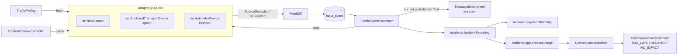
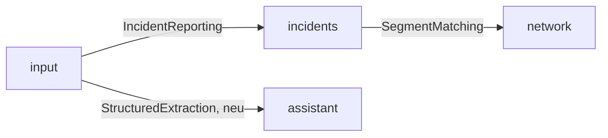

# Verkehrsdaten-Quellen (`input`) – Entwurf

- **Status:** Entwurf, noch kein Code. Füllt die offenen Punkte „Ereignisquellen“ und „Event → Incident“ aus [architecture.md](architecture.md#offene-punkte) und [domain.md](domain.md#offen).
- **Ziel:** Verkehrsereignisse aus mehreren Quellen je Land über **eine** Schnittstelle anbinden, als `Incident` an Segmenten verorten und über den bestehenden `ConsequenceMatcher` den Routen der Trips zuordnen.
- **Grundsatz:** Abruf, Abgleich, Speichern, Verorten, Incident und Anreicherung sind gemeinsam. Je Quelle gibt es nur einen Adapter, der abruft und liest. Neue Quelle = neuer Adapter plus Konfiguration, keine Änderung an Schema oder Verarbeitung.
- **Erste Quelle:** NZTA Traffic and Travel REST API (Neuseeland), siehe [NZTA](#erste-quelle-nzta).

## Überblick



- Bestehend und unverändert: `IncidentLogic`, `ConsequenceMatcher` (Segment → RouteSection, Überschneidung mit der erwarteten Durchfahrt). Neu danach die Bewertung gegen die Stops, siehe [consequence-assessment.md](consequence-assessment.md).
- **Nicht Teil dieses Entwurfs:** Lösungen und Alternativen (Umfahrungen, `recommendations`).

## Schnittstelle `TrafficSource` (`input.logic`)

- Ein Interface für alle Quellen, egal ob abgerufen (`TRAFFIC_FEED`) oder gepusht (`WEBHOOK`). Adapter sind Spring-Beans in `input.sources.<land>` (z. B. `input.sources.nz.NztaSource`) und kennen nur Records aus `input.logic`, keine Entities.

```java
public interface TrafficSource {
    /** Eindeutiger Name, = EventSource.name, z. B. "nz-nzta". */
    String name();
    /** ISO-3166-Code, z. B. "NZ". */
    String country();
    /** Region des Streckennetzes für die Verortung, Standard am Adapter (z. B. "nz"), per network-region überschreibbar (Tests: "wellington"). */
    String networkRegion();
    EventSourceType type();                   // TRAFFIC_FEED oder WEBHOOK
    PollPolicy pollPolicy();                  // nur TRAFFIC_FEED, sonst PollPolicy.NONE
    Attribution attribution();                // Quellenhinweis, Pflichttexte der Nutzungsbedingungen

    /** Ganzer aktueller Stand der Quelle. Nur TRAFFIC_FEED. Wirft SourceUnavailableException bei Fehlern. */
    SourceSnapshot fetch(FetchContext context);

    /** Eine Zustellung an den Webhook prüfen und zerlegen. Nur WEBHOOK. */
    List<SourceItem> parse(WebhookDelivery delivery);

    /** Ein gespeichertes Item fachlich lesen, deterministisch, ohne Netz und ohne Modell. */
    TrafficReport read(SourceItem item);
}
```

- **Records** (in `input.logic`):

  | Record | Inhalt |
  |---|---|
  | `PollPolicy` | `interval`, `jitter`, `maxBackoff`, `timeout`, `clearAfterMissing` (Abrufe), `maxClearRatio` |
  | `FetchContext` | `etag`/`lastModified` des letzten Abrufs, Zeitpunkt |
  | `SourceSnapshot` | `items`, `complete` (ganzer Stand, nur dann wird aufgehoben), `etag`/`lastModified`, `notModified` |
  | `SourceItem` | `subjectId` (Id des Ereignisses bei der Quelle), `version` (Änderungszeitpunkt oder Zähler), `payload` (Roh-JSON genau dieses Ereignisses), `messageText` (alle Freitexte des Ereignisses, für die Anreicherung) |
  | `TrafficReport` | Typ (`IncidentType`), `resolved` (Quelle meldet Ende), `validFrom`, `validTo`, Straße (`roadRef` wie bei der Quelle), Richtung, `location` (`IncidentLocation` aus `incidents.logic`: Punkt, Linie oder Fläche, WGS84), Verzögerung falls angegeben, `assumedDelay` (Annahme der Quelle ohne Zahl, siehe [Annahmen](#verzögerung-ohne-angabe)), `title`, `sourceUrl` |
  | `Attribution` | Quellenname, Hinweistext (z. B. „nur bestätigte, bedeutende Ereignisse“), maximales Alter bis „nicht aktuell“ |
  | `WebhookDelivery` | Header, Body, Empfangszeit; Signaturprüfung im Adapter |

- **Was der Adapter nicht macht:** Speichern, Abgleich, Segmente, Incidents, Modellaufrufe. Damit bleiben alle Regeln (Aufheben, Schutz vor Massenaufhebung, Anreicherung) für jede Quelle gleich.
- **Mehrere Quellen je Land:** z. B. NZTA (State Highways) und Auckland Transport (Nebenstraßen). Jede Quelle hat eigene `subjectId`s und erzeugt eigene Incidents. Doppelte Meldungen derselben Sperrung aus zwei Quellen zusammenführen ist offen, siehe [Offen](#offen).
- **Registrierung:** `TrafficSources` sammelt alle Beans, legt fehlende `EventSource`s beim Start an (`name`, `type`) und schaltet über `EventSource.enabled` und `nfv.input.sources.<name>.enabled` ab. `country` und der Standard für `networkRegion` stehen am Adapter, nicht in der Datenbank; `network-region` und `url` kommen aus der Konfiguration.
- **`RefNormalizer` je Region** (in [network.md](network.md#schnittstellen-networklogic) vorgesehen): `roadRef` der Quelle → `ref` im Netz (`SH 1`, `SH1`, `State Highway 1` → `1`; in Deutschland `A 6` → `A 6`).

## Gemeinsamer Ablauf

### Abruf (`TrafficPolling`)

- Ein Scheduler für alle `TRAFFIC_FEED`-Quellen, je Quelle ein eigener Takt nach `PollPolicy` (Zeitpunkt des nächsten Abrufs im Speicher, eine Replica, siehe [deployment.md](deployment.md); bei mehreren Replicas Sperre per `pg_try_advisory_lock`).
- Je Abruf genau ein `fetch`, Zufallsversatz `jitter`, bei `SourceUnavailableException` Backoff bis `maxBackoff`, danach wieder `interval`.
- Ruhepause je Quelle: kein Abruf, wenn keine Route Section mit Durchfahrt in den nächsten `horizon` (Standard 14 Tage) in der `networkRegion` der Quelle liegt und kein aktiver Incident der Quelle besteht.
- Letzter erfolgreicher Abruf: `event_source.last_success_at`, für „Stand“ im Frontend.

### Webhook (`TrafficWebhookController`)

- `POST /api/v1/input/webhooks/{sourceName}`, ohne Nutzer-Token, Prüfung allein über die Signatur im Adapter (`parse`). Ungültig → `WebhookEvent` mit `signatureVerified=false`, nicht verarbeitet.
- Webhooks liefern einzelne Änderungen, keinen ganzen Stand (`complete=false`): Aufheben nur, wenn die Quelle es meldet (`TrafficReport` mit Ende in der Vergangenheit).

### Abgleich (`FeedDiff`)

- Je Quelle Vergleich mit der letzten bekannten Version je `subjectId`.
- **Neu oder geändert** (`version` neu): ein `TrafficEvent` mit `payload`, `externalId` = `<subjectId>@<version>` (doppelte Abrufe erkennt `uk_input_event_external`).
- **Unverändert:** nichts speichern.
- **Entfallen** (nur bei `complete=true`): erst nach `clearAfterMissing` erfolgreichen Abrufen ohne das Ereignis ein „aufgehoben“-Event (`externalId` `<subjectId>@cleared@<Zeitpunkt>`).
- **Schutz vor Massenaufhebung:** Fehlt mehr als `maxClearRatio` der bekannten Ereignisse auf einmal, keine Aufhebung, Warnung im Log. Fehlerantworten heben nie etwas auf.

### Verarbeitung (`TrafficEventProcessor`)

- Nach dem Commit des Abrufs (`@TransactionalEventListener(AFTER_COMMIT)`, virtueller Thread), je Event eine Transaktion.
1. `read` des Adapters → `TrafficReport`.
2. Anreicherung, nur wenn sich der Text geändert hat, sonst gespeichertes Ergebnis zum Hash, siehe [Anreicherung](#anreicherung-messageenrichment). Vor dem Verorten, weil die Richtung oft nur im Text steht.
3. Übergabe an `incidents.logic.IncidentReporting.report(ReportedIncident)` mit der Incident-Id der vorigen Version (über `subject_id`) oder ohne. `ReportedIncident`: Typ, Gültigkeit, Zeitfenster, Verzögerung (mit „geschätzt“), Ort (`IncidentLocation`), `roadRef`, Richtung, `networkRegion`, beendet ja/nein. `incidents` verortet und legt an (beschlossen 2026-11-04, siehe [Abhängigkeiten](#abhängigkeiten)):
   - Verorten über `network.logic.SegmentMatching` in der `networkRegion`: Linie per Map Matching, Punkt per Umkreis (`point-radius`, Standard 50 m) und `ref`, Tunnel und Brücken eingeschlossen. Richtung aus der Anreicherung, sonst beide Richtungen (`SegmentInfo.reverseId`); Himmelsrichtung (`NORTHBOUND` …) → Segmente, deren Verlauf in diese Richtung zeigt (Peilung ± 60°). Flächen erst später (`AREA_NOT_SUPPORTED`).
   - Erste Version → `IncidentLogic.create`, weitere Version → `IncidentLogic.change` (auch mit neuem Typ, siehe unten), beendet (`TrafficReport.resolved`, z. B. NZTA `Resolved`, oder entfallen) → `change` mit `validTo` = jetzt (kein Löschen, Envers behält die Historie, `ConsequenceMatcher` entfernt die Consequences).
   - Ergebnis `ReportOutcome`: `incidentId` oder Grund (`NO_SEGMENTS`, `AREA_NOT_SUPPORTED`, `ROUTING_UNAVAILABLE`).
4. `Event.processed(incidentId)`, bei einem Grund `processed(null)` mit `processing_note`. Bei `ROUTING_UNAVAILABLE` (Netz noch nicht geladen) bleibt das Event offen und wird beim nächsten Durchlauf erneut verarbeitet.

- **Typwechsel (beschlossen 2026-11-04):** `IncidentLogic.change` nimmt auch den Typ (z. B. `566353`: `Caution` → laut Text gesperrt; Baustelle → Vollsperrung). Gleiche Incident-Id, Envers behält den alten Typ, die Consequence wird aktualisiert (`DELAYED` → `BLOCKED`) und behält ihre Id. Nachgetragen in [domain.md](domain.md#incidents).

## Anreicherung (`MessageEnrichment`)

- **Wofür:** Freitext der Meldung, den `read` nicht deterministisch lesen kann, z. B. „expected to reopen around 3pm“, „allow an extra 30 minutes“, „northbound only“.
- **Nur bei geändertem Text:** Der Agent wird ausschließlich aufgerufen, wenn sich `messageText` gegenüber der vorigen Version desselben Ereignisses (`subjectId`) geändert hat:
  - `message_hash` = SHA-256 über den normalisierten `messageText` (Leerraum zusammengefasst, Groß-/Kleinschreibung beibehalten).
  - Erste Version eines Ereignisses → Aufruf.
  - Neue Version mit gleichem Hash (z. B. nur Zeitstempel, Geometrie oder Status geändert) → kein Aufruf, Ergebnis der vorigen Version übernehmen.
  - Neue Version mit anderem Hash → Aufruf.
  - Unveränderte Abrufe erzeugen kein Event (`FeedDiff`), also auch keinen Aufruf. Aufheben ruft nie auf.
  - Leerer `messageText` → kein Aufruf.
- **Was der Agent nicht tut:** Segmente bestimmen, Incidents anlegen, Gültigkeit über `validFrom`–`validTo` der Quelle hinaus ausdehnen. Verortung aus `read` bleibt führend.
- **Aufruf:** `assistant.StructuredExtraction` mit festem Schema, Antwort strikt geprüft:

  | Feld | Prüfung |
  |---|---|
  | `timeWindows` (Liste `start`–`end` als Ortszeit mit Datum, oder leer = durchgehend) | jedes Fenster innerhalb `validFrom`–`validTo`, `end` > `start`, höchstens 24 h je Fenster, höchstens 200 Fenster; Umrechnung in Zeitpunkte über die Zeitzone der Region (`Pacific/Auckland`), nicht im Modell |
  | `closedDuringWindows` (ja/nein) | `true` hebt `OTHER`/`ROADWORKS`/`CONGESTION` auf `CLOSURE`, nur bei `confidence` `HIGH` |
  | `expectedReopening` (Zeitpunkt oder leer) | nach `validFrom`, höchstens 30 Tage, nur wenn die Quelle kein Ende liefert |
  | `delayMinutes` (Zahl oder leer) | 0–720 |
  | `direction` (`BOTH`, `NORTHBOUND`, `SOUTHBOUND`, `EASTBOUND`, `WESTBOUND`, `UNKNOWN`) | schränkt nur ein, erweitert nie |
  | `vehicleScope` (`ALL`, `HEAVY_ONLY`, `LIGHT_ONLY`) | `HEAVY_ONLY` → für Pkw keine Sperre, nur Hinweis |
  | `evidence` (wörtlicher Ausschnitt des Texts) | muss im `messageText` vorkommen, sonst Ergebnis verwerfen |
  | `confidence` (`HIGH`, `MEDIUM`, `LOW`) | `LOW` → Ergebnis verwerfen |

- Wochentage und Nächte („Sunday to Thursday nights between 9pm and 4:30am“) liefert das Modell bereits als einzelne Fenster mit Datum. Das Prüfen (innerhalb der Gültigkeit, Länge) macht der Code.

- Werte aus `read` gehen vor (z. B. Ende oder Verzögerung, die die Quelle als Feld liefert). Der Agent füllt nur Lücken.
- **Speicherung:** Tabelle `message_enrichment` (`source_id`, `subject_id`, `message_hash`, Ergebnis-JSON, Modell, `created_at`, eindeutig über `source_id, subject_id, message_hash`). Bei gleichem Hash wird das gespeicherte Ergebnis verwendet. Am Incident sind übernommene Werte als geschätzt markiert (Umsetzung beim Bau entscheiden: Spalte `derived` oder Verweis auf `message_enrichment`).
- **Systemkontingent (beschlossen 2026-11-04, nachgetragen in [architecture.md](architecture.md#assistant)):** Hintergrundaufrufe zählen nicht gegen einen Nutzer, sondern gegen ein eigenes Kontingent (`nfv.assistant.system-requests-per-hour`, Standard 60, eigener Zähler im `RateLimiter`). `StructuredExtraction` bekommt dafür einen Aufruf ohne Nutzer (`extractForSystem(…)`), kein technischer Nutzer in `app_user`.
  - Erwartete Last: einmalig rund 200 Aufrufe beim ersten Abruf (Stichprobe: 197 Ereignisse, über einige Stunden verteilt durch das Kontingent), danach nur geänderte Texte, geschätzt einige Dutzend am Tag.
  - **Kontingent erschöpft** (oder Modell nicht erreichbar): Das Event wird ohne Anreicherung verarbeitet (Incident nach `read`, Ereignisse mit Uhrzeiten im Text als `OTHER` ohne Sperre, siehe [Stufen](#stufen)) und als `enrichment_pending` markiert. Jeder Abruf holt offene Anreicherungen nach (älteste zuerst, im Rahmen des Kontingents) und ändert danach den Incident. Gleicher Hash → kein zweiter Aufruf, auch beim Nachholen.
- **Kosten:** Mit der Regel „nur bei geändertem Text“ fällt je Ereignis und Textfassung genau ein Aufruf an, unabhängig vom Abrufintervall. Auch Ereignisse ohne betroffene Route werden angereichert, damit spätere Routen (`RouteChanged`) die Werte schon vorfinden.
- **Ohne Key** fehlt nur die Anreicherung. **Datenschutz:** nur Texte der Quelle gehen ans Modell, keine Nutzer- oder Tripdaten.

## Zeitfenster

- **Problem:** Ein `Incident` hat heute genau eine Gültigkeit `validFrom`–`validTo`. Nächtliche Sperrungen über Wochen (Terrace Tunnel) würden jede Durchfahrt im ganzen Zeitraum treffen.
- **Beschlossen (2026-11-03), in [domain.md](domain.md#incidents) nachgetragen:** `Incident` 0..* `IncidentWindow` (`startsAt`, `endsAt`), `@ElementCollection` wie `incident_segment`, historisiert (`incident_window_aud`).
  - Keine Fenster = durchgehend gültig (wie heute).
  - `validFrom`–`validTo` bleibt die Hülle für die Vorauswahl in `findPassing`/`findActiveOnSegments`.
  - `IncidentOverlap.overlaps` prüft zusätzlich: mindestens ein Fenster überschneidet die Durchfahrt. Die Bewertung ([consequence-assessment.md](consequence-assessment.md)) nutzt dieselbe Prüfung.
  - `Consequence` bekommt das erste getroffene Fenster (`windowStart`, `windowEnd`) für die Anzeige („gesperrt 21:00–04:30“).
- **Verworfen:** je Fenster ein eigener Incident (Terrace Tunnel: rund 35), weil Aktualisierungen der Quelle dann alle Incidents ändern müssten und Benachrichtigungen sich vervielfachen.

## Schema (`V30`)

- `input_event`: `subject_id VARCHAR(255)`, Index `(source_id, subject_id)`; `message_hash VARCHAR(64)`; `processing_note VARCHAR(500)`; `enrichment_pending BOOLEAN`.
- `event_source`: `last_success_at TIMESTAMP(6) WITH TIME ZONE`, `etag VARCHAR(255)`, `last_modified VARCHAR(64)`.
- Neue Tabelle `message_enrichment`, siehe oben.
- Neue Tabellen `incident_window`, `incident_window_aud`; `consequence.window_start`, `consequence.window_end`.

## Erste Quelle: NZTA

- `input.sources.nz.NztaSource`, Name `nz-nzta`, Land `NZ`, Region `nz`, `TRAFFIC_FEED`.
- URL `https://trafficnz.info/service/traffic/rest/4/events/all/10`, `Accept: application/json`, ohne Key. v4 statt v5 (v5 undokumentiert). Nur State Highways, nur „notable“, bestätigte Ereignisse.
- **`PollPolicy` konservativ:** `interval` 5 min, `jitter` 30 s, Backoff 10 → 20 → 30 min, `timeout` 20 s, `clearAfterMissing` 2, `maxClearRatio` 0,5. Eine Anfrage je Zyklus für ganz NZ.
- `complete=true`. Leere Antwort (`"response": ""`) nach HTTP 200 = keine Ereignisse. `If-None-Match`/`If-Modified-Since`, falls die API `ETag`/`Last-Modified` liefert (prüfen).
- User-Agent: App-Name und Kontakt-URL der App, keine persönliche E-Mail.

### Antwort (Stichprobe 2026-11-03, 197 Ereignisse, `events.json`)

- Aufbau: `{"response": {"roadevent": [ … ]}}`, je Ereignis ein Objekt.
- **Geometrie:** WKT in WGS84 (Länge Breite), kein NZTM: `POINT` (121, alle `Road Work`, `Scheduled Road Work`, `Road Hazard`) oder `MULTILINESTRING` (76, alle `Area Warning`, meist ein Teil, bis 6). Keine Umrechnung nötig, Lesen per JTS `WKTReader` in `network`.
- **Zeiten:** ISO mit Offset (`+13:00`), Millisekunden teils vorhanden. `endDate` fehlt bei 16 Ereignissen. `expectedResolution` ist Text: `Until further notice` oder `dd/MM/yyyy HH:mm` in Ortszeit (`Pacific/Auckland`).
- **Optional:** `endDate`, `journey`, `journeyLeg` (2× `null`), `directLineDistance1–3` (Textangaben wie „0.35 km southwest of …“), `restrictions` (1×), `updateDue` (1×). `locations` ist meist Text, 3× eine Liste.

| Feld NZTA | Verwendung |
|---|---|
| `id` (Zahl) | `subjectId` |
| `eventModified` | `version` |
| `status` (`Active` 150, `Scheduled` 17, `Resolved` 30) | `Resolved` = aufgehoben (zusätzlich zum Entfallen aus dem Feed), `Scheduled` = Incident mit künftigem `validFrom` |
| `startDate` | `validFrom` |
| `endDate`, sonst `expectedResolution` | `validTo`, `Until further notice` → leer |
| `eventType` (`Road Work` 105, `Area Warning` 76, `Scheduled Road Work` 11, `Road Hazard` 5) | Typ, siehe unten |
| `eventDescription` (`Maintenance`, `Other`, `Pavement Repairs`, `Resurfacing`, `Crash`, `Flooding`, `Slip`, …) | Typ (`Crash` → `ACCIDENT`), Titel |
| `impact` (`Caution` 136, `Road Closed` 32, `Delays` 28, `Vehicle Restrictions` 1) | Typ und Auswirkung, siehe unten |
| `geometry` | `location` (`GeoPoint` bzw. `GeoLine`) |
| `way.name` (`01N`, `01S`, `006`, …) | `roadRef`; `RefNormalizer`: `01N`/`01S` → `1`, `006` → `6` |
| `locationArea` (z. B. „SH 1 Terrace Tunnel, northbound“) | Titel, Teil von `messageText` |
| `eventComments` | Teil von `messageText` |
| `alternativeRoute` | Teil von `messageText`; `Not Applicable`, `Not applicable.`, `N/A` → leer |
| `locations` (z. B. `01N-1068/05.95-B   TERRACE TUNNEL START TO …`) | nur Anzeige, siehe Richtung |
| `planned`, `informationSource` (`NZTA`, `NMC`, `Police`), `region.name`, `eventIsland` | Anzeige, Filter |
| `journey`, `journeyLeg`, `directLineDistance*`, `supplier` | nicht verwendet |

- **Typ** (Reihenfolge, erster Treffer):
  1. `impact` = `Road Closed` → `CLOSURE`
  2. `eventDescription` = `Crash` → `ACCIDENT`
  3. `eventType` = `Road Work` oder `Scheduled Road Work` → `ROADWORKS`
  4. `impact` = `Delays` → `CONGESTION`
  5. sonst `OTHER` (`Area Warning`/`Road Hazard` mit `Caution`, `Vehicle Restrictions`; Pkw nicht gesperrt)
- <a id="verzögerung-ohne-angabe"></a>**Verzögerung ohne Angabe (beschlossen 2026-11-04):** Die Annahme kommt von der Quelle, nicht aus dem Typ des Incidents (`TrafficReport.assumedDelay`, konfigurierbar, als „geschätzt“ markiert). Grund: 66 Ereignisse der Stichprobe sind `Road Work` + `Caution` (meist 30 km/h), mit einer Annahme je Typ wären alle `DELAYED`.

  | NZTA | Annahme |
  |---|---|
  | `impact` `Caution` | 0 (→ `NO_IMPACT`, außer Text oder Anreicherung nennt eine Zahl) |
  | `impact` `Delays` | 15 min |
  | `eventDescription` `Crash` | 30 min |
  | `impact` `Road Closed` | keine (Sperrung, Wartezeit aus Fenster oder Ende) |
  | `impact` `Vehicle Restrictions` | 0 |

- **Richtung:** Das Suffix in `locations` (`B` 217, `D` 15, `I` 13; RAMM-Stationierung, B = beide, I/D = steigend/fallend) passt nicht immer zum Text: Terrace Tunnel hat `-B`, Text und `locationArea` sagen „northbound“. Richtung daher aus dem Text (Anreicherung), ohne Angabe beide Richtungen. Steigend/fallend lässt sich ohne RAMM-Daten nicht auf Segmente abbilden.
- **`messageText`** = `locationArea` + `eventComments` + `alternativeRoute` (normalisiert). `eventModified` ändert sich auch ohne neuen Text (Terrace Tunnel: geändert um 21:00, Text gleich), genau dann ruft die Anreicherung nicht auf.

### Erkenntnisse aus der Stichprobe

- **Zeitfenster stehen nur im Text:** 97 von 197 Kommentaren nennen Uhrzeiten oder Nächte, darunter 9 der 32 Sperrungen. Beispiel Terrace Tunnel (`566003`): `startDate` 1.11., `endDate` 18.12., gesperrt aber nur „Sunday to Thursday nights between 9pm and 4:30am“. Ohne Zeitfenster bekäme jede Route durch den Tunnel in sieben Wochen eine Sperre, auch tagsüber. Die Anreicherung liest deshalb Zeitfenster, siehe [Zeitfenster](#zeitfenster).
- **`impact` unterschätzt teils:** `566353` (`Area Warning`, `Caution`) ist laut Text nachts nordwärts gesperrt. Die Anreicherung darf die Auswirkung auf Sperrung anheben, nur bei `confidence` `HIGH` und nur mit Text als Beleg, siehe [Anreicherung](#anreicherung-messageenrichment).
- **Punkte für Strecken:** Baustellen und Sperrungen kommen als `POINT`, auch wenn eine Strecke gemeint ist (`locations` von … bis). Für Sperrungen genügt ein Segment, eine gesperrte Stelle sperrt die Straße. Für Verzögerungen ist die Länge zweitrangig.
- **Tunnel und Brücken:** Der Punkt des Terrace Tunnel liegt im Tunnel. Anders als beim Snappen von Stops (`snap_preventions`) darf `SegmentMatching` Tunnel und Brücken nicht ausschließen. Der Filter auf `ref` verhindert Treffer auf Straßen darüber.
- **Ende per Status:** 30 Ereignisse sind `Resolved` und stehen noch im Feed (mit „The road is now clear.“). Aufheben passiert also meist über den Status, das Entfallen aus dem Feed ist die Absicherung.
- **Länge der Texte:** höchstens 489 Zeichen je Kommentar, Kosten je Anreicherung gering.

## Zuordnung zu Trips

- Unverändert über `ConsequenceMatcher`: Segmente des Incidents → `ix_route_section_segment` → Sections mit überschneidender erwarteter Durchfahrt → eine Consequence je Route (erste betroffene Section, `BLOCKED` bei `CLOSURE`, sonst `DELAYED`).
- Neue oder neu geplante Routen finden bestehende Incidents über `RouteChanged` → `matchRoute`.
- Danach Bewertung je Route gegen die Ankunft am Ziel-Stop (`TOO_LATE`, `DELAYED`, `NO_IMPACT`), inklusive Fortschreiben der Verzögerung, siehe [consequence-assessment.md](consequence-assessment.md).
- Ende eines Incidents ist mit „aufgehoben“ gelöst, Richtung über richtungsgenaue Segmente.

## Abhängigkeiten



- **Beschlossen (2026-11-04, nachgetragen in [architecture.md](architecture.md#abhängigkeiten-zwischen-modulen)):** Neu ist nur `input → assistant`. `input` empfängt, speichert, liest und reichert an; `incidents` verortet (über `network.SegmentMatching`, `incidents → network` besteht), legt Incidents an und ordnet sie zu. So bleibt die Verortung an einer Stelle, auch für spätere Incidents an Unterkünften.
- `input` kennt `network` nicht. Orte übergibt es als `incidents.logic.IncidentLocation` (eigener Record, WGS84), `incidents` setzt ihn in `network.logic`-Records um.
- Adapter (`input.sources.*`) hängen nur von `input.logic` und `incidents.logic` (Records) ab, später per ArchUnit.

## Frontend

- Am Hinweis (`IncidentSheet`): Originaltext, Quelle aus `Attribution`, „Stand: hh:mm“, geschätzte Werte mit ✦ wie bei Buchungen.
- „Verkehrsdaten derzeit nicht aktuell“, wenn der letzte Abruf älter als das maximale Alter der Quelle ist.
- Einmaliger Hinweistext je Quelle aus `Attribution`.

## Konfiguration

```properties
nfv.input.horizon=14d
nfv.input.point-radius=50m
nfv.input.enrichment.enabled=true
nfv.assistant.system-requests-per-hour=60
# je Quelle, Name = TrafficSource.name()
nfv.input.sources.nz-nzta.enabled=${NFV_NZTA_ENABLED:true}
# http(s): echte Quelle, classpath:/file: JSON-Datei (Tests, lokal)
nfv.input.sources.nz-nzta.url=${NFV_NZTA_URL:https://trafficnz.info/service/traffic/rest/4/events/all/10}
nfv.input.sources.nz-nzta.network-region=nz
nfv.input.polling.scheduler-enabled=true
nfv.input.sources.nz-nzta.interval=5m
nfv.input.sources.nz-nzta.jitter=30s
nfv.input.sources.nz-nzta.max-backoff=30m
nfv.input.sources.nz-nzta.timeout=20s
nfv.input.sources.nz-nzta.assumed-delay.caution=0m
nfv.input.sources.nz-nzta.assumed-delay.delays=15m
nfv.input.sources.nz-nzta.assumed-delay.crash=30m
```

- Tests rufen nie die echte Quelle auf, siehe [Testumgebung](#testumgebung).

## Testumgebung

- **Grundlage:** eine echte JSON-Antwort der NZTA, vom Nutzer bereitgestellt, unverändert abgelegt als `backend/src/test/resources/sources/nz-nzta/events.json`. Sie legt auch die Feldtabelle von `NztaSource.read` fest.
- **`url` nimmt auch Ressourcen:** `http(s)://…` ruft per HTTP ab, `classpath:…` und `file:…` lesen die Datei (Spring `ResourceLoader`). Der Adapter liest beides gleich (Bytes → JSON), nur `fetch` unterscheidet den Transport. Kein eigener Test-Adapter, getestet wird derselbe Code wie im Betrieb.
- **Automatische Tests** (`src/test/resources/config/application.properties`):

  ```properties
  nfv.input.sources.nz-nzta.enabled=true
  nfv.input.sources.nz-nzta.url=classpath:sources/nz-nzta/events.json
  # kein Scheduler, Tests rufen TrafficPolling.pollNow("nz-nzta") auf
  nfv.input.polling.scheduler-enabled=false
  ```

- **Ablage:** `events.json` ist die Stichprobe vom 2026-11-03 (197 Ereignisse, ca. 460 KB), unverändert. **Versionen simulieren:** weitere Dateien, von Hand aus `events.json` abgeleitet, z. B. `events-changed-text.json` (gleiche Id, neuer Änderungszeitpunkt, anderer Kommentar), `events-changed-status.json` (neuer Änderungszeitpunkt, gleicher Text), `events-cleared.json` (Ereignis fehlt), `events-empty.json` (`"response": ""`). Der Test setzt die `url` per `@DynamicPropertySource` oder ruft `pollNow` mit einer anderen Ressource auf.
- **Zeit:** fester `Clock` auf `2026-11-03T22:15:00+13:00` (kurz nach dem jüngsten `eventModified` der Stichprobe, 22:13), damit Gültigkeiten und erwartete Durchfahrten der Testrouten zur Antwort passen.
- **Streckennetz:** Tests laufen auf der Region `wellington` ([network.md](network.md#tests), `nfv.input.sources.nz-nzta.network-region=wellington`). Die Stichprobe hat zwei Ereignisse im Testextrakt:
  - `566003` Terrace Tunnel, `POINT` im Tunnel, `Road Work`/`Road Closed`, `Active`, nordwärts, Sonntag bis Donnerstag 21:00–04:30 bis 18.12.
  - `566353` Urban Motorway Terrace Tunnel → Ngauranga, `MULTILINESTRING` (reicht über den Testextrakt hinaus), `Area Warning`/`Caution`, `Scheduled` ab 8.11., laut Text nachts nordwärts gesperrt.
  - Alle übrigen 195 ergeben `NO_SEGMENTS`, das ist erwartet und wird mitgeprüft.
- **Lokal und `mvn spring-boot:test-run`:** dieselbe Datei über `NFV_NZTA_URL=classpath:sources/nz-nzta/events.json` bzw. `file:/data/nzta/events.json` (Bind-Mount wie `~/data/osm`), damit Entwicklung die NZTA nicht abfragt. Standard lokal: Datei. Nur Stack (Betrieb) nutzt die echte URL.
- **Fehlerfälle** (Timeout, 5xx, 429, kaputtes JSON) über `MockRestServiceServer` mit `http`-URL, Inhalt wieder aus den Dateien.

## Tests

- Vertragstest für jeden Adapter (gemeinsame abstrakte Testklasse): liest die Dateien unter `src/test/resources/sources/<name>/` über `classpath:`, `read` liefert gültige `TrafficReport`s für jedes Ereignis der Antwort.
- `FeedDiff` mit einer Fake-Quelle: neu, geändert, unverändert, entfallen nach `clearAfterMissing`, Massenaufhebung, Fehlerantwort, `complete=false`.
- Anreicherung: erste Version → Aufruf, gleiche Textfassung bei neuer Version → kein Aufruf, geänderter Text → Aufruf, leerer Text → kein Aufruf (`StructuredExtraction` gemockt, Aufrufe gezählt).
- `SegmentMatching` gegen den Wellington-Testextrakt ([network.md](network.md#tests)): `566003` trifft nur die nordwärts gerichteten Segmente im Terrace Tunnel (`ref` 1), nicht The Terrace darüber; `566353` trifft die Motorway-Segmente nordwärts innerhalb des Extrakts.
- `NztaSource.read` über alle 197 Ereignisse: kein Fehler, Typ-Regeln laut Tabelle (z. B. 32 `CLOSURE`), `Until further notice` → `validTo` leer, `locations` als Text und als Liste, `journey` `null`.
- Zeitfenster: Route durch den Terrace Tunnel am 4.11. um 22:00 → Consequence `BLOCKED`; dieselbe Route um 12:00 → keine; am Freitag 6.11. um 22:00 → keine (Anreicherung gemockt mit den Fenstern aus dem Text).
- Ende zu Ende: NZTA-Fixture → Incident → Consequence an einer geplanten Route, dann „aufgehoben“ → Consequence weg.

## Stufen

1. `TrafficSource`, Records, `TrafficSources`, `TrafficPolling`, `FeedDiff`, `V30`, `NztaSource.fetch`. Sammelt echte Payloads.
2. `NztaSource.read`, `IncidentReporting` mit `SegmentMatching` (Punkt, Linie), Incident anlegen und ändern (inkl. Typ).
3. Aufheben, Frontend (Quelle, Stand, nicht aktuell).
4. `MessageEnrichment` mit Hash-Regel, Systemkontingent und Nachholen, Zeitfenster am Incident, Bewertung ([consequence-assessment.md](consequence-assessment.md)). Bis dahin Ereignisse mit Uhrzeiten im Text nur als Hinweis (`OTHER`) ohne Sperre, damit nächtliche Sperrungen nicht ganztags melden.
5. Webhook-Endpunkt, zweite Quelle (z. B. Auckland Transport), Flächenereignisse, Verzögerung fortschreiben, Benachrichtigung.

## Offen

- Bedeutung des Suffix `I`/`D` in `locations` gegen die Fahrtrichtung prüfen, ggf. als Richtung verwenden, wenn der Text keine nennt.
- `ETag`/`Last-Modified` bei der NZTA (an einer echten Antwort mit Headern prüfen).
- Zusammenführen derselben Sperrung aus zwei Quellen (gleiche Segmente, überlappende Zeit).
- Aufbewahrung alter `input_event`-Versionen (z. B. 90 Tage).
- Ablage der geschätzten Felder am Incident (Spalte `derived` oder Verweis auf `message_enrichment`).
- Schriftliche Rückfrage an opendata@nzta.govt.nz, ob 5 min in Ordnung sind.
