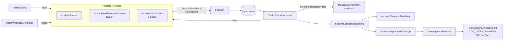
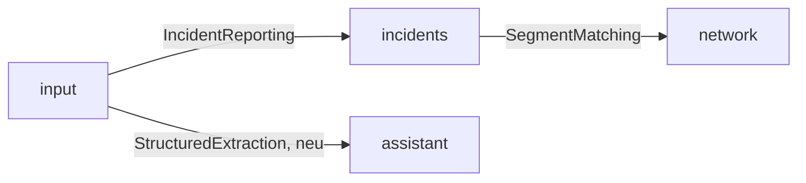

# Verkehrsdaten-Quellen (`input`) – Entwurf

- **Status:** Stufen 1, 2 und 4 umgesetzt (Abruf, Abgleich, Lesen, Verorten, Incidents anlegen, ändern und beenden, Ruhepause, Anreicherung, siehe [Stufen](#stufen)), Rest Entwurf. Füllt die offenen Punkte „Ereignisquellen“ und „Event → Incident“ aus [architecture.md](architecture.md#offene-punkte) und [domain.md](domain.md#offen).
- **Ziel:** Verkehrsereignisse aus mehreren Quellen je Land über **eine** Schnittstelle anbinden, als `Incident` an Segmenten verorten und über den bestehenden `ConsequenceMatcher` den Routen der Trips zuordnen.
- **Grundsatz:** Abruf, Abgleich, Speichern, Verorten, Incident und Anreicherung sind gemeinsam. Je Quelle gibt es nur einen Adapter, der abruft und liest. Neue Quelle = neuer Adapter plus Konfiguration, keine Änderung an Schema oder Verarbeitung.
- **Erste Quelle:** NZTA Traffic and Travel REST API (Neuseeland), siehe [NZTA](#erste-quelle-nzta).

## Überblick



- Bestehend und unverändert: `IncidentLogic`, `ConsequenceMatcher` (Segment → RouteSection, Überschneidung mit der erwarteten Durchfahrt). Neu danach die Bewertung gegen die Stops, siehe [consequence-assessment.md](consequence-assessment.md).
- **Nicht Teil dieses Entwurfs:** Lösungen und Alternativen (Umfahrungen, `recommendations`).

## Schnittstelle `TrafficSource` (`input.logic`)

- Ein Interface für alle Quellen, egal ob abgerufen (`TRAFFIC_FEED`) oder gepusht (`WEBHOOK`). Adapter sind Spring-Beans in `input.sources.<land>` (z. B. `input.sources.nz.NztaSource`) und kennen nur Records aus `input.logic`, keine Entities (Ausnahme: das Enum `EventSourceType`).
- **Umgesetzt (Stufen 1, 2):** alles außer `parse` (mit `WebhookDelivery`, kommt mit der ersten Webhook-Quelle).
- **Abweichung (Stufe 2):** `read` bekommt den gespeicherten `payload` (`TrafficReport read(String payload)`), nicht das `SourceItem`: am Event ist nur der Payload gespeichert. `messageText` liefert `read` mit (`TrafficReport.messageText`), gleiche Funktion wie beim Abruf.

```java
public interface TrafficSource {
    /** Eindeutiger Name, = EventSource.name, z. B. "nz-nzta". */
    String name();
    /** ISO-3166-Code, z. B. "NZ". */
    String country();
    /** Region des Streckennetzes für die Verortung, Standard am Adapter (z. B. "nz"), per network-region überschreibbar (Tests: "wellington"). */
    String networkRegion();
    EventSourceType type();                   // TRAFFIC_FEED oder WEBHOOK
    PollPolicy pollPolicy();                  // nur TRAFFIC_FEED, sonst PollPolicy.NONE
    Attribution attribution();                // Quellenhinweis, Pflichttexte der Nutzungsbedingungen

    /** Ganzer aktueller Stand der Quelle. Nur TRAFFIC_FEED. Wirft SourceUnavailableException bei Fehlern. */
    SourceSnapshot fetch(FetchContext context);

    /** Eine Zustellung an den Webhook prüfen und zerlegen. Nur WEBHOOK. */
    List<SourceItem> parse(WebhookDelivery delivery);

    /** Ein gespeichertes Item fachlich lesen, deterministisch, ohne Netz und ohne Modell. */
    TrafficReport read(String payload);
}
```

- **Records** (in `input.logic`):

  | Record | Inhalt |
  |---|---|
  | `PollPolicy` | `interval`, `jitter`, `maxBackoff`, `timeout`, `clearAfterMissing` (Abrufe), `maxClearRatio`, `minKnownForRatio` (ab so vielen bekannten Ereignissen gilt `maxClearRatio`); `PollPolicy.NONE` für Webhooks |
  | `FetchContext` | `etag`/`lastModified` des letzten Abrufs, Zeitpunkt, `location` (andere Adresse nur für diesen Abruf, Tests) |
  | `SourceSnapshot` | `items`, `complete` (ganzer Stand, nur dann wird aufgehoben), `etag`/`lastModified`, `notModified` |
  | `SourceItem` | `subjectId` (Id des Ereignisses bei der Quelle), `version` (Änderungszeitpunkt oder Zähler), `payload` (Roh-JSON genau dieses Ereignisses), `messageText` (alle Freitexte des Ereignisses, für die Anreicherung), `messageHash()` |
  | `TrafficReport` | Typ (`IncidentType`), `resolved` (Quelle meldet Ende), `validFrom`, `validTo`, Straße (`roadRef` wie bei der Quelle), Richtung, `location` (`IncidentLocation` aus `incidents.logic`: Punkt, Linie oder Fläche, WGS84), Verzögerung falls angegeben, `assumedDelay` (Annahme der Quelle ohne Zahl, siehe [Annahmen](#verzögerung-ohne-angabe)), `title`, `description`, `messageText`, `sourceUrl` |
  | `Attribution` | Quellenname, Hinweistext (z. B. „nur bestätigte, bedeutende Ereignisse“), maximales Alter bis „nicht aktuell“ |
  | `WebhookDelivery` | Header, Body, Empfangszeit; Signaturprüfung im Adapter |

- **Was der Adapter nicht macht:** Speichern, Abgleich, Segmente, Incidents, Modellaufrufe. Damit bleiben alle Regeln (Aufheben, Schutz vor Massenaufhebung, Anreicherung) für jede Quelle gleich.
- **Mehrere Quellen je Land:** z. B. NZTA (State Highways) und Auckland Transport (Nebenstraßen). Jede Quelle hat eigene `subjectId`s und erzeugt eigene Incidents. Doppelte Meldungen derselben Sperrung aus zwei Quellen zusammenführen ist offen, siehe [Offen](#offen).
- **Registrierung:** `TrafficSources` sammelt alle Beans, legt fehlende `EventSource`s beim Start an (`name`, `type`) und schaltet über `EventSource.enabled` und `nfv.input.sources.<name>.enabled` ab. `country` und der Standard für `networkRegion` stehen am Adapter, nicht in der Datenbank; `network-region` und `url` kommen aus der Konfiguration.
- **`RefNormalizer` je Region** (in [network.md](network.md#schnittstellen-networklogic) vorgesehen): `roadRef` der Quelle → `ref` im Netz (`SH 1`, `SH1`, `State Highway 1` → `1`; in Deutschland `A 6` → `A 6`).

## Gemeinsamer Ablauf

### Abruf (`TrafficPolling`)

- Ein Scheduler für alle `TRAFFIC_FEED`-Quellen (`TrafficPollingScheduler`, sucht alle `nfv.input.polling.tick` fällige Quellen, abschaltbar über `nfv.input.polling.scheduler-enabled`), je Quelle ein eigener Takt nach `PollPolicy` (`PollSchedule`, Zeitpunkt des nächsten Abrufs im Speicher, eine Replica, siehe [deployment.md](deployment.md); bei mehreren Replicas Sperre per `pg_try_advisory_lock`).
- Je Abruf genau ein `fetch` (außerhalb einer Transaktion), danach `FeedDiff` in einer Transaktion. Erster Abruf direkt nach dem Start plus Zufallsversatz `jitter`, danach `interval` plus `jitter`.
- Bei `SourceUnavailableException` Backoff: 2×, 4×, … `interval`, höchstens `maxBackoff` (NZTA: 10 → 20 → 30 min), danach wieder `interval`. Ein Fehler ändert nichts Gespeichertes.
- `TrafficPolling.pollNow(name)` bzw. `pollNow(name, location)` ruft sofort ab, unabhängig vom Takt (Tests). Abgeschaltete Quellen → `SKIPPED`.
- Ruhepause je Quelle (Stufe 2): kein Abruf, wenn keine Route Section mit Durchfahrt in den nächsten `horizon` (Standard 14 Tage) in der `networkRegion` der Quelle liegt und kein aktiver Incident der Quelle besteht (`TrafficPolling.isNeeded`). Dann nächster Blick nach `interval`. `pollNow` ignoriert die Ruhepause.
  - Abfrage über `incidents.IncidentReporting.hasPassagesInRegion` (Segmente der Sections mit Durchfahrt im Zeitraum aus `trips`, deren Region aus `network.SegmentQueries.anyInRegion`) und `anyActive` (Incidents aus den Events der Quelle).
- Letzter erfolgreicher Abruf (auch bei „nicht geändert“): `event_source.last_success_at`, für „Stand“ im Frontend. `ETag`/`Last-Modified` der letzten Antwort in `event_source.etag`/`last_modified`.

### Webhook (`TrafficWebhookController`)

- `POST /api/v1/input/webhooks/{sourceName}`, ohne Nutzer-Token, Prüfung allein über die Signatur im Adapter (`parse`). Ungültig → `WebhookEvent` mit `signatureVerified=false`, nicht verarbeitet.
- Webhooks liefern einzelne Änderungen, keinen ganzen Stand (`complete=false`): Aufheben nur, wenn die Quelle es meldet (`TrafficReport` mit Ende in der Vergangenheit).

### Abgleich (`FeedDiff`)

- Je Quelle Vergleich mit der letzten bekannten Version je `subjectId`. Zustand in der Tabelle `source_subject` (`version`, `message_hash`, `missing_polls`, `last_seen_at`, `cleared_at`), Ergebnis `FeedDiff.Result` (neu, geändert, unverändert, fehlend, aufgehoben, Aufhebung blockiert).
- **Neu oder geändert** (`version` neu): ein `TrafficEvent` mit `payload`, `subject_id`, `message_hash`, `externalId` = `<subjectId>@<version>` (doppelte Abrufe erkennt `uk_input_event_external`). Noch keine Verarbeitung (Stufe 2).
- **Unverändert:** nichts speichern, nur `last_seen_at`.
- **Entfallen** (nur bei `complete=true`): erst nach `clearAfterMissing` erfolgreichen Abrufen ohne das Ereignis ein „aufgehoben“-Event (`externalId` `<subjectId>@cleared@<Zeitpunkt>`, `payload` der letzten Version).
- **Wieder da** nach dem Aufheben: gilt als geändert. Gleiche Version wie zuvor → `externalId` `<subjectId>@<version>@reappeared@<Zeitpunkt>`.
- **Schutz vor Massenaufhebung:** Fehlt mehr als `maxClearRatio` der bekannten (nicht aufgehobenen) Ereignisse auf einmal, keine Aufhebung und der Abruf zählt für niemanden als „fehlt“, Warnung im Log. Gilt erst ab `minKnownForRatio` bekannten Ereignissen (NZTA: 10), damit eine Quelle mit wenigen Ereignissen alle aufheben kann. Fehlerantworten heben nie etwas auf.
- **Nicht geändert** (HTTP 304): nur `last_success_at`, kein Ereignis zählt als fehlend.

### Verarbeitung (`TrafficEventProcessor`)

- Nach dem Commit des Abrufs (`@TransactionalEventListener(AFTER_COMMIT)`, virtueller Thread), je Event eine Transaktion.
1. `read` des Adapters → `TrafficReport`.
2. Anreicherung, nur wenn sich der Text geändert hat, sonst gespeichertes Ergebnis zum Hash, siehe [Anreicherung](#anreicherung-messageenrichment). Vor dem Verorten, weil die Richtung oft nur im Text steht.
3. Übergabe an `incidents.logic.IncidentReporting.report(ReportedIncident)` mit der Incident-Id der vorigen Version (über `subject_id`) oder ohne. `ReportedIncident`: Typ, Gültigkeit, Zeitfenster, Verzögerung (mit „geschätzt“), Ort (`IncidentLocation`), `roadRef`, Richtung, `networkRegion`, beendet ja/nein. `incidents` verortet und legt an (beschlossen 2026-11-04, siehe [Abhängigkeiten](#abhängigkeiten)):
   - Verorten über `network.logic.SegmentMatching` in der `networkRegion`: Linie per Map Matching, Punkt per Umkreis (`nfv.incidents.point-radius-meters`, Standard 50) und `ref`, Tunnel und Brücken eingeschlossen. Richtung aus der Anreicherung, sonst beide Richtungen; Himmelsrichtung (`TravelDirection.NORTHBOUND` …) → Segmente, deren Verlauf (Start → Ende) in diese Richtung zeigt (Peilung ± 60°). Flächen erst später (`AREA_NOT_SUPPORTED`). Betrifft ein Ereignis nur eine Auf- oder Abfahrt (`TrafficReport.linkOnly`, `ReportedIncident.linkOnly`), zählen nur Segmente mit `link`, ohne Filter auf `ref`.
   - Beide Richtungen bei Linien: Map Matching in Reihenfolge der Punkte **und** umgekehrt (getrennte Fahrbahnen wie die Urban Motorway sind je eine Einbahnstraße ohne `reverseId`), dazu `reverseId` für zweispurige Straßen.
   - Erste Version → `IncidentLogic.create`, weitere Version → `IncidentLogic.change` (auch mit neuem Typ, siehe unten), beendet (`TrafficReport.resolved`, z. B. NZTA `Resolved`, oder entfallen: `externalId` mit `@cleared@`) → `change` mit `validTo` = jetzt (frühestens `validFrom`; kein Löschen, Envers behält die Historie, `ConsequenceMatcher` entfernt die Consequences). Vor dem Beginn beendet (abgesagt): `validTo` = `validFrom`, eine Gültigkeit ohne Länge trifft keine Durchfahrt (`IncidentOverlap`).
   - Vorige Version: letztes Event derselben Quelle und `subject_id` mit Incident. Führte eine Version zu keinem Incident (z. B. `NO_SEGMENTS`), legt die nächste einen an.
   - Ergebnis `ReportOutcome`: `incidentId` oder Grund (`NO_SEGMENTS`, `AREA_NOT_SUPPORTED`, `ROUTING_UNAVAILABLE`, `ENDED`: beendet gemeldet, ohne dass es einen Incident gab).
4. `Event.processed(incidentId, note)`, bei einem Grund `processed(null)` mit dem Grund als `processing_note`. Bei `ROUTING_UNAVAILABLE` (Netz noch nicht geladen) bleibt das Event offen und wird beim nächsten Durchlauf erneut verarbeitet.

- **Umsetzung (Stufe 2):**
  - Auslöser: `FeedDiff` veröffentlicht nach **jedem** erfolgreichen Abruf `SourcePolled` (auch ohne neue Events, damit offene wie `ROUTING_UNAVAILABLE` nachgeholt werden). `TrafficEventProcessor.processPending()` verarbeitet alle offenen `TrafficEvent`s aller Quellen, älteste zuerst, je Event eine Transaktion, nie zwei Läufe gleichzeitig. Abschaltbar über `nfv.input.processing.after-poll` (Tests rufen `processPending` selbst auf).
  - Fehler beim Verarbeiten (Ausnahme) → Event mit `processing_note` `FAILED: …` abgeschlossen, damit es nicht jeden Lauf erneut scheitert. Nicht lesbarer Payload → `UNREADABLE: …`, unbekannte Quelle → `UNKNOWN_SOURCE`.
  - **Übergangsregel ohne Zeitfenster:** Liefert die Anreicherung keine verwertbaren Fenster und nennt `messageText` Uhrzeiten oder Nächte (`9pm`, `4:30am`, `21:00`, `night(s)`, `overnight`), wird das Ereignis als `OTHER` gemeldet (keine Sperre), `processing_note` `TIMES_IN_TEXT: …`. Betrifft z. B. `566003` (Terrace Tunnel, nur nachts gesperrt).
    - **Sperrungen darunter (beschlossen 2026-11-05, `V36`):** `Incident.timesUnconfirmed` (historisiert, auch in `TripIncidentDto`). Bewertung `DELAYED` mit Verzögerung 0 statt `NO_IMPACT`, Hinweis „Zeiten prüfen“, keine Verschiebung, nie `TOO_LATE`. Grund: Auch rund um die Uhr gesperrte Strecken nennen Uhrzeiten (`561819`, `565813`), 9 der 20 aktiven Sperrungen der Stichprobe wären sonst nicht gezählt worden. Nimmt in Kauf, dass nächtliche Sperrungen bis zur Anreicherung auch tagsüber warnen.
    - Sperrungen, die nur im Text stehen (`566353`, `Caution`), bleiben bis zur Anreicherung `NO_IMPACT`.
  - **Abgelaufenes Ende (beschlossen 2026-11-05):** Meldet die Quelle eine Sperrung ohne Fenster weiter als nicht beendet, obwohl `validTo` schon vorbei ist (`541001`, `expectedResolution` 19.5.2026), gilt das Datum als veraltet: `validTo` leer (bis auf Weiteres, also nicht passierbar). Geprüft nur beim Verarbeiten einer Version: Läuft das Ende ab, während das Ereignis unverändert im Feed steht, entfällt der Incident weiter zu diesem Datum, siehe [Offen](#offen).
  - Beschreibung des Incidents: `title` und `description` des `TrafficReport` (gekürzt auf 2000 Zeichen).

- **Typwechsel (beschlossen 2026-11-04):** `IncidentLogic.change` nimmt auch den Typ (z. B. `566353`: `Caution` → laut Text gesperrt; Baustelle → Vollsperrung). Gleiche Incident-Id, Envers behält den alten Typ, die Consequence wird aktualisiert (`DELAYED` → `BLOCKED`) und behält ihre Id. Nachgetragen in [domain.md](domain.md#incidents).

## Anreicherung (`MessageEnrichment`)

- **Umgesetzt (`V38`):** `input.logic.AssistantEnrichmentModel` fragt das Modell über `StructuredExtraction.extractForSystem` (Systemkontingent), `input.logic.MessageEnrichment` speichert die Antwort (`message_enrichment`, Entity `StoredEnrichment`, unverändert) und prüft sie bei jeder Verwendung. Tests mocken `EnrichmentModel`.
  - **Abweichung: Aufruf außerhalb der Transaktion.** Ein Aufruf kann bis zu 90 s dauern und soll keine Datenbankverbindung halten. `TrafficEventProcessor` fragt vor der Transaktion des Events, die Transaktion liest nur die gespeicherte Antwort.
  - **Keine Antwort jetzt** (`EnrichmentDeferredException`: Kontingent erschöpft, Modell nicht erreichbar, Antwort unbrauchbar): Das Event wird ohne Anreicherung verarbeitet und `enrichment_pending`. Bis zum nächsten Lauf wird das Modell nicht mehr gefragt, weitere Events werden ebenfalls `enrichment_pending`.
  - **Nachholen:** Am Ende jedes Laufs, wenige Fehlversuche zuerst, dann die ältesten; Fehlversuch beendet das Nachholen für diesen Lauf. Danach gleiches Event erneut gemeldet, gleicher Incident. Überholte Versionen und beendete Ereignisse werden nicht nachgeholt. Nach 20 Fehlversuchen (`enrichment_attempts`) bleibt das Event ohne Anreicherung, ein erschöpftes Kontingent zählt nicht als Fehlversuch.
  - **Ohne Key oder mit `nfv.input.enrichment.enabled=false`:** kein Aufruf, kein `enrichment_pending`. Kommt später ein Key dazu, werden bereits verarbeitete Events erst mit neuer Version angereichert.
  - **Bestand:** `V38` setzt `enrichment_pending` für alle bereits verarbeiteten `TrafficEvent`s mit Text, damit auch Ereignisse mit unverändertem Text gelesen werden (Terrace Tunnel). Überholte Versionen und beendete Ereignisse gehen ohne Aufruf ab.
  - **Ablage geschätzter Werte (beschlossen 2026-11-05):** Eine Verzögerung aus dem Text ersetzt `assumedDelay` und gilt damit als geschätzt, keine eigene Spalte. `expectedDelay` bleibt der Zahl der Quelle vorbehalten.
  - **Lesen:** `closedDuringWindows` hebt `OTHER`, `ROADWORKS`, `CONGESTION` auf `CLOSURE` (nur `HIGH`, `ACCIDENT` bleibt). `expectedReopening` wird `validTo`. `direction` geht an die Verortung. Ungültige Einzelwerte (Wiedereröffnung, Verzögerung) werden ignoriert, die übrige Antwort gilt. `evidence` wird ohne Unterschiede im Leerraum verglichen.
  - **Nicht geprüft:** Qualität des Modells an echten Texten, siehe [Offen](#offen). `events.json` enthält die Fälle, ein Lauf mit Key zeigt sie.
  - Umrechnung Ortszeit → Zeitpunkt mit `TrafficSource.zone()` (NZTA `Pacific/Auckland`), im Code, nicht im Modell.
  - Ende nach Beginn, höchstens 24 h je Fenster, höchstens 200 Fenster; sonst wird die ganze Antwort verworfen.
  - **Abweichung:** Fenster werden auf `validFrom`–`validTo` **zugeschnitten** statt verworfen (erste Nacht des Terrace Tunnel beginnt 21:00, `validFrom` 21:00:26); ganz außerhalb liegende fallen weg, bleibt keines, wird die Antwort verworfen. Die Gültigkeit wird nie ausgedehnt.
  - Mit Fenstern gilt der Typ aus `read` (z. B. `CLOSURE` → `BLOCKED` nur in den Fenstern). Ohne verwertbare Antwort bleibt die Übergangsregel (`TIMES_IN_TEXT` → `OTHER`). Beendete Events fragen das Modell nie.
  - `vehicleScope` geht an `Incident.vehicleScope` (für die Bewertung, [consequence-assessment.md](consequence-assessment.md)), ungeprüft bis auf den Wertebereich.

- **Wofür:** Freitext der Meldung, den `read` nicht deterministisch lesen kann, z. B. „expected to reopen around 3pm“, „allow an extra 30 minutes“, „northbound only“.
- **Nur bei geändertem Text oder geänderter Gültigkeit (Gültigkeit beschlossen 2026-11-05, `V39`):** Der Agent wird aufgerufen, wenn es für `messageText` und `validFrom`–`validTo` desselben Ereignisses (`subjectId`) noch keine Antwort gibt. Die Gültigkeit gehört dazu, weil die Antwort datierte Fenster enthält: Verlängert die Quelle eine Sperrung bei gleichem Text, endeten die Fenster sonst beim alten Ende und spätere Durchfahrten wären nicht betroffen. Fehlversuche werden wiederholt, siehe oben.
  - `message_hash` = SHA-256 über den normalisierten `messageText` (Leerraum zusammengefasst, Groß-/Kleinschreibung beibehalten).
  - Erste Version eines Ereignisses → Aufruf.
  - Neue Version mit gleichem Hash und gleicher Gültigkeit (z. B. nur Zeitstempel, Geometrie oder Status geändert) → kein Aufruf, gespeicherte Antwort verwenden.
  - Neue Version mit anderem Hash oder anderer Gültigkeit → Aufruf.
  - Unveränderte Abrufe erzeugen kein Event (`FeedDiff`), also auch keinen Aufruf. Aufheben ruft nie auf.
  - Leerer `messageText` → kein Aufruf.
- **Was der Agent nicht tut:** Segmente bestimmen, Incidents anlegen, Gültigkeit über `validFrom`–`validTo` der Quelle hinaus ausdehnen. Verortung aus `read` bleibt führend.
- **Aufruf:** `assistant.StructuredExtraction` mit festem Schema, Antwort strikt geprüft:

  | Feld | Prüfung |
  |---|---|
  | `timeWindows` (Liste `start`–`end` als Ortszeit mit Datum, oder leer = durchgehend) | jedes Fenster innerhalb `validFrom`–`validTo`, `end` > `start`, höchstens 24 h je Fenster, höchstens 200 Fenster; Umrechnung in Zeitpunkte über die Zeitzone der Region (`Pacific/Auckland`), nicht im Modell |
  | `closedDuringWindows` (ja/nein) | `true` hebt `OTHER`/`ROADWORKS`/`CONGESTION` auf `CLOSURE`, nur bei `confidence` `HIGH` |
  | `expectedReopening` (Zeitpunkt oder leer) | nach `validFrom`, höchstens 30 Tage, nur wenn die Quelle kein Ende liefert |
  | `delayMinutes` (Zahl oder leer) | 0–720 |
  | `direction` (`BOTH`, `NORTHBOUND`, `SOUTHBOUND`, `EASTBOUND`, `WESTBOUND`, `UNKNOWN`) | schränkt nur ein, erweitert nie |
  | `vehicleScope` (`ALL`, `HEAVY_ONLY`, `LIGHT_ONLY`) | `HEAVY_ONLY` → für Pkw keine Sperre, nur Hinweis |
  | `evidence` (wörtlicher Ausschnitt des Texts) | muss im `messageText` vorkommen, sonst Ergebnis verwerfen |
  | `confidence` (`HIGH`, `MEDIUM`, `LOW`) | `LOW` → Ergebnis verwerfen |

- Wochentage und Nächte („Sunday to Thursday nights between 9pm and 4:30am“) liefert das Modell bereits als einzelne Fenster mit Datum. Das Prüfen (innerhalb der Gültigkeit, Länge) macht der Code.

- Werte aus `read` gehen vor (z. B. Ende oder Verzögerung, die die Quelle als Feld liefert). Der Agent füllt nur Lücken.
- **Speicherung:** Tabelle `message_enrichment` (`source_id`, `subject_id`, `message_hash`, `validity`, Ergebnis-JSON, Modell, `created_at`, eindeutig über `source_id, subject_id, message_hash, validity`). Bei gleichem Hash und gleicher Gültigkeit wird das gespeicherte Ergebnis verwendet. Am Incident sind übernommene Werte als geschätzt markiert (Umsetzung beim Bau entscheiden: Spalte `derived` oder Verweis auf `message_enrichment`).
- **Systemkontingent (beschlossen 2026-11-04, nachgetragen in [architecture.md](architecture.md#assistant)):** Hintergrundaufrufe zählen nicht gegen einen Nutzer, sondern gegen ein eigenes Kontingent (`nfv.assistant.system-requests-per-hour`, Standard 60, eigener Zähler im `RateLimiter`). `StructuredExtraction` bekommt dafür einen Aufruf ohne Nutzer (`extractForSystem(…)`), kein technischer Nutzer in `app_user`.
  - Erwartete Last: einmalig rund 200 Aufrufe beim ersten Abruf (Stichprobe: 197 Ereignisse, über einige Stunden verteilt durch das Kontingent), danach nur geänderte Texte, geschätzt einige Dutzend am Tag.
  - **Kontingent erschöpft** (oder Modell nicht erreichbar): Das Event wird ohne Anreicherung verarbeitet (Incident nach `read`, Ereignisse mit Uhrzeiten im Text als `OTHER` ohne Sperre, siehe [Stufen](#stufen)) und als `enrichment_pending` markiert. Jeder Abruf holt offene Anreicherungen nach (älteste zuerst, im Rahmen des Kontingents) und ändert danach den Incident. Gleicher Hash → kein zweiter Aufruf, auch beim Nachholen.
- **Kosten:** Mit der Regel „nur bei geändertem Text oder geänderter Gültigkeit“ fällt je Ereignis, Textfassung und Gültigkeit genau ein Aufruf an (ohne Wiederholungen nach Fehlern), unabhängig vom Abrufintervall. Auch Ereignisse ohne betroffene Route werden angereichert, damit spätere Routen (`RouteChanged`) die Werte schon vorfinden.
- **Ohne Key** fehlt nur die Anreicherung. **Datenschutz:** nur Texte der Quelle gehen ans Modell, keine Nutzer- oder Tripdaten.

## Zeitfenster

- **Problem:** Ein `Incident` hat heute genau eine Gültigkeit `validFrom`–`validTo`. Nächtliche Sperrungen über Wochen (Terrace Tunnel) würden jede Durchfahrt im ganzen Zeitraum treffen.
- **Beschlossen (2026-11-03), in [domain.md](domain.md#incidents) nachgetragen:** `Incident` 0..* `IncidentWindow` (`startsAt`, `endsAt`), `@ElementCollection` wie `incident_segment`, historisiert (`incident_window_aud`).
  - Keine Fenster = durchgehend gültig (wie heute).
  - `validFrom`–`validTo` bleibt die Hülle für die Vorauswahl in `findPassing`/`findActiveOnSegments`.
  - `IncidentOverlap.overlaps` prüft zusätzlich: mindestens ein Fenster überschneidet die Durchfahrt. Die Bewertung ([consequence-assessment.md](consequence-assessment.md)) nutzt dieselbe Prüfung.
  - `Consequence` bekommt das erste getroffene Fenster (`windowStart`, `windowEnd`) für die Anzeige („gesperrt 21:00–04:30“).
- **Umgesetzt (`V34`):**
  - `IncidentWindow` als `@Embeddable` in `Set` (`incident_window`, PK `incident_id, starts_at, ends_at`); Envers braucht in `incident_window_aud` zusätzlich `setordinal`.
  - Logik-Record `incidents.logic.TimeWindow` (Ende nach Beginn), `Incident.timeWindows()` sortiert, `Incident.firstWindow(start, end)`.
  - `IncidentOverlap.overlaps(validFrom, validTo, windows, start, end)` und `firstWindow`; genutzt von `Incident.overlaps`, `ActiveIncident.overlaps` (damit auch Streckenvorschläge) und `ConsequenceMatcher`.
  - `ConsequenceMatcher.matchIncident` filtert die Sections aus `findPassing` (Hülle) zusätzlich nach den Fenstern; `matchRoute` über `Incident.overlaps`. `consequence.window_start`/`window_end` = erstes getroffenes Fenster, leer ohne Fenster.
  - `IncidentLogic.create`/`change` (Variante mit Typ) nehmen die Fenster, die Variante ohne Typ behält sie. Beim Beenden bleiben die Fenster, die Hülle (`validTo`) begrenzt sie.
- **Verworfen:** je Fenster ein eigener Incident (Terrace Tunnel: rund 35), weil Aktualisierungen der Quelle dann alle Incidents ändern müssten und Benachrichtigungen sich vervielfachen.

## Schema

- **`V32` (Stufe 1, umgesetzt):**
  - `input_event`: `subject_id VARCHAR(255)`, Index `ix_input_event_subject (source_id, subject_id)`; `message_hash VARCHAR(64)`; `processing_note VARCHAR(500)`; `enrichment_pending BOOLEAN NOT NULL DEFAULT FALSE`.
  - `event_source`: `last_success_at TIMESTAMP(6) WITH TIME ZONE`, `etag VARCHAR(255)`, `last_modified VARCHAR(64)`.
  - Neue Tabelle `source_subject` (`source_id`, `subject_id`, `version`, `message_hash`, `missing_polls`, `last_seen_at`, `cleared_at`, eindeutig über `source_id, subject_id`): Zustand von `FeedDiff`.
- **`V33` (Stufe 2, umgesetzt):** `incident.assumed_delay BIGINT` und `incident_aud.assumed_delay` (Dauer in Nanosekunden wie `expected_delay`).
- **`V34` (Zeitfenster, umgesetzt):** Tabellen `incident_window` (`incident_id`, `starts_at`, `ends_at`) und `incident_window_aud` (mit `setordinal`); `consequence.window_start`, `consequence.window_end`.
- **`V36` (Übergangsregel, umgesetzt):** `incident.times_unconfirmed BOOLEAN` und `incident_aud.times_unconfirmed`.
- **`V37` (Auf- und Abfahrten, umgesetzt):** `road_segment.link BOOLEAN`, siehe [network.md](network.md#datenmodell).
- **`V38` (Anreicherung, umgesetzt):** Tabelle `message_enrichment`, siehe oben; `input_event.enrichment_attempts SMALLINT`.
- **`V39` (umgesetzt):** `message_enrichment.validity`, Teil des eindeutigen Schlüssels.
- **`V40` (umgesetzt):** `revtype` im Primärschlüssel von `incident_window_aud`: Envers nummeriert die Elemente des Sets nach Position, ein Fenster kann in einer Revision entfernt und hinzugefügt werden. `IncidentWindow` vergleicht Zeitpunkte, nicht Offsets (die Datenbank liefert einen anderen als die Quelle), `Incident.change` ändert nur die Differenz der Fenster.

## Erste Quelle: NZTA

- `input.sources.nz.NztaSource`, Name `nz-nzta`, Land `NZ`, Region `nz`, `TRAFFIC_FEED`.
- URL `https://trafficnz.info/service/traffic/rest/4/events/all/10`, `Accept: application/json`, ohne Key. v4 statt v5 (v5 undokumentiert). Nur State Highways, nur „notable“, bestätigte Ereignisse.
- **`PollPolicy` konservativ:** `interval` 5 min, `jitter` 30 s, Backoff 10 → 20 → 30 min, `timeout` 20 s, `clearAfterMissing` 2, `maxClearRatio` 0,5. Eine Anfrage je Zyklus für ganz NZ.
- `complete=true`. Leere Antwort (`"response": ""`) nach HTTP 200 = keine Ereignisse. `If-None-Match`/`If-Modified-Since`, falls die API `ETag`/`Last-Modified` liefert (prüfen); 304 → `notModified`.
- Fehler → `SourceUnavailableException`: HTTP-Status außer 2xx/304, Timeout, kaputtes JSON, Antwort ohne `response` bzw. `roadevent`, Datei fehlt. Ereignisse ohne `id` oder `eventModified`/`eventCreated` werden übersprungen (Warnung).
- User-Agent: `Nfv (+<nfv.frontend-url>)`, keine persönliche E-Mail.
- `PollPolicy` aus der Konfiguration (`interval`, `jitter`, `max-backoff`, `timeout`), `clearAfterMissing` 2, `maxClearRatio` 0,5 und `minKnownForRatio` 10 fest im Adapter.

### Antwort (Stichprobe 2026-11-03, 197 Ereignisse, `events.json`)

- Aufbau: `{"response": {"roadevent": [ … ]}}`, je Ereignis ein Objekt.
- **Geometrie:** WKT in WGS84 (Länge Breite), kein NZTM: `POINT` (121, alle `Road Work`, `Scheduled Road Work`, `Road Hazard`) oder `MULTILINESTRING` (76, alle `Area Warning`, meist ein Teil, bis 6). Keine Umrechnung nötig, Lesen per JTS `WKTReader` in `network`.
- **Zeiten:** ISO mit Offset (`+13:00`), Millisekunden teils vorhanden. `endDate` fehlt bei 16 Ereignissen. `expectedResolution` ist Text: `Until further notice` oder `dd/MM/yyyy HH:mm` in Ortszeit (`Pacific/Auckland`).
- **Optional:** `endDate`, `journey`, `journeyLeg` (2× `null`), `directLineDistance1–3` (Textangaben wie „0.35 km southwest of …“), `restrictions` (1×), `updateDue` (1×). `locations` ist meist Text, 3× eine Liste.

| Feld NZTA | Verwendung |
|---|---|
| `id` (Zahl) | `subjectId` |
| `eventModified` | `version` |
| `status` (`Active` 150, `Scheduled` 17, `Resolved` 30) | `Resolved` = aufgehoben (zusätzlich zum Entfallen aus dem Feed), `Scheduled` = Incident mit künftigem `validFrom` |
| `startDate` | `validFrom` |
| `endDate`, sonst `expectedResolution` | `validTo`, `Until further notice` → leer |
| `eventType` (`Road Work` 105, `Area Warning` 76, `Scheduled Road Work` 11, `Road Hazard` 5) | Typ, siehe unten |
| `eventDescription` (`Maintenance`, `Other`, `Pavement Repairs`, `Resurfacing`, `Crash`, `Flooding`, `Slip`, …) | Typ (`Crash` → `ACCIDENT`), Titel |
| `impact` (`Caution` 136, `Road Closed` 32, `Delays` 28, `Vehicle Restrictions` 1) | Typ und Auswirkung, siehe unten |
| `geometry` | `location` (`GeoPoint` bzw. `GeoLine`) |
| `way.name` (`01N`, `01S`, `006`, …) | `roadRef`; `RefNormalizer`: `01N`/`01S` → `1`, `006` → `6`. Bei `locationArea` mit Anfang `SH N/A` leer: eine Nebenstraße, `way` nennt nur einen Highway in der Nähe |
| `locationArea` (z. B. „SH 1 Terrace Tunnel, northbound“) | Titel, Teil von `messageText`; `on-ramp`, `onramp`, `off-ramp` oder `link to` ergeben `linkOnly`, außer `incl link to` (die Straße selbst samt Abzweig) |
| `eventComments` | Teil von `messageText` |
| `alternativeRoute` | Teil von `messageText`; `Not Applicable`, `Not applicable.`, `N/A` → leer |
| `locations` (z. B. `01N-1068/05.95-B   TERRACE TUNNEL START TO …`) | nur Anzeige, siehe Richtung |
| `planned`, `informationSource` (`NZTA`, `NMC`, `Police`), `region.name`, `eventIsland` | Anzeige, Filter |
| `journey`, `journeyLeg`, `directLineDistance*`, `supplier` | nicht verwendet |

- **Typ** (Reihenfolge, erster Treffer):
  1. `impact` = `Road Closed` → `CLOSURE`
  2. `eventDescription` = `Crash` → `ACCIDENT`
  3. `eventType` = `Road Work` oder `Scheduled Road Work` → `ROADWORKS`
  4. `impact` = `Delays` → `CONGESTION`
  5. sonst `OTHER` (`Area Warning`/`Road Hazard` mit `Caution`, `Vehicle Restrictions`; Pkw nicht gesperrt)
- <a id="verzögerung-ohne-angabe"></a>**Verzögerung ohne Angabe (beschlossen 2026-11-04):** Die Annahme kommt von der Quelle, nicht aus dem Typ des Incidents (`TrafficReport.assumedDelay`, konfigurierbar, als „geschätzt“ markiert). Grund: 66 Ereignisse der Stichprobe sind `Road Work` + `Caution` (meist 30 km/h), mit einer Annahme je Typ wären alle `DELAYED`.

  | NZTA | Annahme |
  |---|---|
  | `impact` `Caution` | 0 (→ `NO_IMPACT`, außer Text oder Anreicherung nennt eine Zahl) |
  | `impact` `Delays` | 15 min |
  | `eventDescription` `Crash` | 30 min |
  | `impact` `Road Closed` | keine (Sperrung, Wartezeit aus Fenster oder Ende) |
  | `impact` `Vehicle Restrictions` | 0 |

- **Richtung:** Das Suffix in `locations` (`B` 217, `D` 15, `I` 13; RAMM-Stationierung, B = beide, I/D = steigend/fallend) passt nicht immer zum Text: Terrace Tunnel hat `-B`, Text und `locationArea` sagen „northbound“. Richtung daher aus dem Text (Anreicherung), ohne Angabe beide Richtungen. Steigend/fallend lässt sich ohne RAMM-Daten nicht auf Segmente abbilden. `read` liefert deshalb keine Richtung (beide).
- **Umsetzung `read` (Stufe 2, `NztaReader`):** Geometrie per JTS `WKTReader` in `input.sources.nz` (Bibliothek, nicht `network`): `POINT` → Punkt, `(MULTI)LINESTRING` → Linien, `POLYGON` → Fläche. `validFrom` = `startDate`, sonst `eventCreated`. `expectedResolution` ohne `endDate` in `Pacific/Auckland`. Titel `eventType: locationArea` (z. B. „Road Work: SH 1 Terrace Tunnel, northbound“), Beschreibung = `messageText` plus `locations` (Text oder Liste, je Zeile). `assumedDelay`-Schlüssel: `caution`, `delays`, `crash`, `vehicle-restrictions`; `Crash` vor `impact`, `Road Closed` ohne Annahme.
- **`messageText`** = `locationArea` + `eventComments` + `alternativeRoute` (normalisiert). `eventModified` ändert sich auch ohne neuen Text (Terrace Tunnel: geändert um 21:00, Text gleich), genau dann ruft die Anreicherung nicht auf.

### Probelauf gegen das ganze Netz `nz` (2026-11-05)

- Stichprobe `events.json`, fester `Clock` 3.11. 22:15, ohne Anreicherung, keine Routen bewertet: Es zeigt, wo Incidents landen, nicht die Kategorien. Import rund 4,5 min, 1.634.230 Segmente.
- Aktive Ereignisse mit Incident: vor den Regeln zu Auf- und Abfahrten und `SH N/A` 158 von 167, danach 163 von 167.
- Sperrungen an Auf- und Abfahrten (7) liegen danach nur auf `link`-Segmenten, vorher lagen 5 auf der Hauptfahrbahn, 2 fanden nichts. Im Umkreis von 50 m treffen sie mehrere Segmente (1 bis 11, je ein anderer OSM-Weg), vermutlich auch andere Rampen desselben Knotens; nicht einzeln geprüft.
- Nicht verortet: `541001` (Sperrung, `way` `026`, in OSM `SH 26A`), `565813` (Sperrung, Linie), `562769` (`Caution`, Linie), `565350` (`Caution`, Straße in OSM ohne Nummer).

### Erkenntnisse aus der Stichprobe

- **Zeitfenster stehen nur im Text:** 97 von 197 Kommentaren nennen Uhrzeiten oder Nächte, darunter 9 der 32 Sperrungen. Beispiel Terrace Tunnel (`566003`): `startDate` 1.11., `endDate` 18.12., gesperrt aber nur „Sunday to Thursday nights between 9pm and 4:30am“. Ohne Zeitfenster bekäme jede Route durch den Tunnel in sieben Wochen eine Sperre, auch tagsüber. Die Anreicherung liest deshalb Zeitfenster, siehe [Zeitfenster](#zeitfenster).
- **`impact` unterschätzt teils:** `566353` (`Area Warning`, `Caution`) ist laut Text nachts nordwärts gesperrt. Die Anreicherung darf die Auswirkung auf Sperrung anheben, nur bei `confidence` `HIGH` und nur mit Text als Beleg, siehe [Anreicherung](#anreicherung-messageenrichment).
- **Punkte für Strecken:** Baustellen und Sperrungen kommen als `POINT`, auch wenn eine Strecke gemeint ist (`locations` von … bis). Für Sperrungen genügt ein Segment, eine gesperrte Stelle sperrt die Straße. Für Verzögerungen ist die Länge zweitrangig.
- **Tunnel und Brücken:** Der Punkt des Terrace Tunnel liegt im Tunnel. Anders als beim Snappen von Stops (`snap_preventions`) darf `SegmentMatching` Tunnel und Brücken nicht ausschließen. Der Filter auf `ref` verhindert Treffer auf Straßen darüber.
- **Ende per Status:** 30 Ereignisse sind `Resolved` und stehen noch im Feed (mit „The road is now clear.“). Aufheben passiert also meist über den Status, das Entfallen aus dem Feed ist die Absicherung.
- **Länge der Texte:** höchstens 489 Zeichen je Kommentar, Kosten je Anreicherung gering.

## Zuordnung zu Trips

- Unverändert über `ConsequenceMatcher`: Segmente des Incidents → `ix_route_section_segment` → Sections mit überschneidender erwarteter Durchfahrt → eine Consequence je Route (erste betroffene Section, `BLOCKED` bei `CLOSURE`, sonst `DELAYED`).
- Neue oder neu geplante Routen finden bestehende Incidents über `RouteChanged` → `matchRoute`.
- Danach Bewertung je Route gegen die Ankunft am Ziel-Stop (`TOO_LATE`, `DELAYED`, `NO_IMPACT`), inklusive Fortschreiben der Verzögerung, siehe [consequence-assessment.md](consequence-assessment.md).
- Ende eines Incidents ist mit „aufgehoben“ gelöst, Richtung über richtungsgenaue Segmente.

## Abhängigkeiten



- **Beschlossen (2026-11-04, nachgetragen in [architecture.md](architecture.md#abhängigkeiten-zwischen-modulen)):** Neu ist nur `input → assistant`. `input` empfängt, speichert, liest und reichert an; `incidents` verortet (über `network.SegmentMatching`, `incidents → network` besteht), legt Incidents an und ordnet sie zu. So bleibt die Verortung an einer Stelle, auch für spätere Incidents an Unterkünften.
- `input` kennt `network` nicht. Orte übergibt es als `incidents.logic.IncidentLocation` (eigener Record, WGS84), `incidents` setzt ihn in `network.logic`-Records um.
- Adapter (`input.sources.*`) hängen nur von `input.logic` und `incidents.logic` (Records) ab, später per ArchUnit.

## Testquelle `manual`

- **Zweck:** Ereignisse von Hand eingeben und das Ergebnis direkt sehen, mit beliebigen Daten, ohne Datei tauschen, auch Richtung und Zeitfenster vor der Anreicherung. Manuelle Tests in `test.txt`.
- **Aufbau:** `input.sources.manual.ManualSource`, ein gewöhnlicher Adapter (`TRAFFIC_FEED`), kein Webhook, weil `TrafficPolling` und `TrafficEventProcessor` nur `TrafficEvent`s kennen. Eingegebene Ereignisse liegen im Speicher, `fetch` liefert sie als nicht vollständigen Stand (`complete=false`), ein Neustart hebt also nichts auf. Ablauf danach wie bei jeder Quelle: `FeedDiff`, `read`, Anreicherung, `IncidentReporting`, Bewertung.
- **Endpunkte** (`input.api.TestTrafficEventController`):
  - `POST /api/v1/test/traffic-events`: meldet das Ereignis, ruft sofort ab und verarbeitet, Antwort wie beim `GET`. Gleiche `id` ändert das Ereignis, `resolved` beendet es. Ungültig → 400.
  - `GET /api/v1/test/traffic-events/{id}?source=…`: letzte Version eines Ereignisses jeder Quelle (Standard `manual`, z. B. `source=nz-nzta`): `outcome` (`PENDING`, `INCIDENT` oder Grund wie `NO_SEGMENTS`), `note`, Incident mit Straßen und Consequences aller Routen.
- **Felder:** `id`, `type`, `point` oder `line`, `roadRef`, `direction`, `validFrom`, `validTo`, `delayMinutes`, `assumedDelayMinutes`, `text`, `windows`, `vehicleScope`, `linkOnly`, `resolved`.
- **`TrafficReport`** trägt dafür zusätzlich `windows` und `vehicleScope`: Ohne Anreicherung gelten diese Werte, mit Anreicherung deren Werte. Mit `windows` greift die Übergangsregel `TIMES_IN_TEXT` nicht.
- **Absicherung** (beschlossen 2026-11-05), ein Ereignis wirkt auf die Routen aller Nutzer der Region:
  - Quelle und Endpunkte gibt es nur mit `nfv.input.sources.manual.enabled=true` (`NFV_MANUAL_SOURCE_ENABLED`, Standard `false`), nie in Produktion. Die OpenAPI-Datei enthält sie nicht, der generierte Client also auch nicht.
  - Rolle `tester` für `/api/v1/test/**` (`ApiSecurityConfig`, erste Rollenprüfung der API). Das Konto `test` bekommt sie nur beim Anlegen auf leerer Datenbank (`TestAccountInitializer`), nicht nach Namen: Jeder kann sich registrieren. Bestehende Konten per SQL (`auth_account_role`), danach neu anmelden.
  - Das Konto `test`/`test` hat ein bekanntes Passwort: auf einem erreichbaren Server eigenes Konto mit der Rolle nutzen.
- **Region:** `nfv.input.sources.manual.network-region` (`NFV_MANUAL_SOURCE_REGION`, Standard `nz`).
- **Antwort des `POST`:** Nach einem Abruf kann der Hintergrundlauf (`after-poll`) das Ereignis vor der Anfrage verarbeiten. `TrafficEventInspection` liest den Stand deshalb als Projektion aus der Datenbank (`EventRepository.EventState`), nicht als Entity: Die Session der Anfrage hielte sonst den alten Stand.
- **Tests:** `ManualSourceApiTest` (mit `after-poll`, Kategorien, Richtung, Fenster, Änderung, Ende, Fehler, Rollen), `ManualSourceDisabledTest`, `TestAccountRoleTest`. Manuell in `test.txt`, am 2026-11-05 gegen `docker-compose.local.yml` mit echter Anmeldung und ganzem Netz `nz` durchlaufen.

## Frontend

- Am Hinweis (`IncidentSheet`): Originaltext, Quelle aus `Attribution`, „Stand: hh:mm“, geschätzte Werte mit ✦ wie bei Buchungen.
- „Verkehrsdaten derzeit nicht aktuell“, wenn der letzte Abruf älter als das maximale Alter der Quelle ist.
- Einmaliger Hinweistext je Quelle aus `Attribution`.

## Konfiguration

```properties
# Stufe 4 (umgesetzt)
nfv.input.enrichment.enabled=true
nfv.assistant.system-requests-per-hour=60
# Stufe 1 (umgesetzt): Scheduler, alle tick nach fälligen Quellen suchen
nfv.input.polling.scheduler-enabled=${NFV_INPUT_POLLING_ENABLED:true}
nfv.input.polling.tick=30s
# Stufe 2 (umgesetzt): Ruhepause, Verarbeitung nach jedem Abruf, Umkreis für Punkte (in incidents, verortet dort)
nfv.input.horizon=14d
nfv.input.processing.after-poll=true
nfv.incidents.point-radius-meters=50
# je Quelle, Name = TrafficSource.name(); ohne Eintrag ist die Quelle aus
nfv.input.sources.nz-nzta.enabled=${NFV_NZTA_ENABLED:true}
# http(s): echte Quelle, classpath:/file: JSON-Datei (Tests, lokal)
nfv.input.sources.nz-nzta.url=${NFV_NZTA_URL:https://trafficnz.info/service/traffic/rest/4/events/all/10}
nfv.input.sources.nz-nzta.network-region=nz
nfv.input.sources.nz-nzta.interval=5m
nfv.input.sources.nz-nzta.jitter=30s
nfv.input.sources.nz-nzta.max-backoff=30m
nfv.input.sources.nz-nzta.timeout=20s
# Stufe 2 (umgesetzt)
nfv.input.sources.nz-nzta.assumed-delay.caution=0m
nfv.input.sources.nz-nzta.assumed-delay.delays=15m
nfv.input.sources.nz-nzta.assumed-delay.crash=30m
nfv.input.sources.nz-nzta.assumed-delay.vehicle-restrictions=0m
```

- Tests rufen nie die echte Quelle auf, siehe [Testumgebung](#testumgebung).

## Testumgebung

- **Grundlage:** eine echte JSON-Antwort der NZTA, vom Nutzer bereitgestellt, unverändert abgelegt als `backend/src/test/resources/sources/nz-nzta/events.json`. Sie legt auch die Feldtabelle von `NztaSource.read` fest.
- **`url` nimmt auch Ressourcen:** `http(s)://…` ruft per HTTP ab, `classpath:…` und `file:…` lesen die Datei (Spring `ResourceLoader`). Der Adapter liest beides gleich (Bytes → JSON), nur `fetch` unterscheidet den Transport. Kein eigener Test-Adapter, getestet wird derselbe Code wie im Betrieb.
- **Automatische Tests** (`src/test/resources/config/application.properties`):

  ```properties
  nfv.input.sources.nz-nzta.enabled=true
  nfv.input.sources.nz-nzta.url=classpath:sources/nz-nzta/events.json
  nfv.input.sources.nz-nzta.network-region=wellington
  # kein Scheduler, Tests rufen TrafficPolling.pollNow("nz-nzta") auf
  nfv.input.polling.scheduler-enabled=false
  # keine Verarbeitung im Hintergrund, Tests rufen TrafficEventProcessor.processPending() auf
  nfv.input.processing.after-poll=false
  ```

- **Ablage:** `events.json` ist die Stichprobe vom 2026-11-03 (197 Ereignisse, ca. 460 KB), unverändert. **Versionen simulieren:** weitere Dateien, von Hand aus `events.json` abgeleitet, jeweils nur an `566003` (Terrace Tunnel) geändert: `events-changed-text.json` (`eventModified` 4.11. 09:30, Kommentar „10pm and 5am“ statt „9pm and 4:30am“), `events-changed-status.json` (`eventModified` 4.11. 09:30, `status` `Resolved`, gleicher Text), `events-cleared.json` (Ereignis fehlt, 196), `events-empty.json` (`"response": ""`). Die Tests rufen `pollNow(name, location)` mit der jeweiligen Datei auf.
- **Zeit:** fester `Clock` auf `2026-11-03T22:15:00+13:00` (kurz nach dem jüngsten `eventModified` der Stichprobe, 22:13), damit Gültigkeiten und erwartete Durchfahrten der Testrouten zur Antwort passen.
- **Streckennetz:** Tests laufen auf der Region `wellington` ([network.md](network.md#tests), `nfv.input.sources.nz-nzta.network-region=wellington`). Die Stichprobe hat zwei Ereignisse im Testextrakt:
  - `566003` Terrace Tunnel, `POINT` im Tunnel, `Road Work`/`Road Closed`, `Active`, nordwärts, Sonntag bis Donnerstag 21:00–04:30 bis 18.12.
  - `566353` Urban Motorway Terrace Tunnel → Ngauranga, `MULTILINESTRING` (reicht über den Testextrakt hinaus), `Area Warning`/`Caution`, `Scheduled` ab 8.11., laut Text nachts nordwärts gesperrt.
  - Alle übrigen 195 ergeben `NO_SEGMENTS`, das ist erwartet und wird mitgeprüft.
- **Lokal und `mvn spring-boot:test-run`:** dieselbe Datei über `NFV_NZTA_URL=classpath:sources/nz-nzta/events.json` bzw. `file:/data/nzta/events.json` (Bind-Mount wie `~/data/osm`), damit Entwicklung die NZTA nicht abfragt. Standard lokal: Datei. Nur Stack (Betrieb) nutzt die echte URL.
- **Fehlerfälle** (Timeout, 5xx, 429, kaputtes JSON) über `MockRestServiceServer` mit `http`-URL, Inhalt wieder aus den Dateien.

## Tests

- **Stufe 1 (umgesetzt):**
  - `NztaSourceTest`: `fetch` über `classpath:`, `file:` und `MockRestServiceServer` (Header `Accept`, `User-Agent`, `If-None-Match`/`If-Modified-Since`, `ETag`/`Last-Modified`, 304, 503, 429, kaputtes JSON, Timeout), abgeleitete Dateien, leere Antwort.
  - `FeedDiffTest` (`@SpringBootTest`): NZTA-Dateien über `pollNow` (neu, unverändert, geänderter Text, nur Status geändert, entfallen nach 2 Abrufen und wieder da, leere Antwort blockiert, Fehler ändert nichts, abgeschaltet) und `FeedDiff.apply` mit erfundenen Snapshots (wenige Ereignisse, Grenze `maxClearRatio`, `complete=false`, 304).
  - `PollScheduleTest` (Backoff, Jitter), `SourceItemTest` (`message_hash`).
- **Stufe 2 (umgesetzt):**
  - `NztaReadTest`: `read` über alle 197 Ereignisse (Typen 32 `CLOSURE`, 90 `ROADWORKS`, 61 `OTHER`, 11 `CONGESTION`, 3 `ACCIDENT`; 30 `Resolved`; 121 Punkte, 76 Linien), `Until further notice` → offen (12), `expectedResolution` in Ortszeit, `assumedDelay` je `impact` aus der Konfiguration, `locations` als Text und Liste, kaputter Payload.
  - `SegmentMatchingTest` (Wellington): `566003` mit `01N` nur Tunnel-Segmente mit `SH 1`, ohne `ref` auch The Terrace darüber; Peilung trennt die Richtungen; `566353` per Map Matching auf beiden Fahrbahnen der Motorway, nordwärts und südwärts getrennt; außerhalb nichts; Region ohne Netz → `RoutingUnavailableException`; `RefNormalizer`.
  - `TrafficProcessingTest` (fester `Clock` 3.11. 22:15 NZ): Ende zu Ende NZTA-Datei → 197 verarbeitet, Incidents nur für `566003` und `566353`, Rest `NO_SEGMENTS`/`ENDED` → Consequence `DELAYED` mit `timesUnconfirmed` an der Route Te Aro → Thorndon am 10.11. (wegen `TIMES_IN_TEXT`), dann `Resolved` → gleicher Incident endet, Consequence weg. Neue Version ohne Uhrzeiten → gleicher Incident, Typ `CLOSURE`, ohne `timesUnconfirmed`. Neue Version mit abgelaufenem Ende → `validTo` leer. Quelle auf Region ohne Netz → Event bleibt offen. Ruhepause.
  - `NztaReadTest` und `SegmentMatchingTest` zusätzlich: `linkOnly` je Ereignis, `SH N/A` ohne `roadRef`, `linkOnly` findet Rampen ohne Nummer.
  - `TrafficProcessingTest`, Anreicherung (Modell gemockt): gleicher Text fragt einmal, neue Gültigkeit fragt neu und ersetzt die Fenster, Antwort ändert Typ, Richtung, Verzögerung, niedrige Sicherheit und falscher Beleg werden ignoriert, Nachholen ändert denselben Incident, Aufgeben nach 20 Fehlversuchen, Kontingent zählt nicht. `AssistantEnrichmentModelTest`: gesendeter Text, Lesen der Antwort. `RateLimiterTest`: Systemkontingent.
- **Zeitfenster (umgesetzt):**
  - `TrafficProcessingTest.nightWindowsBlockOnlyPassagesAtNight` (Modell gemockt mit So–Do 21:00–04:30 vom 1.11. bis 18.12.): `566003` bleibt `CLOSURE` mit 34 Fenstern; Route Mi 4.11. 22:00 → `BLOCKED`, Fenster 4.11. 21:00 – 5.11. 04:30; 12:00 → keine; Fr 6.11. 22:00 → keine. Danach geplante Routen (über `matchRoute`): Do 5.11. 23:00 → Fenster ab 5.11. 21:00, Sa 7.11. 23:00 → keine.
  - `MessageEnrichmentTest`: Zeitzone (Sommer- und Winterzeit), Zuschneiden, verworfene Antworten (Ende vor Beginn, über 24 h, über 200), leer = durchgehend, `IncidentOverlap` mit Fenstern.
- Vertragstest für jeden Adapter (gemeinsame abstrakte Testklasse): liest die Dateien unter `src/test/resources/sources/<name>/` über `classpath:`, `read` liefert gültige `TrafficReport`s für jedes Ereignis der Antwort.
- Anreicherung: erste Version → Aufruf, gleiche Textfassung bei neuer Version → kein Aufruf, geänderter Text → Aufruf, leerer Text → kein Aufruf (`StructuredExtraction` gemockt, Aufrufe gezählt).
- `SegmentMatching` gegen den Wellington-Testextrakt ([network.md](network.md#tests)): `566003` trifft nur die nordwärts gerichteten Segmente im Terrace Tunnel (`ref` 1), nicht The Terrace darüber; `566353` trifft die Motorway-Segmente nordwärts innerhalb des Extrakts.
- `NztaSource.read` über alle 197 Ereignisse: kein Fehler, Typ-Regeln laut Tabelle (z. B. 32 `CLOSURE`), `Until further notice` → `validTo` leer, `locations` als Text und als Liste, `journey` `null`.
- Zeitfenster: Route durch den Terrace Tunnel am 4.11. um 22:00 → Consequence `BLOCKED`; dieselbe Route um 12:00 → keine; am Freitag 6.11. um 22:00 → keine (Anreicherung gemockt mit den Fenstern aus dem Text).
- Ende zu Ende: NZTA-Fixture → Incident → Consequence an einer geplanten Route, dann „aufgehoben“ → Consequence weg.

## Stufen

1. **Umgesetzt:** `TrafficSource`, Records, `TrafficSources`, `TrafficPolling`, `FeedDiff`, `V32`, `NztaSource.fetch`. Sammelt echte Payloads.
2. **Umgesetzt:** `NztaSource.read`, `IncidentReporting` mit `SegmentMatching` (Punkt, Linie), Incident anlegen und ändern (inkl. Typ), `assumedDelay` (`V33`), `TrafficEventProcessor`, Ruhepause beim Abruf, wenn niemand in der Region unterwegs ist. Beenden (`Resolved`, entfallen) gleich mit umgesetzt, weil `ReportedIncident` „beendet“ ohnehin trägt.
3. Frontend (Quelle, Stand, nicht aktuell).
4. **Umgesetzt:** Zeitfenster am Incident und an der Consequence (`V34`), Bewertung ([consequence-assessment.md](consequence-assessment.md)), Modellaufruf mit Hash-Regel, Systemkontingent und Nachholen, alle Felder der Anreicherung (`V38`). Ohne verwertbare Antwort Ereignisse mit Uhrzeiten im Text nur als Hinweis (`OTHER`) ohne Sperre, damit nächtliche Sperrungen nicht ganztags melden.
5. Webhook-Endpunkt, zweite Quelle (z. B. Auckland Transport), Flächenereignisse, Verzögerung fortschreiben, Benachrichtigung.

## Offen

- Bedeutung des Suffix `I`/`D` in `locations` gegen die Fahrtrichtung prüfen, ggf. als Richtung verwenden, wenn der Text keine nennt.
- `ETag`/`Last-Modified` bei der NZTA (an einer echten Antwort mit Headern prüfen).
- Zusammenführen derselben Sperrung aus zwei Quellen (gleiche Segmente, überlappende Zeit).
- Aufbewahrung alter `input_event`-Versionen (z. B. 90 Tage).
- Anweisung an das Modell und Regeln an echten Texten prüfen (`AssistantEnrichmentModel.INSTRUCTIONS`), bisher nur mit gemocktem Modell getestet.
- Sperrungen, deren Strecke nur im Text steht („von … bis“), sind nicht Teil der Anreicherung; siehe oben.
- Beim ersten Lauf (rund 170 Aufrufe, 60 je Stunde) wartet ein `POST` an die Testquelle, bis der laufende Durchgang fertig ist.
- Schriftliche Rückfrage an opendata@nzta.govt.nz, ob 5 min in Ordnung sind.
- Sperrungen als `POINT`, die eine Strecke meinen („Full Closure Lincoln Rd to Brigham Creek Rd“: `566364`, `566366`, `566367`, `566368`): Nur 447–1.465 m werden getroffen, das „von … bis“ steht nur im Text. `566368` trifft zudem SH 20A, der Text nennt SH 20.
- Ereignisse ohne passende Nummer in OSM (`541001`, `565350`): Rückfall auf die nächste Hauptstraße im Umkreis, als unsicher markiert.
- Abgelaufenes Ende bei unverändertem Ereignis: Sperrung im Feed, Ende vorbei, keine neue Version. Der Incident entfällt zu diesem Datum; Prüfung bei jedem Abruf wäre nötig.
- Vergessene Einträge der Quelle mit altem Datum gelten durch die Regel „abgelaufenes Ende“ als nicht passierbar.
