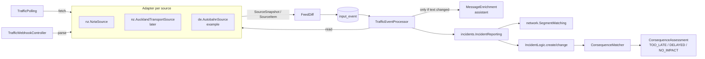

# Traffic data sources (`input`) – draft

- **Status:** Stages 1, 2 and 4 implemented (polling, diffing, reading, locating, creating, changing and ending incidents, idle pause, enrichment, see [Stages](#stages)), the rest is a draft. Fills the open points "Event sources" and "Event → Incident" from [architecture.md](architecture.md#open-points) and [domain.md](domain.md#open).
- **Goal:** Connect traffic events from several sources per country through **one** interface, locate them as an `Incident` on segments and assign them to the trips' routes via the existing `ConsequenceMatcher`.
- **Principle:** Polling, diffing, storing, locating, incident and enrichment are shared. Each source only has an adapter that fetches and reads. New source = new adapter plus configuration, no change to schema or processing.
- **First source:** NZTA Traffic and Travel REST API (New Zealand), see [NZTA](#first-source-nzta).

## Overview



- Existing and unchanged: `IncidentLogic`, `ConsequenceMatcher` (segment → RouteSection, overlap with the expected passage). New afterwards: the assessment against the stops, see [consequence-assessment.md](consequence-assessment.md).
- **Not part of this draft:** solutions and alternatives (detours, `recommendations`).

## Interface `TrafficSource` (`input.logic`)

- One interface for all sources, whether polled (`TRAFFIC_FEED`) or pushed (`WEBHOOK`). Adapters are Spring beans in `input.sources.<country>` (e.g. `input.sources.nz.NztaSource`) and only know records from `input.logic`, no entities (exception: the enum `EventSourceType`).
- **Implemented (stages 1, 2):** everything except `parse` (with `WebhookDelivery`, comes with the first webhook source).
- **Deviation (stage 2):** `read` gets the stored `payload` (`TrafficReport read(String payload)`), not the `SourceItem`: only the payload is stored on the event. `read` also returns `messageText` (`TrafficReport.messageText`), same function as when polling.

```java
public interface TrafficSource {
    /** Unique name, = EventSource.name, e.g. "nz-nzta". */
    String name();
    /** ISO 3166 code, e.g. "NZ". */
    String country();
    /** Region of the road network used for locating, default on the adapter (e.g. "nz"), can be overridden via network-region (tests: "wellington"). */
    String networkRegion();
    EventSourceType type();                   // TRAFFIC_FEED or WEBHOOK
    PollPolicy pollPolicy();                  // only TRAFFIC_FEED, otherwise PollPolicy.NONE
    Attribution attribution();                // source notice, mandatory texts from the terms of use

    /** Entire current state of the source. Only TRAFFIC_FEED. Throws SourceUnavailableException on errors. */
    SourceSnapshot fetch(FetchContext context);

    /** Verify and split a delivery to the webhook. Only WEBHOOK. */
    List<SourceItem> parse(WebhookDelivery delivery);

    /** Read a stored item in domain terms, deterministic, without network and without a model. */
    TrafficReport read(String payload);
}
```

- **Records** (in `input.logic`):

  | Record | Content |
  |---|---|
  | `PollPolicy` | `interval`, `jitter`, `maxBackoff`, `timeout`, `clearAfterMissing` (polls), `maxClearRatio`, `minKnownForRatio` (`maxClearRatio` applies from this many known events on); `PollPolicy.NONE` for webhooks |
  | `FetchContext` | `etag`/`lastModified` of the last poll, point in time, `location` (different address only for this poll, tests) |
  | `SourceSnapshot` | `items`, `complete` (entire state, only then are events cleared), `etag`/`lastModified`, `notModified` |
  | `SourceItem` | `subjectId` (id of the event at the source), `version` (modification time or counter), `payload` (raw JSON of exactly this event), `messageText` (all free texts of the event, for the enrichment), `messageHash()` |
  | `TrafficReport` | type (`IncidentType`), `resolved` (source reports the end), `validFrom`, `validTo`, road (`roadRef` as at the source), direction, `location` (`IncidentLocation` from `incidents.logic`: point, line or area, WGS84), delay if given, `assumedDelay` (assumption of the source without a number, see [assumptions](#delay-without-a-value)), `title`, `description`, `messageText`, `sourceUrl` |
  | `Attribution` | source name, notice text (e.g. "only confirmed, notable events"), maximum age until "not up to date" |
  | `WebhookDelivery` | headers, body, time of receipt; signature check in the adapter |

- **What the adapter does not do:** storing, diffing, segments, incidents, model calls. This keeps all rules (clearing, protection against mass clearing, enrichment) the same for every source.
- **Several sources per country:** e.g. NZTA (state highways) and Auckland Transport (local roads). Each source has its own `subjectId`s and creates its own incidents. Merging duplicate reports of the same closure from two sources is open, see [Open](#open).
- **Registration:** `TrafficSources` collects all beans, creates missing `EventSource`s on startup (`name`, `type`) and switches them off via `EventSource.enabled` and `nfv.input.sources.<name>.enabled`. `country` and the default for `networkRegion` are on the adapter, not in the database; `network-region` and `url` come from the configuration.
- **`RefNormalizer` per region** (planned in [network.md](network.md#interfaces-networklogic)): `roadRef` of the source → `ref` in the network (`SH 1`, `SH1`, `State Highway 1` → `1`; in Germany `A 6` → `A 6`).

## Common flow

### Polling (`TrafficPolling`)

- One scheduler for all `TRAFFIC_FEED` sources (`TrafficPollingScheduler`, looks for due sources every `nfv.input.polling.tick`, can be switched off via `nfv.input.polling.scheduler-enabled`), each source with its own rhythm according to `PollPolicy` (`PollSchedule`, time of the next poll in memory, one replica, see [deployment.md](deployment.md); with several replicas a lock via `pg_try_advisory_lock`).
- Exactly one `fetch` per poll (outside a transaction), then `FeedDiff` in one transaction. First poll directly after startup plus random offset `jitter`, then `interval` plus `jitter`.
- On `SourceUnavailableException` backoff: 2×, 4×, … `interval`, at most `maxBackoff` (NZTA: 10 → 20 → 30 min), then `interval` again. An error changes nothing that is stored.
- `TrafficPolling.pollNow(name)` or `pollNow(name, location)` polls immediately, regardless of the rhythm (tests). Disabled sources → `SKIPPED`.
- Idle pause per source (stage 2): no poll if no route section with a passage in the next `horizon` (default 14 days) lies in the source's `networkRegion` and no active incident of the source exists (`TrafficPolling.isNeeded`). Then the next look after `interval`. `pollNow` ignores the idle pause.
  - Query via `incidents.IncidentReporting.hasPassagesInRegion` (segments of the sections with a passage in the period from `trips`, their region from `network.SegmentQueries.anyInRegion`) and `anyActive` (incidents from the source's events).
- Last successful poll (also on "not modified"): `event_source.last_success_at`, for "as of" in the frontend. `ETag`/`Last-Modified` of the last response in `event_source.etag`/`last_modified`.

### Webhook (`TrafficWebhookController`)

- `POST /api/v1/input/webhooks/{sourceName}`, without a user token, verified solely via the signature in the adapter (`parse`). Invalid → `WebhookEvent` with `signatureVerified=false`, not processed.
- Webhooks deliver single changes, not an entire state (`complete=false`): clearing only when the source reports it (`TrafficReport` with an end in the past).

### Diffing (`FeedDiff`)

- Per source, comparison with the last known version per `subjectId`. State in the table `source_subject` (`version`, `message_hash`, `missing_polls`, `last_seen_at`, `cleared_at`), result `FeedDiff.Result` (new, changed, unchanged, missing, cleared, clearing blocked).
- **New or changed** (`version` new): one `TrafficEvent` with `payload`, `subject_id`, `message_hash`, `externalId` = `<subjectId>@<version>` (`uk_input_event_external` detects duplicate polls). No processing yet (stage 2).
- **Unchanged:** store nothing, only `last_seen_at`.
- **Dropped** (only with `complete=true`): only after `clearAfterMissing` successful polls without the event a "cleared" event (`externalId` `<subjectId>@cleared@<time>`, `payload` of the last version).
- **Back again** after clearing: counts as changed. Same version as before → `externalId` `<subjectId>@<version>@reappeared@<time>`.
- **Protection against mass clearing:** If more than `maxClearRatio` of the known (not cleared) events are missing at once, nothing is cleared and the poll does not count as "missing" for anyone, warning in the log. Applies only from `minKnownForRatio` known events on (NZTA: 10), so that a source with few events can clear all of them. Error responses never clear anything.
- **Not modified** (HTTP 304): only `last_success_at`, no event counts as missing.

### Processing (`TrafficEventProcessor`)

- After the commit of the poll (`@TransactionalEventListener(AFTER_COMMIT)`, virtual thread), one transaction per event.
1. `read` of the adapter → `TrafficReport`.
2. Enrichment, only if the text has changed, otherwise the stored result for the hash, see [Enrichment](#enrichment-messageenrichment). Before locating, because the direction is often only in the text.
3. Hand-over to `incidents.logic.IncidentReporting.report(ReportedIncident)` with the incident id of the previous version (via `subject_id`) or without. `ReportedIncident`: type, validity, time windows, delay (with "estimated"), location (`IncidentLocation`), `roadRef`, direction, `networkRegion`, ended yes/no. `incidents` locates and creates (decided 2026-11-04, see [Dependencies](#dependencies)):
   - Locating via `network.logic.SegmentMatching` in the `networkRegion`: line via map matching, point via radius (`nfv.incidents.point-radius-meters`, default 50) and `ref`, tunnels and bridges included. Direction from the enrichment, otherwise both directions; compass direction (`TravelDirection.NORTHBOUND` …) → segments whose course (start → end) points in that direction (bearing ± 60°). Areas only later (`AREA_NOT_SUPPORTED`). If an event only affects an on- or off-ramp (`TrafficReport.linkOnly`, `ReportedIncident.linkOnly`), only segments with `link` count, without a filter on `ref`.
   - Both directions for lines: map matching in the order of the points **and** reversed (dual carriageways like the Urban Motorway are each a one-way road without `reverseId`), plus `reverseId` for two-way roads.
   - First version → `IncidentLogic.create`, further version → `IncidentLogic.change` (also with a new type, see below), ended (`TrafficReport.resolved`, e.g. NZTA `Resolved`, or dropped: `externalId` with `@cleared@`) → `change` with `validTo` = now (at the earliest `validFrom`; no deletion, Envers keeps the history, `ConsequenceMatcher` removes the consequences). Ended before the start (cancelled): `validTo` = `validFrom`, a validity without length hits no passage (`IncidentOverlap`).
   - Previous version: last event of the same source and `subject_id` with an incident. If a version led to no incident (e.g. `NO_SEGMENTS`), the next one creates one.
   - Result `ReportOutcome`: `incidentId` or reason (`NO_SEGMENTS`, `AREA_NOT_SUPPORTED`, `ROUTING_UNAVAILABLE`, `ENDED`: reported as ended without there having been an incident).
4. `Event.processed(incidentId, note)`, for a reason `processed(null)` with the reason as `processing_note`. With `ROUTING_UNAVAILABLE` (network not loaded yet) the event stays open and is processed again in the next run.

- **Implementation (stage 2):**
  - Trigger: `FeedDiff` publishes `SourcePolled` after **every** successful poll (also without new events, so that open ones such as `ROUTING_UNAVAILABLE` are caught up). `TrafficEventProcessor.processPending()` processes all open `TrafficEvent`s of all sources, oldest first, one transaction per event, never two runs at the same time. Can be switched off via `nfv.input.processing.after-poll` (tests call `processPending` themselves).
  - Error while processing (exception) → event completed with `processing_note` `FAILED: …`, so that it does not fail again on every run. Unreadable payload → `UNREADABLE: …`, unknown source → `UNKNOWN_SOURCE`.
  - **Interim rule without time windows:** If the enrichment yields no usable windows and `messageText` mentions times of day or nights (`9pm`, `4:30am`, `21:00`, `night(s)`, `overnight`), the event is reported as `OTHER` (no closure), `processing_note` `TIMES_IN_TEXT: …`. Affects e.g. `566003` (Terrace Tunnel, only closed at night).
    - **Closures among them (decided 2026-11-05, `V36`):** `Incident.timesUnconfirmed` (history-tracked, also in `TripIncidentDto`). Assessment `DELAYED` with a delay of 0 instead of `NO_IMPACT`, notice "check times", no shift, never `TOO_LATE`. Reason: even roads closed around the clock mention times of day (`561819`, `565813`), 9 of the 20 active closures in the sample would otherwise not have been counted. Accepts that night closures also warn during the day until enriched.
    - Closures that are only in the text (`566353`, `Caution`) stay `NO_IMPACT` until enriched.
  - **Expired end (decided 2026-11-05):** If the source keeps reporting a closure without windows as not ended although `validTo` has already passed (`541001`, `expectedResolution` 19 May 2026), the date counts as outdated: `validTo` empty (until further notice, i.e. not passable). Only checked when processing a version: if the end expires while the event stays unchanged in the feed, the incident still ends at that date, see [Open](#open).
  - Description of the incident: `title` and `description` of the `TrafficReport` (truncated to 2000 characters).

- **Type change (decided 2026-11-04):** `IncidentLogic.change` also takes the type (e.g. `566353`: `Caution` → closed according to the text; roadworks → full closure). Same incident id, Envers keeps the old type, the consequence is updated (`DELAYED` → `BLOCKED`) and keeps its id. Added to [domain.md](domain.md#incidents).

## Enrichment (`MessageEnrichment`)

- **Implemented (`V39`):** `input.logic.AssistantEnrichmentModel` asks the model via `StructuredExtraction.extractForSystem` (system quota), `input.logic.MessageEnrichment` stores the answer (`message_enrichment`, entity `StoredEnrichment`, unchanged) and checks it on every use. Tests mock `EnrichmentModel`.
  - **Deviation: call outside the transaction.** A call can take up to 90 s and should not hold a database connection. `TrafficEventProcessor` asks before the event's transaction, the transaction only reads the stored answer.
  - **No answer now** (`EnrichmentDeferredException`: quota exhausted, model unreachable, answer unusable): the event is processed without enrichment and marked `enrichment_pending`. Until the next run the model is not asked again, further events also become `enrichment_pending`.
  - **Catching up:** At the end of every run, few failed attempts first, then the oldest; a failed attempt ends catching up for this run. Then the same event is reported again, same incident. Superseded versions and ended events are not caught up. After 20 failed attempts (`enrichment_attempts`) the event stays without enrichment, an exhausted quota does not count as a failed attempt.
  - **Without a key or with `nfv.input.enrichment.enabled=false`:** no call, no `enrichment_pending`. If a key is added later, already processed events are only enriched with a new version.
  - **Existing data:** `V39` sets `enrichment_pending` for all already processed `TrafficEvent`s with text, so that events with unchanged text are read as well (Terrace Tunnel). Superseded versions and ended events are completed without a call.
  - **Storage of estimated values (decided 2026-11-05):** A delay from the text replaces `assumedDelay` and thus counts as estimated, no column of its own. `expectedDelay` stays reserved for the source's number.
  - **Reading:** `closedDuringWindows` raises `OTHER`, `ROADWORKS`, `CONGESTION` to `CLOSURE` (only `HIGH`, `ACCIDENT` stays). `expectedReopening` becomes `validTo`. `direction` goes to locating. Invalid single values (reopening, delay) are ignored, the rest of the answer applies. `evidence` is compared ignoring differences in whitespace.
  - **Not verified:** quality of the model on real texts, see [Open](#open). `events.json` contains the cases, a run with a key shows them.
  - Conversion of local time → point in time with `TrafficSource.zone()` (NZTA `Pacific/Auckland`), in code, not in the model.
  - End after start, at most 24 h per window, at most 200 windows; otherwise the whole answer is discarded.
  - **Deviation:** windows are **clipped** to `validFrom`–`validTo` instead of discarded (the first night of the Terrace Tunnel starts at 21:00, `validFrom` 21:00:26); those lying completely outside are dropped, if none remains the answer is discarded. The validity is never extended.
  - With windows, the type from `read` applies (e.g. `CLOSURE` → `BLOCKED` only within the windows). Without a usable answer the interim rule stays (`TIMES_IN_TEXT` → `OTHER`). Ended events never ask the model.
  - `vehicleScope` goes to `Incident.vehicleScope` (for the assessment, [consequence-assessment.md](consequence-assessment.md)), unchecked except for the value range.

- **What for:** free text of the report that `read` cannot read deterministically, e.g. "expected to reopen around 3pm", "allow an extra 30 minutes", "northbound only".
- **Only on changed text or changed validity (validity decided 2026-11-05, `V40`):** The agent is called if there is no answer yet for `messageText` and `validFrom`–`validTo` of the same event (`subjectId`). The validity is part of it because the answer contains dated windows: if the source extends a closure with the same text, the windows would otherwise end at the old end and later passages would not be affected. Failed attempts are retried, see above.
  - `message_hash` = SHA-256 over the normalised `messageText` (whitespace collapsed, case preserved).
  - First version of an event → call.
  - New version with the same hash and the same validity (e.g. only timestamp, geometry or status changed) → no call, use the stored answer.
  - New version with a different hash or a different validity → call.
  - Unchanged polls create no event (`FeedDiff`), hence no call either. Clearing never calls.
  - Empty `messageText` → no call.
- **What the agent does not do:** determine segments, create incidents, extend the validity beyond the source's `validFrom`–`validTo`. Locating from `read` stays leading.
- **Call:** `assistant.StructuredExtraction` with a fixed schema, answer strictly checked:

  | Field | Check |
  |---|---|
  | `timeWindows` (list of `start`–`end` as local time with date, or empty = continuous) | every window within `validFrom`–`validTo`, `end` > `start`, at most 24 h per window, at most 200 windows; conversion into points in time via the region's time zone (`Pacific/Auckland`), not in the model |
  | `closedDuringWindows` (yes/no) | `true` raises `OTHER`/`ROADWORKS`/`CONGESTION` to `CLOSURE`, only with `confidence` `HIGH` |
  | `expectedReopening` (point in time or empty) | after `validFrom`, at most 30 days, only if the source provides no end |
  | `delayMinutes` (number or empty) | 0–720 |
  | `direction` (`BOTH`, `NORTHBOUND`, `SOUTHBOUND`, `EASTBOUND`, `WESTBOUND`, `UNKNOWN`) | only narrows, never widens |
  | `vehicleScope` (`ALL`, `HEAVY_ONLY`, `LIGHT_ONLY`) | `HEAVY_ONLY` → no closure for cars, only a notice |
  | `evidence` (verbatim excerpt of the text) | must occur in `messageText`, otherwise discard the result |
  | `confidence` (`HIGH`, `MEDIUM`, `LOW`) | `LOW` → discard the result |

- The model already returns weekdays and nights ("Sunday to Thursday nights between 9pm and 4:30am") as single windows with a date. The checks (within the validity, length) are done by the code.

- Values from `read` take precedence (e.g. end or delay that the source provides as a field). The agent only fills gaps.
- **Storage:** table `message_enrichment` (`source_id`, `subject_id`, `message_hash`, `validity`, result JSON, model, `created_at`, unique over `source_id, subject_id, message_hash, validity`). With the same hash and the same validity the stored result is used. On the incident, adopted values are marked as estimated (decide during implementation: column `derived` or reference to `message_enrichment`).
- **System quota (decided 2026-11-04, added to [architecture.md](architecture.md#assistant)):** Background calls do not count against a user but against a quota of their own (`nfv.assistant.system-requests-per-hour`, default 60, separate counter in the `RateLimiter`). `StructuredExtraction` gets a call without a user for this (`extractForSystem(…)`), no technical user in `app_user`.
  - Expected load: a one-off of around 200 calls on the first poll (sample: 197 events, spread over a few hours by the quota), afterwards only changed texts, estimated a few dozen per day.
  - **Quota exhausted** (or model unreachable): the event is processed without enrichment (incident according to `read`, events with times of day in the text as `OTHER` without a closure, see [Stages](#stages)) and marked as `enrichment_pending`. Every poll catches up open enrichments (oldest first, within the quota) and then changes the incident. Same hash → no second call, also when catching up.
- **Cost:** With the rule "only on changed text or changed validity" there is exactly one call per event, text version and validity (without retries after errors), regardless of the polling interval. Events without an affected route are enriched as well, so that later routes (`RouteChanged`) already find the values.
- **Without a key** only the enrichment is missing. **Data protection:** only texts of the source go to the model, no user or trip data.

## Time windows

- **Problem:** An `Incident` currently has exactly one validity `validFrom`–`validTo`. Night closures over weeks (Terrace Tunnel) would hit every passage in the whole period.
- **Decided (2026-11-03), added to [domain.md](domain.md#incidents):** `Incident` 0..* `IncidentWindow` (`startsAt`, `endsAt`), `@ElementCollection` like `incident_segment`, history-tracked (`incident_window_aud`).
  - No windows = continuously valid (as today).
  - `validFrom`–`validTo` stays the envelope for the preselection in `findPassing`/`findActiveOnSegments`.
  - `IncidentOverlap.overlaps` additionally checks: at least one window overlaps the passage. The assessment ([consequence-assessment.md](consequence-assessment.md)) uses the same check.
  - `Consequence` gets the first window that is hit (`windowStart`, `windowEnd`) for display ("closed 21:00–04:30").
- **Implemented (`V34`):**
  - `IncidentWindow` as `@Embeddable` in a `Set` (`incident_window`, PK `incident_id, starts_at, ends_at`); Envers additionally needs `setordinal` in `incident_window_aud`.
  - Logic record `incidents.logic.TimeWindow` (end after start), `Incident.timeWindows()` sorted, `Incident.firstWindow(start, end)`.
  - `IncidentOverlap.overlaps(validFrom, validTo, windows, start, end)` and `firstWindow`; used by `Incident.overlaps`, `ActiveIncident.overlaps` (and thus also route suggestions) and `ConsequenceMatcher`.
  - `ConsequenceMatcher.matchIncident` additionally filters the sections from `findPassing` (envelope) by the windows; `matchRoute` via `Incident.overlaps`. `consequence.window_start`/`window_end` = first window hit, empty without windows.
  - `IncidentLogic.create`/`change` (variant with type) take the windows, the variant without type keeps them. When ending, the windows stay, the envelope (`validTo`) limits them.
- **Rejected:** one incident of its own per window (Terrace Tunnel: around 35), because updates from the source would then have to change all incidents and notifications would multiply.

## Schema

- **`V32` (stage 1, implemented):**
  - `input_event`: `subject_id VARCHAR(255)`, index `ix_input_event_subject (source_id, subject_id)`; `message_hash VARCHAR(64)`; `processing_note VARCHAR(500)`; `enrichment_pending BOOLEAN NOT NULL DEFAULT FALSE`.
  - `event_source`: `last_success_at TIMESTAMP(6) WITH TIME ZONE`, `etag VARCHAR(255)`, `last_modified VARCHAR(64)`.
  - New table `source_subject` (`source_id`, `subject_id`, `version`, `message_hash`, `missing_polls`, `last_seen_at`, `cleared_at`, unique over `source_id, subject_id`): state of `FeedDiff`.
- **`V33` (stage 2, implemented):** `incident.assumed_delay BIGINT` and `incident_aud.assumed_delay` (duration in nanoseconds like `expected_delay`).
- **`V34` (time windows, implemented):** tables `incident_window` (`incident_id`, `starts_at`, `ends_at`) and `incident_window_aud` (with `setordinal`); `consequence.window_start`, `consequence.window_end`.
- **`V36` (interim rule, implemented):** `incident.times_unconfirmed BOOLEAN` and `incident_aud.times_unconfirmed`.
- **`V37` (on- and off-ramps, implemented):** `road_segment.link BOOLEAN`, see [network.md](network.md#data-model).
- **`V39` (enrichment, implemented):** table `message_enrichment`, see above; `input_event.enrichment_attempts SMALLINT`.
- **`V40` (implemented):** `message_enrichment.validity`, part of the unique key.
- **`V41` (implemented):** `revtype` in the primary key of `incident_window_aud`: Envers numbers the elements of the set by position, a window can be removed and added in one revision. `IncidentWindow` compares points in time, not offsets (the database returns a different one than the source), `Incident.change` only changes the difference of the windows.

## First source: NZTA

- `input.sources.nz.NztaSource`, name `nz-nzta`, country `NZ`, region `nz`, `TRAFFIC_FEED`.
- URL `https://trafficnz.info/service/traffic/rest/4/events/all/10`, `Accept: application/json`, without a key. v4 instead of v5 (v5 undocumented). Only state highways, only "notable", confirmed events.
- **Conservative `PollPolicy`:** `interval` 5 min, `jitter` 30 s, backoff 10 → 20 → 30 min, `timeout` 20 s, `clearAfterMissing` 2, `maxClearRatio` 0.5. One request per cycle for all of NZ.
- `complete=true`. Empty response (`"response": ""`) after HTTP 200 = no events. `If-None-Match`/`If-Modified-Since` if the API provides `ETag`/`Last-Modified` (to be checked); 304 → `notModified`.
- Errors → `SourceUnavailableException`: HTTP status other than 2xx/304, timeout, broken JSON, response without `response` or `roadevent`, file missing. Events without `id` or `eventModified`/`eventCreated` are skipped (warning).
- User agent: `Nfv (+<nfv.frontend-url>)`, no personal email.
- `PollPolicy` from the configuration (`interval`, `jitter`, `max-backoff`, `timeout`), `clearAfterMissing` 2, `maxClearRatio` 0.5 and `minKnownForRatio` 10 fixed in the adapter.

### Response (sample 2026-11-03, 197 events, `events.json`)

- Structure: `{"response": {"roadevent": [ … ]}}`, one object per event.
- **Geometry:** WKT in WGS84 (longitude latitude), no NZTM: `POINT` (121, all `Road Work`, `Scheduled Road Work`, `Road Hazard`) or `MULTILINESTRING` (76, all `Area Warning`, mostly one part, up to 6). No conversion needed, read via JTS `WKTReader` in `network`.
- **Times:** ISO with offset (`+13:00`), milliseconds partly present. `endDate` is missing for 16 events. `expectedResolution` is text: `Until further notice` or `dd/MM/yyyy HH:mm` in local time (`Pacific/Auckland`).
- **Optional:** `endDate`, `journey`, `journeyLeg` (2× `null`), `directLineDistance1–3` (text such as "0.35 km southwest of …"), `restrictions` (1×), `updateDue` (1×). `locations` is mostly text, 3× a list.

| NZTA field | Use |
|---|---|
| `id` (number) | `subjectId` |
| `eventModified` | `version` |
| `status` (`Active` 150, `Scheduled` 17, `Resolved` 30) | `Resolved` = cleared (in addition to dropping out of the feed), `Scheduled` = incident with a future `validFrom` |
| `startDate` | `validFrom` |
| `endDate`, otherwise `expectedResolution` | `validTo`, `Until further notice` → empty |
| `eventType` (`Road Work` 105, `Area Warning` 76, `Scheduled Road Work` 11, `Road Hazard` 5) | type, see below |
| `eventDescription` (`Maintenance`, `Other`, `Pavement Repairs`, `Resurfacing`, `Crash`, `Flooding`, `Slip`, …) | type (`Crash` → `ACCIDENT`), title |
| `impact` (`Caution` 136, `Road Closed` 32, `Delays` 28, `Vehicle Restrictions` 1) | type and impact, see below |
| `geometry` | `location` (`GeoPoint` or `GeoLine`) |
| `way.name` (`01N`, `01S`, `006`, …) | `roadRef`; `RefNormalizer`: `01N`/`01S` → `1`, `006` → `6`. Empty if `locationArea` starts with `SH N/A`: a local road, `way` only names a highway nearby |
| `locationArea` (e.g. "SH 1 Terrace Tunnel, northbound") | title, part of `messageText`; `on-ramp`, `onramp`, `off-ramp` or `link to` result in `linkOnly`, except `incl link to` (the road itself including the junction) |
| `eventComments` | part of `messageText` |
| `alternativeRoute` | part of `messageText`; `Not Applicable`, `Not applicable.`, `N/A` → empty |
| `locations` (e.g. `01N-1068/05.95-B   TERRACE TUNNEL START TO …`) | display only, see direction |
| `planned`, `informationSource` (`NZTA`, `NMC`, `Police`), `region.name`, `eventIsland` | display, filter |
| `journey`, `journeyLeg`, `directLineDistance*`, `supplier` | not used |

- **Type** (in order, first match):
  1. `impact` = `Road Closed` → `CLOSURE`
  2. `eventDescription` = `Crash` → `ACCIDENT`
  3. `eventType` = `Road Work` or `Scheduled Road Work` → `ROADWORKS`
  4. `impact` = `Delays` → `CONGESTION`
  5. otherwise `OTHER` (`Area Warning`/`Road Hazard` with `Caution`, `Vehicle Restrictions`; cars not blocked)
- <a id="delay-without-a-value"></a>**Delay without a value (decided 2026-11-04):** The assumption comes from the source, not from the type of the incident (`TrafficReport.assumedDelay`, configurable, marked as "estimated"). Reason: 66 events of the sample are `Road Work` + `Caution` (mostly 30 km/h), with one assumption per type all of them would be `DELAYED`.

  | NZTA | Assumption |
  |---|---|
  | `impact` `Caution` | 0 (→ `NO_IMPACT`, unless text or enrichment names a number) |
  | `impact` `Delays` | 15 min |
  | `eventDescription` `Crash` | 30 min |
  | `impact` `Road Closed` | none (closure, waiting time from window or end) |
  | `impact` `Vehicle Restrictions` | 0 |

- **Direction:** The suffix in `locations` (`B` 217, `D` 15, `I` 13; RAMM chainage, B = both, I/D = increasing/decreasing) does not always match the text: Terrace Tunnel has `-B`, text and `locationArea` say "northbound". Direction is therefore taken from the text (enrichment), without a value both directions. Increasing/decreasing cannot be mapped to segments without RAMM data. `read` therefore returns no direction (both).
- **Implementation of `read` (stage 2, `NztaReader`):** geometry via JTS `WKTReader` in `input.sources.nz` (library, not `network`): `POINT` → point, `(MULTI)LINESTRING` → lines, `POLYGON` → area. `validFrom` = `startDate`, otherwise `eventCreated`. `expectedResolution` without `endDate` in `Pacific/Auckland`. Title `eventType: locationArea` (e.g. "Road Work: SH 1 Terrace Tunnel, northbound"), description = `messageText` plus `locations` (text or list, one per line). `assumedDelay` keys: `caution`, `delays`, `crash`, `vehicle-restrictions`; `Crash` before `impact`, `Road Closed` without an assumption.
- **`messageText`** = `locationArea` + `eventComments` + `alternativeRoute` (normalised). `eventModified` also changes without new text (Terrace Tunnel: modified at 21:00, text the same), exactly then the enrichment does not call.

### Trial run against the entire network `nz` (2026-11-05)

- Sample `events.json`, fixed `Clock` 3 Nov 22:15, without enrichment, no routes assessed: it shows where incidents land, not the categories. Import around 4.5 min, 1,634,230 segments.
- Active events with an incident: before the rules for on- and off-ramps and `SH N/A` 158 of 167, afterwards 163 of 167.
- Closures at on- and off-ramps (7) then only lie on `link` segments, before that 5 lay on the main carriageway and 2 found nothing. Within a radius of 50 m they hit several segments (1 to 11, each a different OSM way), probably also other ramps of the same junction; not checked individually.
- Not located: `541001` (closure, `way` `026`, in OSM `SH 26A`), `565813` (closure, line), `562769` (`Caution`, line), `565350` (`Caution`, road in OSM without a number).

### Findings from the sample

- **Time windows are only in the text:** 97 of 197 comments mention times of day or nights, including 9 of the 32 closures. Example Terrace Tunnel (`566003`): `startDate` 1 Nov, `endDate` 18 Dec, but only closed "Sunday to Thursday nights between 9pm and 4:30am". Without time windows every route through the tunnel would get a closure for seven weeks, also during the day. The enrichment therefore reads time windows, see [Time windows](#time-windows).
- **`impact` partly underestimates:** `566353` (`Area Warning`, `Caution`) is closed northbound at night according to the text. The enrichment may raise the impact to a closure, only with `confidence` `HIGH` and only with text as evidence, see [Enrichment](#enrichment-messageenrichment).
- **Points for stretches:** Roadworks and closures come as `POINT`, even if a stretch is meant (`locations` from … to). For closures one segment is enough, one closed spot closes the road. For delays the length is secondary.
- **Tunnels and bridges:** The point of the Terrace Tunnel lies inside the tunnel. Unlike when snapping stops (`snap_preventions`), `SegmentMatching` must not exclude tunnels and bridges. The filter on `ref` prevents hits on roads above.
- **End via status:** 30 events are `Resolved` and are still in the feed (with "The road is now clear."). Clearing therefore mostly happens via the status, dropping out of the feed is the safeguard.
- **Length of the texts:** at most 489 characters per comment, low cost per enrichment.

## Assignment to trips

- Unchanged via `ConsequenceMatcher`: segments of the incident → `ix_route_section_segment` → sections with an overlapping expected passage → one consequence per route (first affected section, `BLOCKED` for `CLOSURE`, otherwise `DELAYED`).
- New or replanned routes find existing incidents via `RouteChanged` → `matchRoute`.
- Then assessment per route against the arrival at the target stop (`TOO_LATE`, `DELAYED`, `NO_IMPACT`), including propagating the delay, see [consequence-assessment.md](consequence-assessment.md).
- The end of an incident is solved with "cleared", direction via direction-specific segments.

## Dependencies


- **Decided (2026-11-04, added to [architecture.md](architecture.md#dependencies-between-modules)):** Only `input → assistant` is new. `input` receives, stores, reads and enriches; `incidents` locates (via `network.SegmentMatching`, `incidents → network` exists), creates incidents and assigns them. This keeps locating in one place, also for later incidents at accommodations.
- `input` does not know `network`. It passes locations as `incidents.logic.IncidentLocation` (record of its own, WGS84), `incidents` converts it into `network.logic` records.
- Adapters (`input.sources.*`) only depend on `input.logic` and `incidents.logic` (records), later enforced via ArchUnit.

## Test source `manual`

- **Purpose:** enter events by hand and see the result directly, with arbitrary data, without swapping files, including direction and time windows before the enrichment. Manual tests in `test.txt`.
- **Structure:** `input.sources.manual.ManualSource`, an ordinary adapter (`TRAFFIC_FEED`), not a webhook, because `TrafficPolling` and `TrafficEventProcessor` only know `TrafficEvent`s. Entered events are kept in memory, `fetch` returns them as an incomplete state (`complete=false`), so a restart clears nothing. The flow afterwards is the same as for every source: `FeedDiff`, `read`, enrichment, `IncidentReporting`, assessment.
- **Endpoints** (`input.api.TestTrafficEventController`):
  - `POST /api/v1/test/traffic-events`: reports the event, polls immediately and processes, response as for the `GET`. The same `id` changes the event, `resolved` ends it. Invalid → 400.
  - `POST /api/v1/test/traffic-events/placement` (`tripId`, `routeId`, `point`): places a spot on the caller's planned route (`incidents.logic.RoutePlacement`), reports nothing. Response: point on the route, distance, road number and name there, planned passage of the section. Someone else's route, an unplanned route or a route more than 5 km away → 422.
  - `GET /api/v1/test/traffic-events/{id}?source=…`: last version of an event of any source (default `manual`, e.g. `source=nz-nzta`): `outcome` (`PENDING`, `INCIDENT` or a reason such as `NO_SEGMENTS`), `note`, incident with roads and consequences of all routes.
- **Demo trip:** `demo.logic.DemoTrips` reports its prepared incidents through this source as well (event ids `demo-<key>-<day>`), see [demo-trip.md](demo-trip.md).
- **Fields:** `id`, `type`, `point` or `line`, `onRoute` (`tripId`, `routeId`, only with `point`: first place the point on this route, the response then includes `placement`), `roadRef`, `direction`, `validFrom`, `validTo`, `delayMinutes`, `assumedDelayMinutes`, `text`, `windows`, `vehicleScope`, `linkOnly`, `resolved`.
- **`TrafficReport`** additionally carries `windows` and `vehicleScope` for this: without enrichment these values apply, with enrichment its values. With `windows` the interim rule `TIMES_IN_TEXT` does not apply.
- **Safeguards** (decided 2026-11-05), an event affects the routes of all users in the region:
  - The source and endpoints only exist with `nfv.input.sources.manual.enabled=true` (`NFV_MANUAL_SOURCE_ENABLED`, default `false`), never in production. The OpenAPI file does not contain them, so neither does the generated client.
  - Role `tester` for `/api/v1/test/**` (`ApiSecurityConfig`, first role check of the API). The account `test` only gets it when created on an empty database (`TestAccountInitializer`), not by name: anyone can register. Existing accounts via SQL (`auth_account_role`), then sign in again.
  - The account `test`/`test` has a known password: on a reachable server use an account of your own with the role.
- **Frontend (2026-11-10):** pink button with a white lightning bolt on the left of the trip's button row (same size as the plus button), only if the access token carries the role `tester` (`auth/session.ts` `hasRole`, claim `roles` or `realm_access.roles`; display only, the backend does the check). Opens a sheet with steps under `stoerungen/neu`: kind, spot (tap on the map, the sheet moves down for this, pink pin; optionally road and direction), period, delay, text. "Report incident" sends `POST /api/v1/test/traffic-events` with its own `id` (`app-<time>`) through the configured client without generated types (`incidents/testIncidentApi.ts`), afterwards the sheet shows the result (incident with sections, roads and affected routes of the trip, or the reason without an incident). "Done" reloads the trip. 403 and 404 (source off) as messages of their own.
  - **Snapping (2026-11-11):** A tap up to 60 px next to a planned route of the trip belongs to that route (`incidents/snap.ts`, nearest line from `RouteLines`). The backend then places the spot via PostGIS on the nearest point of the route's sections (`SegmentQueries.closest`, `ST_ClosestPoint` on `ST_LineSubstring`), immediately for the preview (`/placement`, the pin jumps there, the road number is filled into the empty field, "The route is expected to pass here on …") and once more when reporting (`onRoute`). The point thus lies on the segment the route drives and is reliably found within the radius of `nfv.incidents.point-radius-meters`. Further away, the spot stays where it was tapped. `onRoute` is stored with the report on the device, "Change" places it on the route again.
  - **Result for the route:** If the incident affects the route, the sheet says that it will be on the map after "Done". Otherwise it names the likely reason: the route has already passed the spot (the map does not show notices for passed spots), passage outside "From"/"To" (assignment needs a temporal overlap, see [consequence-assessment.md](consequence-assessment.md)), otherwise check road or direction.
  - **Changing and ending:** The device remembers reported events (`localStorage` `nfv.testIncidents`, at most 20, `incidents/testIncidentStore.ts`). The first step lists them: "Change" opens the wizard prefilled and reports with the same `id` (new version), "End" reports `resolved`, ended ones can be removed. Only on this device; after a restart of the backend the source no longer knows the `id`, "Change" then creates the event anew.
- **Region:** `nfv.input.sources.manual.network-region` (`NFV_MANUAL_SOURCE_REGION`, default `nz`).
- **Response of the `POST`:** After a poll, the background run (`after-poll`) can process the event before the request does. `TrafficEventInspection` therefore reads the state as a projection from the database (`EventRepository.EventState`), not as an entity: the request's session would otherwise hold the old state.
- **Tests:** `ManualSourceApiTest` (with `after-poll`, categories, direction, windows, change, end, errors, roles, snapping onto your own route), `ManualSourceDisabledTest`, `TestAccountRoleTest`. Manually in `test.txt`, run through on 2026-11-05 against `docker-compose.local.yml` with a real sign-in and the entire network `nz`.

## Frontend

- On the notice (`IncidentSheet`): original text, source from `Attribution`, "As of: hh:mm", estimated values with ✦ as for bookings.
- "Traffic data currently not up to date" if the last poll is older than the source's maximum age.
- One-time notice text per source from `Attribution`.

## Configuration

```properties
# Stage 4 (implemented)
nfv.input.enrichment.enabled=true
nfv.assistant.system-requests-per-hour=60
# Stage 1 (implemented): scheduler, looks for due sources every tick
nfv.input.polling.scheduler-enabled=${NFV_INPUT_POLLING_ENABLED:true}
nfv.input.polling.tick=30s
# Stage 2 (implemented): idle pause, processing after every poll, radius for points (in incidents, locating happens there)
nfv.input.horizon=14d
nfv.input.processing.after-poll=true
nfv.incidents.point-radius-meters=50
# per source, name = TrafficSource.name(); without an entry the source is off
nfv.input.sources.nz-nzta.enabled=${NFV_NZTA_ENABLED:true}
# http(s): real source, classpath:/file: JSON file (tests, local)
nfv.input.sources.nz-nzta.url=${NFV_NZTA_URL:https://trafficnz.info/service/traffic/rest/4/events/all/10}
nfv.input.sources.nz-nzta.network-region=nz
nfv.input.sources.nz-nzta.interval=5m
nfv.input.sources.nz-nzta.jitter=30s
nfv.input.sources.nz-nzta.max-backoff=30m
nfv.input.sources.nz-nzta.timeout=20s
# Stage 2 (implemented)
nfv.input.sources.nz-nzta.assumed-delay.caution=0m
nfv.input.sources.nz-nzta.assumed-delay.delays=15m
nfv.input.sources.nz-nzta.assumed-delay.crash=30m
nfv.input.sources.nz-nzta.assumed-delay.vehicle-restrictions=0m
```

- Tests never call the real source, see [Test environment](#test-environment).

## Test environment

- **Basis:** a real JSON response from NZTA, provided by the user, stored unchanged as `backend/src/test/resources/sources/nz-nzta/events.json`. It also defines the field table of `NztaSource.read`.
- **`url` also accepts resources:** `http(s)://…` fetches via HTTP, `classpath:…` and `file:…` read the file (Spring `ResourceLoader`). The adapter reads both the same way (bytes → JSON), only `fetch` distinguishes the transport. No test adapter of its own, the same code is tested as in operation.
- **Automated tests** (`src/test/resources/config/application.properties`):

  ```properties
  nfv.input.sources.nz-nzta.enabled=true
  nfv.input.sources.nz-nzta.url=classpath:sources/nz-nzta/events.json
  nfv.input.sources.nz-nzta.network-region=wellington
  # no scheduler, tests call TrafficPolling.pollNow("nz-nzta")
  nfv.input.polling.scheduler-enabled=false
  # no background processing, tests call TrafficEventProcessor.processPending()
  nfv.input.processing.after-poll=false
  ```

- **Storage:** `events.json` is the sample from 2026-11-03 (197 events, approx. 460 KB), unchanged. **Simulating versions:** further files, derived by hand from `events.json`, each only changed at `566003` (Terrace Tunnel): `events-changed-text.json` (`eventModified` 4 Nov 09:30, comment "10pm and 5am" instead of "9pm and 4:30am"), `events-changed-status.json` (`eventModified` 4 Nov 09:30, `status` `Resolved`, same text), `events-cleared.json` (event missing, 196), `events-empty.json` (`"response": ""`). The tests call `pollNow(name, location)` with the respective file.
- **Time:** fixed `Clock` at `2026-11-03T22:15:00+13:00` (shortly after the latest `eventModified` of the sample, 22:13), so that validities and expected passages of the test routes match the response.
- **Road network:** tests run on the region `wellington` ([network.md](network.md#tests), `nfv.input.sources.nz-nzta.network-region=wellington`). The sample has two events in the test extract:
  - `566003` Terrace Tunnel, `POINT` in the tunnel, `Road Work`/`Road Closed`, `Active`, northbound, Sunday to Thursday 21:00–04:30 until 18 Dec.
  - `566353` Urban Motorway Terrace Tunnel → Ngauranga, `MULTILINESTRING` (extends beyond the test extract), `Area Warning`/`Caution`, `Scheduled` from 8 Nov, closed northbound at night according to the text.
  - All other 195 result in `NO_SEGMENTS`, that is expected and is checked as well.
- **Local and `mvn spring-boot:test-run`:** the same file via `NFV_NZTA_URL=classpath:sources/nz-nzta/events.json` or `file:/data/nzta/events.json` (bind mount like `~/data/osm`), so that development does not query NZTA. Local default: file. Only the stack (operation) uses the real URL.
- **Error cases** (timeout, 5xx, 429, broken JSON) via `MockRestServiceServer` with an `http` URL, content again from the files.

## Tests

- **Stage 1 (implemented):**
  - `NztaSourceTest`: `fetch` via `classpath:`, `file:` and `MockRestServiceServer` (headers `Accept`, `User-Agent`, `If-None-Match`/`If-Modified-Since`, `ETag`/`Last-Modified`, 304, 503, 429, broken JSON, timeout), derived files, empty response.
  - `FeedDiffTest` (`@SpringBootTest`): NZTA files via `pollNow` (new, unchanged, changed text, only status changed, dropped after 2 polls and back again, empty response blocked, error changes nothing, disabled) and `FeedDiff.apply` with made-up snapshots (few events, `maxClearRatio` limit, `complete=false`, 304).
  - `PollScheduleTest` (backoff, jitter), `SourceItemTest` (`message_hash`).
- **Stage 2 (implemented):**
  - `NztaReadTest`: `read` over all 197 events (types 32 `CLOSURE`, 90 `ROADWORKS`, 61 `OTHER`, 11 `CONGESTION`, 3 `ACCIDENT`; 30 `Resolved`; 121 points, 76 lines), `Until further notice` → open (12), `expectedResolution` in local time, `assumedDelay` per `impact` from the configuration, `locations` as text and list, broken payload.
  - `SegmentMatchingTest` (Wellington): `566003` with `01N` only tunnel segments with `SH 1`, without `ref` also The Terrace above; bearing separates the directions; `566353` via map matching on both carriageways of the motorway, northbound and southbound separately; nothing outside; region without network → `RoutingUnavailableException`; `RefNormalizer`.
  - `TrafficProcessingTest` (fixed `Clock` 3 Nov 22:15 NZ): end to end NZTA file → 197 processed, incidents only for `566003` and `566353`, the rest `NO_SEGMENTS`/`ENDED` → consequence `DELAYED` with `timesUnconfirmed` on the route Te Aro → Thorndon on 10 Nov (because of `TIMES_IN_TEXT`), then `Resolved` → same incident ends, consequence gone. New version without times of day → same incident, type `CLOSURE`, without `timesUnconfirmed`. New version with an expired end → `validTo` empty. Source on a region without network → event stays open. Idle pause.
  - `NztaReadTest` and `SegmentMatchingTest` additionally: `linkOnly` per event, `SH N/A` without `roadRef`, `linkOnly` finds ramps without a number.
  - `TrafficProcessingTest`, enrichment (model mocked): same text asks once, new validity asks again and replaces the windows, answer changes type, direction, delay, low confidence and wrong evidence are ignored, catching up changes the same incident, giving up after 20 failed attempts, quota does not count. `AssistantEnrichmentModelTest`: sent text, reading the answer. `RateLimiterTest`: system quota.
- **Time windows (implemented):**
  - `TrafficProcessingTest.nightWindowsBlockOnlyPassagesAtNight` (model mocked with Sun–Thu 21:00–04:30 from 1 Nov to 18 Dec): `566003` stays `CLOSURE` with 34 windows; route Wed 4 Nov 22:00 → `BLOCKED`, window 4 Nov 21:00 – 5 Nov 04:30; 12:00 → none; Fri 6 Nov 22:00 → none. Then planned routes (via `matchRoute`): Thu 5 Nov 23:00 → window from 5 Nov 21:00, Sat 7 Nov 23:00 → none.
  - `MessageEnrichmentTest`: time zone (summer and winter time), clipping, discarded answers (end before start, over 24 h, over 200), empty = continuous, `IncidentOverlap` with windows.
- Contract test for every adapter (shared abstract test class): reads the files under `src/test/resources/sources/<name>/` via `classpath:`, `read` returns valid `TrafficReport`s for every event of the response.
- Enrichment: first version → call, same text version on a new version → no call, changed text → call, empty text → no call (`StructuredExtraction` mocked, calls counted).
- `SegmentMatching` against the Wellington test extract ([network.md](network.md#tests)): `566003` only hits the northbound segments in the Terrace Tunnel (`ref` 1), not The Terrace above; `566353` hits the northbound motorway segments within the extract.
- `NztaSource.read` over all 197 events: no error, type rules according to the table (e.g. 32 `CLOSURE`), `Until further notice` → `validTo` empty, `locations` as text and as a list, `journey` `null`.
- Time windows: route through the Terrace Tunnel on 4 Nov at 22:00 → consequence `BLOCKED`; the same route at 12:00 → none; on Friday 6 Nov at 22:00 → none (enrichment mocked with the windows from the text).
- End to end: NZTA fixture → incident → consequence on a planned route, then "cleared" → consequence gone.

## Stages

1. **Implemented:** `TrafficSource`, records, `TrafficSources`, `TrafficPolling`, `FeedDiff`, `V32`, `NztaSource.fetch`. Collects real payloads.
2. **Implemented:** `NztaSource.read`, `IncidentReporting` with `SegmentMatching` (point, line), creating and changing incidents (incl. type), `assumedDelay` (`V33`), `TrafficEventProcessor`, idle pause when polling if nobody is travelling in the region. Ending (`Resolved`, dropped) implemented along with it, because `ReportedIncident` carries "ended" anyway.
3. Frontend (source, as of, not up to date).
4. **Implemented:** time windows on the incident and on the consequence (`V34`), assessment ([consequence-assessment.md](consequence-assessment.md)), model call with hash rule, system quota and catching up, all fields of the enrichment (`V39`). Without a usable answer, events with times of day in the text only as a notice (`OTHER`) without a closure, so that night closures do not report all day.
5. Webhook endpoint, second source (e.g. Auckland Transport), area events, propagating the delay, notification.

## Open

- Check the meaning of the suffix `I`/`D` in `locations` against the direction of travel, possibly use it as the direction if the text names none.
- `ETag`/`Last-Modified` at NZTA (check on a real response with headers).
- Merging the same closure from two sources (same segments, overlapping time).
- Retention of old `input_event` versions (e.g. 90 days).
- Check the model instructions and rules on real texts (`AssistantEnrichmentModel.INSTRUCTIONS`), so far only tested with a mocked model.
- Closures whose stretch is only in the text ("from … to") are not part of the enrichment; see above.
- On the first run (around 170 calls, 60 per hour) a `POST` to the test source waits until the current run is finished.
- Written inquiry to opendata@nzta.govt.nz whether 5 min is acceptable.
- Closures as `POINT` that mean a stretch ("Full Closure Lincoln Rd to Brigham Creek Rd": `566364`, `566366`, `566367`, `566368`): only 447–1,465 m are hit, the "from … to" is only in the text. `566368` also hits SH 20A, the text names SH 20.
- Events without a matching number in OSM (`541001`, `565350`): fall back to the nearest main road within the radius, marked as uncertain.
- Expired end with an unchanged event: closure in the feed, end passed, no new version. The incident ends at that date; a check on every poll would be needed.
- Forgotten entries of the source with an old date count as not passable through the rule "expired end".
