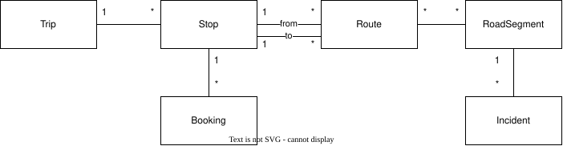
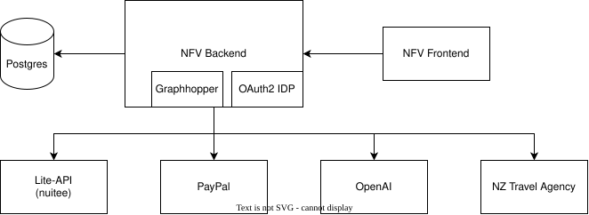

# NoFrustrationVacation

Agentic travel assistant that combines up-to-date official traffic data with booking preferences to make the best out of vacation troubles. The AI agent monitors road incidents along your planned travelling route and proactively prepares alternatives if this becomes necessary. This includes proposing alternative routes, stops and even similar accomodations if one becomes unreachable.
Bookings made via the app are paid with PayPal and only payed once fully confirmed. They can be cancelled easily in case your plans change again.

## Running the app locally

The application stack can be run locally as a docker compose stack from the repository root:

1. Copy `.env.example` to `.env`. The defaults are sufficient to get started locally, but the booking, PayPal and AI integrations require secrets/API keys to be provided.
1. ``docker compose -f docker-compose.local.yml up --build``
2. Access the frontend via [http://localhost:18173/](http://localhost:18173/) in your browser

## Core Features

### Add trip data

- Add stops
- Add routes between stops. Pick between suggested alternatives or place individual waypoints.
- Add bookings to stops. Extract booking data from pasted booking confirmation, search for accommodation name and autocomplete accommodation infos, or fully manual.

### Suggested solutions

- Incidents have a consequence (none, target will be reached delayed, target cannot be reached in time) and a type (traffic jam, road closure, accident, ...)
- If an incident requires replanning, solutions are automatically prepared by the assistant and the user can select the preferred alternative. The user is guided through the rebooking progress if required, the route is updated automatically on the map.

### Proactive changes by the user

- Booked for the wrong year? Accommodation did not register the booking? The user can proactively search for similar accommodations. The AI assistant compares search results (extracted via Lite-API and search criteria deterministically) to find the best match.
- Find route alternatives

## Core Domain

## Integration & runtime dependencies

| Component | Purpose |
|---|---|
| Nfv Backend | NoFrustrationVacation backend with business logic, persistence and integration of external services |
| Nfv Frontend | NoFrustrationVacation UI |
| Postgres | Relational database |
| PayPal | User payments and refunds upon booking cancellations |
| Lite-API by Nuitée (https://nuitee.com/connect) | Retrieve accommodation information, perform bookings and cancellations |
| OpenAI | GPT models for AI features (extracting accommodation data from booking confirmations, proposing traveling alternatives via function calling, generating cover images) |
| Identity Provider | A minimal OAuth2 IDP implementation is contained as a module within the Nfv backend. It has no dependencies to the rest of the application and can be exchanged with a dedicated IDP like Keycloak in the future. |
| NZ Transport Agency (https://opendata-nzta.opendata.arcgis.com/search?q=traffic) | Live traffic data for New Zealand. Data is polled regularly, incident severity is evaluated and incidents are mapped to trip routes. |                                                                                                                                                                                                                   |
| Graphopper | Library integrated into the backend for road network calculations (route suggestions, alternatives) |                                                                                 |                                                                                                                                      |

