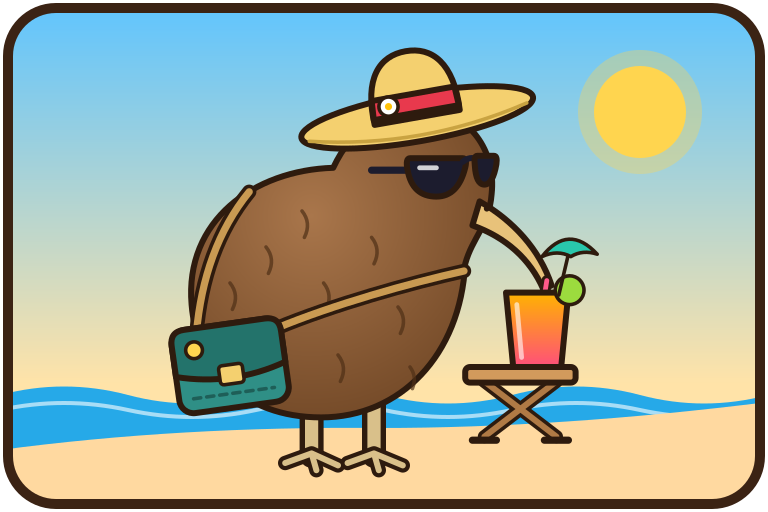

# Nfv

Travel incident app: users store their trip routes and are informed about events that affect them, e.g. road closures. The architecture is described in [Docs/architecture.md](Docs/architecture.md), the domain model in [Docs/domain.md](Docs/domain.md).

## Getting Started

Running the frontend locally on port 18173:

1. ``npm i`` (before first start and after changes in dependencies)
2. ``npm run dev``
3. Visit [http://localhost:18173/](http://localhost:18173/) in browser
4. Log in via the identity provider of the backend (must be running). On startup the backend creates the account `test` / `test` if no account exists yet.

Running the backend from `backend/` requires Java 25 and Maven:

1. Run `mvn spring-boot:test-run` (starts a PostGIS container, Docker required), or start PostgreSQL via `docker-compose.local.yml` and run `mvn spring-boot:run`.
2. Open the live OpenAPI document at [http://localhost:18180/v3/api-docs](http://localhost:18180/v3/api-docs).

The backend uses PostgreSQL with PostGIS, tests start it via Testcontainers. Flyway migrations belong in `backend/src/main/resources/db/migration` as `V1__description.sql`, `V2__description.sql`, and so on. Hibernate validates the schema and does not create tables. Run `mvn verify` (or just `mvn test`) in `backend/` to regenerate `frontend/openapi.json`, `OpenApiSpecTest` writes it. The spec is committed as the API contract for the frontend, and the backend CI fails if it is outdated, so commit it together with API changes.

Entities annotated with `@Audited` are historized by Hibernate Envers in `_aud` tables, see [Docs/envers.md](Docs/envers.md).

Authentication (OAuth2/OIDC with an own identity provider that can be replaced by Keycloak) is described in [Docs/authentication.md](Docs/authentication.md).

The frontend is available in German and English (i18next), every UI text is kept in both languages, see [Docs/i18n.md](Docs/i18n.md).

Monetary values (single base currency USD, `Money` type, exchange rates and currency conversion at the API boundary) are described in [Docs/money.md](Docs/money.md).

The PayPal connection (payment and refund of accommodations booked in the app) and how to configure its credentials are described in [Docs/paypal.md](Docs/paypal.md).

Running PostgreSQL, backend and frontend as a Docker Swarm stack (`docker-compose.yml`, profile `postgres`, credentials as Docker secrets) is described in [Docs/deployment.md](Docs/deployment.md). For a local run with PostgreSQL that builds all images from source, copy `.env.example` to `.env` and run `docker compose -f docker-compose.local.yml up --build`.
